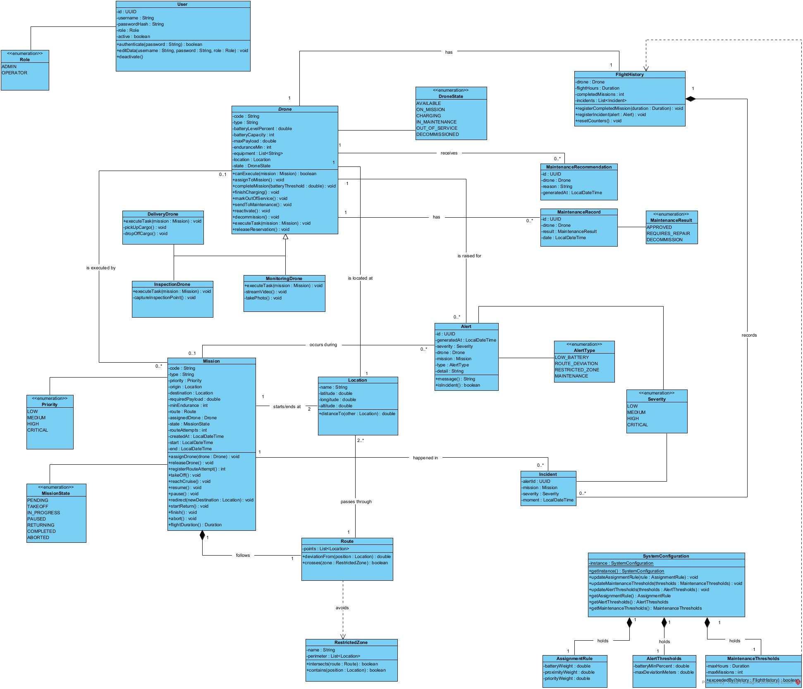
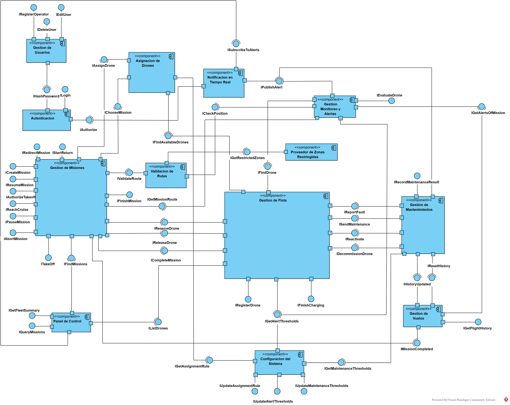
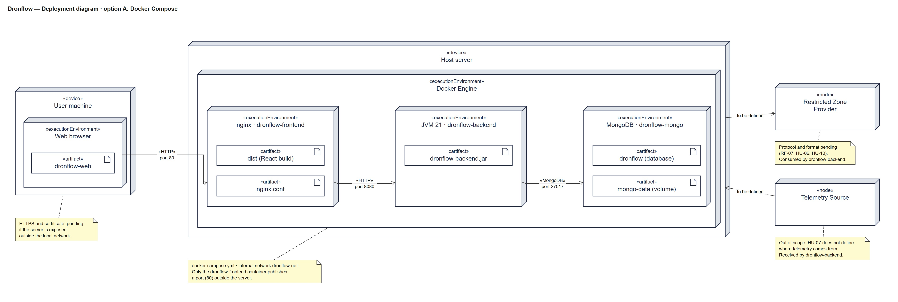

# Dronflow

Sistema de Gestión Inteligente de Flotas de Drones para Misiones de Entrega, Inspección y Monitoreo.


## Descripción

Dronflow es un sistema de software para la gestión centralizada de una flota de drones autónomos que ejecutan distintos tipos de misiones: entregas, inspección de infraestructura y monitoreo o fotografía aérea. El sistema controla el ciclo de vida completo de cada dron segun su disponibilidad y asigna misiones según criterios como batería disponible, cercanía y prioridad.

Antes de cada vuelo, el sistema valida la ruta planificada contra zonas restringidas, y durante la ejecución de la misión monitorea el estado del dron para generar alertas ante eventos críticos como batería baja, desviación de ruta o ingreso a espacio aéreo prohibido. Cada dron mantiene un historial de vuelos que permite estimar cuándo requerirá mantenimiento preventivo, evitando fallas inesperadas durante una misión.

Un operador cuenta con un panel de control desde el cual puede supervisar el estado de toda la flota en tiempo simulado, consultar el historial de misiones pasadas e intervenir manualmente sobre un dron en curso cuando la situación lo requiera.

El proyecto se desarrolla en Java como trabajo final de la asignatura de Diseño de Software, con énfasis en el diseño orientado a objetos: relaciones de herencia y composición entre los distintos tipos de drones y misiones, manejo del comportamiento dinámico de cada dron a través de sus estados, y aplicación justificada de patrones de diseño para resolver problemas concretos del dominio.

## Características principales

- Gestión completa del ciclo de vida de cada dron (disponible, en misión, cargando, en mantenimiento, fuera de servicio).
- Soporte para múltiples tipos de dron: entrega, inspección y monitoreo/fotografía.
- Asignación automática de misiones según batería, cercanía y prioridad.
- Validación de rutas de vuelo contra zonas restringidas.
- Sistema de alertas por severidad (baja, media, alta, crítica).
- Historial de vuelos y estimación de mantenimiento preventivo.
- Panel de control para supervisión e intervención manual del operador.
- Gestión de roles: operador y administrador.

## Stack tecnológico

- **Backend:** obligatoriamente con **Spring Boot** (Java).
- **Base de datos:** **MongoDB**.

## Arquitectura

El proyecto sigue una **arquitectura en capas** (*layer architecture*). Cada petición atraviesa las capas siempre en el mismo sentido y una capa solo conoce a la que tiene justo debajo:

```
Controller  →  Service  →  Repository  →  MongoDB
  (REST)      (lógica de    (acceso a
              negocio)       datos)
```

- **Controller** — expone los endpoints REST, valida la entrada y traduce a DTO. No contiene lógica de negocio.
- **Service** — concentra las reglas de negocio, las transiciones de estado y la coordinación entre entidades. Es la única capa que puede llamar a varios repositorios.
- **Repository** — acceso a MongoDB. Solo operaciones de persistencia y consulta.

**Regla del proyecto: por cada clase del modelo hay un repositorio, un servicio y un controlador.**

| Clase del modelo | Repository | Service | Controller |
|---|---|---|---|
| `User` | `UserRepository` | `UserService` | `UserController` |
| `Drone` | `DroneRepository` | `DroneService` | `DroneController` |
| `Mission` | `MissionRepository` | `MissionService` | `MissionController` |
| `Alert` | `AlertRepository` | `AlertService` | `AlertController` |
| `FlightHistory` | `FlightHistoryRepository` | `FlightHistoryService` | `FlightHistoryController` |
| `MaintenanceRecord` | `MaintenanceRecordRepository` | `MaintenanceRecordService` | `MaintenanceRecordController` |
| `MaintenanceRecommendation` | `MaintenanceRecommendationRepository` | `MaintenanceRecommendationService` | `MaintenanceRecommendationController` |
| `SystemConfiguration` | `SystemConfigurationRepository` | `SystemConfigurationService` | `SystemConfigurationController` |

Quedan fuera de la regla las clases que no tienen colección propia en MongoDB:

- `DeliveryDrone`, `InspectionDrone` y `MonitoringDrone` son subtipos de `Drone` y comparten su colección, su repositorio, su servicio y su controlador.
- `Location`, `Route`, `Incident`, `AssignmentRule`, `AlertThresholds` y `MaintenanceThresholds` son objetos de valor: van embebidos en el documento de la entidad que los contiene (`Mission`, `FlightHistory` y `SystemConfiguration`).
- `RestrictedZone` no se persiste: según RF-07 las zonas restringidas son datos de configuración fija provistos externamente, y se consultan a través de un proveedor externo.


## Diagrama de clases (vista lógica)



La especificación de cada clase, atributo, operación y relación está en [`docs/diagrama-clases.md`](docs/diagrama-clases.md).

## Diagrama de componentes

[](docs/vistas/diagrama-componentes.svg)

13 componentes, 52 interfaces y 30 conectores de ensamble, con sus puertos e interfaces provistas y requeridas. En el ancho del README los nombres de las interfaces no se alcanzan a leer: **haz clic en la imagen para abrir la versión vectorial a tamaño completo**.

El detalle de cada componente, interfaz y conexión está en [`docs/diagrama-componentes.md`](docs/diagrama-componentes.md).

## Diagrama de contexto


Dronflow como caja negra, con sus actores y los sistemas externos que le suministran datos. Cada línea es una funcionalidad concreta, trazada a su historia de usuario. Haz clic para abrir la versión vectorial.

El listado completo de actores y funcionalidades está en [`docs/diagrama-contexto.md`](docs/diagrama-contexto.md).

## Diagrama de despliegue

[](docs/vistas/despliegue.svg)

Muestra **dónde se ejecuta** cada parte del sistema y cómo se comunican:

- **Equipo del usuario** (`«device»`): el administrador u operador abre la aplicación web (`dronflow-web`, React + TS) en su navegador.
- **Servidor** (`«device»`): Docker Engine ejecuta tres contenedores en la red interna `dronflow-net`:
  - **nginx** sirve el build de React y reenvía las peticiones `/api/**` al backend. Es lo único expuesto hacia afuera (puerto 80).
  - **JVM 21** ejecuta `dronflow-backend.jar` (Spring Boot): la API REST y el flujo SSE de alertas en tiempo real.
  - **MongoDB** guarda la base `dronflow` en el volumen `mongo-data`, para que los datos no se pierdan al reiniciar (RNF-10).
- **Sistemas externos** (`«node»`): el proveedor de zonas restringidas y la fuente de telemetría. Su protocolo aún no está definido.

Rutas de comunicación: navegador → nginx por HTTP (puerto 80), nginx → backend por HTTP (puerto 8080) y backend → MongoDB con el protocolo de MongoDB (puerto 27017).

También hay una versión sin Docker (JVM + MongoDB en un solo servidor): [`docs/vistas/despliegue-simple.jpg`](docs/vistas/despliegue-simple.jpg). El detalle de ambas opciones y la vista de desarrollo en tres capas están en [`docs/diagrama-despliegue-y-desarrollo.md`](docs/diagrama-despliegue-y-desarrollo.md).

## Principios GRASP aplicados

El diseño asigna cada responsabilidad siguiendo los nueve principios GRASP. Cada fila dice dónde se ve en los diagramas de clases, de tres capas y de componentes.

| Principio | Cómo se aplica en Dronflow |
|---|---|
| **Information Expert** | Cada responsabilidad la tiene la clase que posee los datos: `Drone.canExecute(mission)` decide si el dron sirve para una misión, `Route.crosses(zone)` y `Route.deviationFrom(position)` validan la ruta, `Location.distanceTo(other)` calcula la cercanía, `MaintenanceThresholds.exceededBy(history)` decide el mantenimiento y `Severity.isIncident()` decide qué alerta es incidencia. |
| **Creator** | Crea quien contiene: `FlightHistory` crea sus `Incident` (`registerIncident(alert)`), `Mission` contiene su `Route` y `SystemConfiguration` contiene sus tres reglas. Las entidades nuevas las crean los Service del caso de uso (*creates and returns*). |
| **Controller** | Un `@RestController` por entidad recibe la petición HTTP y delega en su Service, sin lógica de negocio. Solo expone lo que un usuario pide: por ejemplo, `FlightHistoryController` solo consulta el historial. |
| **Low Coupling** | Controller → Service → Repository, y ningún componente usa el repositorio de otro: se comunican por interfaces. Los ciclos se rompen con eventos (`MissionCompleted`, `HistoryUpdated`, `DroneAvailable`, `TelemetryReceived`). Meta de CBO ≤ 8 (RNF-01). |
| **High Cohesion** | Un Service por entidad con las reglas de su caso de uso; los Repository solo persisten y las entidades solo guardan su estado y sus reglas. |
| **Polymorphism** | `Drone.executeTask(mission)` cambia según el subtipo (`DeliveryDrone`, `InspectionDrone`, `MonitoringDrone`). Los estados del dron y de la misión usan el patrón State, y los criterios de asignación (batería, cercanía, prioridad) y las reglas de alerta son implementaciones intercambiables de una interfaz. |
| **Pure Fabrication** | Clases que no son del dominio y existen para mantener la cohesión: los Service y Repository, `RouteValidator`, `DroneFactoryRegistry`, `PasswordHasher` y el canal SSE de alertas. |
| **Indirection** | Entre Monitoreo y Notificación hay un publicador de alertas (patrón Observer); entre módulos, eventos; y el proveedor de zonas restringidas se usa a través de la interfaz `RestrictedZoneProvider`. |
| **Protected Variations** | Lo que puede cambiar queda detrás de una interfaz: el proveedor externo de zonas (protocolo aún sin definir), el algoritmo de contraseñas (`PasswordHasher`) y la creación de drones (`DroneFactory`): un tipo de dron nuevo requiere como máximo 2 clases nuevas, sin tocar el código existente (RNF-02). |

## Autor

-🧑‍💻 Juan Esteban Cuaran Santander — Estudiante de Ingeniería de Software 

