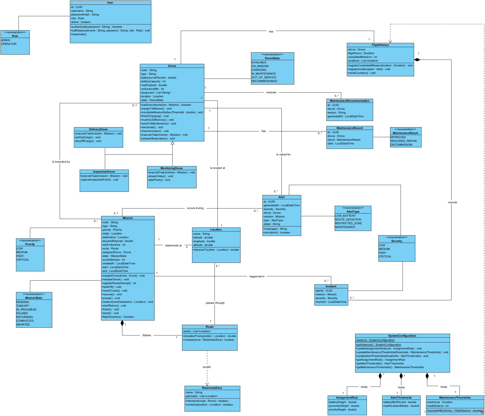

# Dronflow

Sistema de Gestión Inteligente de Flotas de Drones para Misiones de Entrega, Inspección y Monitoreo.

## Descripción

Dronflow es un sistema de software para la gestión centralizada de una flota de drones autónomos que ejecutan distintos tipos de misiones: entregas, inspección de infraestructura y monitoreo o fotografía aérea. El sistema controla el ciclo de vida completo de cada dron segun su disponibilidad y asigna misiones según criterios como batería disponible, cercanía y prioridad.

Antes de cada vuelo, el sistema valida la ruta planificada contra zonas restringidas, y durante la ejecución de la misión monitorea el estado del dron para generar alertas ante eventos críticos como batería baja, desviación de ruta o ingreso a espacio aéreo prohibido. Cada dron mantiene un historial de vuelos que permite estimar cuándo requerirá mantenimiento preventivo, evitando fallas inesperadas durante una misión.

Un operador cuenta con un panel de control desde el cual puede supervisar el estado de toda la flota en tiempo simulado, consultar el historial de misiones pasadas e intervenir manualmente sobre un dron en curso cuando la situación lo requiera.

El proyecto se desarrolla en Java como trabajo final de la asignatura de Diseño de Software, con énfasis en el diseño orientado a objetos: relaciones de herencia y composición entre los distintos tipos de drones y misiones, manejo del comportamiento dinámico de cada dron a través de sus estados, y aplicación justificada de patrones de diseño para resolver problemas concretos del dominio.

## Características principales

- Gestión completa del ciclo de vida de cada dron (disponible, en misión, cargando, en mantenimiento, fuera de servicio).
- Soporte para múltiples tipos de dron: entrega, inspección y monitoreo/fotografía.
- Asignación automática de misiones según batería, cercanía y prioridad.
- Validación de rutas de vuelo contra zonas restringidas.
- Sistema de alertas por severidad (baja, media, alta, crítica).
- Historial de vuelos y estimación de mantenimiento preventivo.
- Panel de control para supervisión e intervención manual del operador.
- Gestión de roles: operador y administrador.

## Stack tecnológico

- **Backend:** obligatoriamente con **Spring Boot** (Java).
- **Base de datos:** **MongoDB**.

## Diagrama de clases (vista lógica)

La especificación de cada clase, atributo, operación y relación está en [`docs/diagrama-clases.md`](docs/diagrama-clases.md).

## Autor

-🧑‍💻 Juan Esteban Cuaran Santander — Estudiante de Ingeniería de Software 

