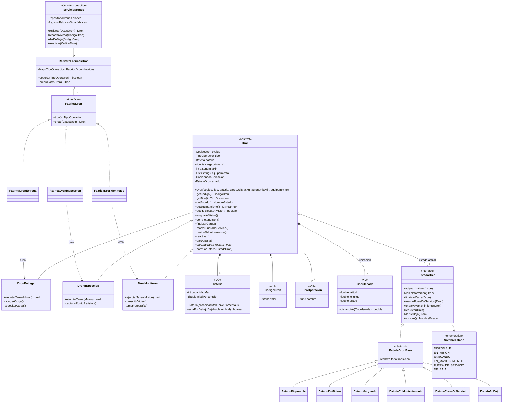
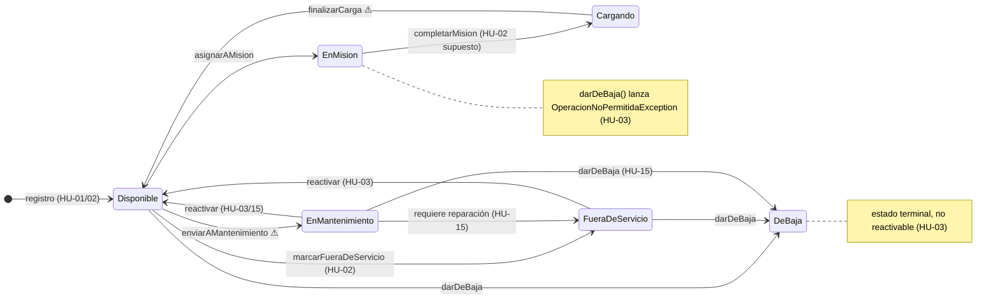
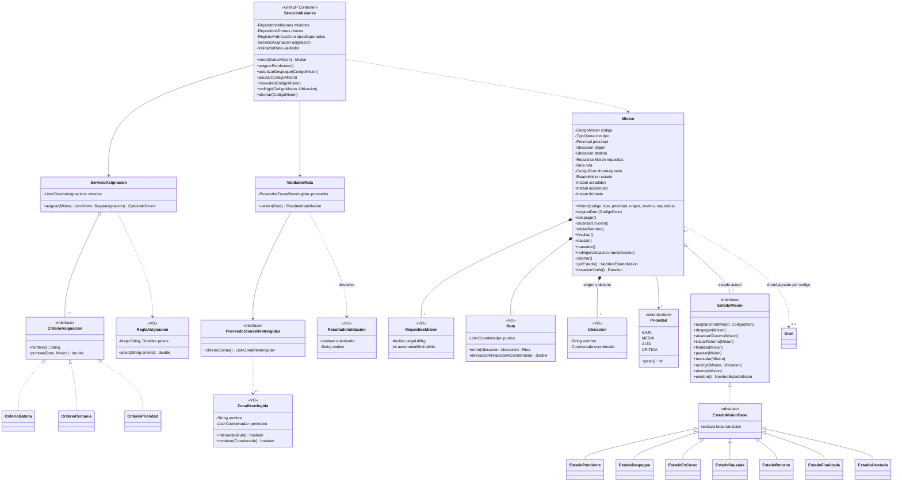
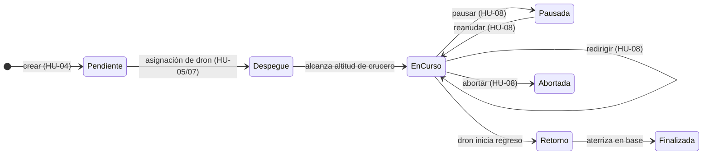
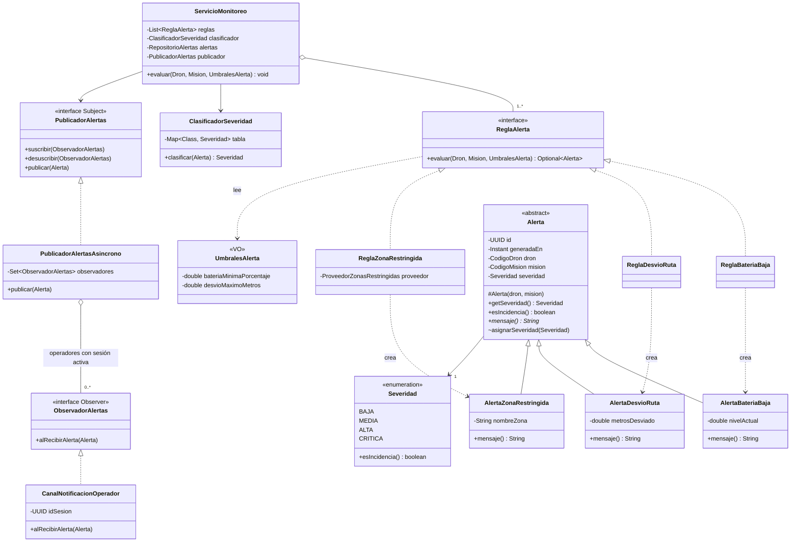
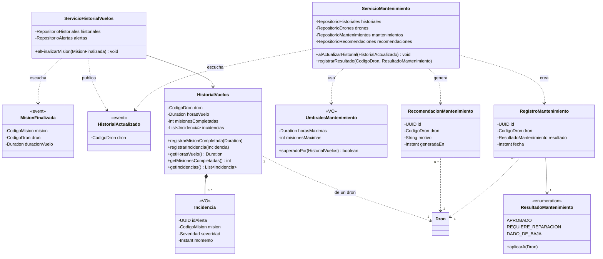

# Diagrama de clases — Dronflow

Diseño orientado a objetos derivado **únicamente** de las historias de usuario (`docs/historias-usuario/HU-01..HU-22`) y de `docs/requeriments.md`.
Todo lo que una HU no define está marcado con ⚠ y listado en la sección [Vacíos y preguntas abiertas](#8-vacíos-y-preguntas-abiertas); no se modeló por iniciativa propia (ver `AGENTS.md`).

Stack: Spring Boot + MongoDB (el diseño anterior asumía JDBC/ACID; se corrigió). Notación: `+` público, `-` privado, `#` protegido. Diagramas en Mermaid.

---

## 1. Drones (HU-01, HU-02, HU-03)

**Decisiones y por qué (frente al diagrama anterior):**
- `equipamiento` es `List<String>`: HU-01 dice "lista de texto libre, sin catálogo cerrado". Se eliminaron `Equipamiento` y `CategoriaEquipo` (inventados).
- `TipoOperacion` es un objeto de valor (no un `enum`): con un `enum` agregar un tipo obliga a editar código existente y rompe RNF-02. Cada `FabricaDronX` declara su tipo y `RegistroFabricasDron` las recibe inyectadas; tipo nuevo = `DronX` + `FabricaDronX` (2 clases). HU-01 "tipo inválido" = `soporta()` devuelve `false`.
- `Dron.puedeEjecutar(Mision)` (Information Expert) valida tipo igual, `cargaUtilMaxKg ≥` requerida y `autonomiaMin ≥` mínima (HU-01 "acordes a su tipo", HU-05).
- `EstadoDronBase` rechaza por defecto toda transición; cada estado solo sobrescribe las válidas (evita 6×7 métodos repetidos).
- Se eliminó `CategoriaEquipo`, `reiniciarContadores…`, `iniciarCarga()` manual y `liberar()`: ninguna HU los pide.

---

## 2. Misiones, asignación y validación de ruta (HU-04..HU-08)

**Decisiones y por qué:**
- **`Mision` es una clase concreta, sin subclases por tipo.** Ninguna HU define atributos ni comportamiento propio por tipo de misión (HU-04 solo pide tipo, prioridad, origen, destino y requisitos). `MisionEntrega.pesoCargaKg`, `MisionInspeccion.puntosRevision` y `ModoCaptura` del diseño anterior eran inventados y se eliminaron. El comportamiento por tipo vive en `Dron.ejecutarTarea()` (RF-02).
- **`Prioridad` ahora usa BAJA/MEDIA/ALTA/CRITICA** (HU-04: "misma escala que la severidad"). El diseño anterior tenía `URGENTE`, que contradice la HU.
- Se eliminaron `Intervencion*` (Command) y `bitacora/EventoMision`: HU-08 no menciona bitácora; las 4 acciones son 4 métodos de `ServicioMisiones` que delegan en el `EstadoMision` (el estado valida que solo se pause/redirija/aborte estando "en curso").
- `Mision` referencia al dron **por `CodigoDron`**, no por objeto: evita el acoplamiento bidireccional Dron↔Mision del diseño anterior y encaja con el modelo de documentos de MongoDB.
- `ServicioAsignacion` es una sola clase con `CriterioAsignacion` (Strategy). Se eliminaron `EstrategiaAsignacion` y `AsignacionPonderada`: eran 3 capas para una única implementación. La `ReglaAsignacion` activa se pasa por parámetro (viene de `ConfiguracionSistema`), así un cambio de HU-18 aplica a la siguiente asignación sin objetos obsoletos.
- `ValidadorRuta` devuelve `ResultadoValidacion` con `motivo`: HU-06 exige "notificar al operador el motivo del rechazo". `redirigir()` también lo invoca (supuesto de HU-08).
- `Mision.inicioVuelo/finVuelo` (→ `duracionVuelo()`) son necesarios para "horas de vuelo de la misión" (HU-13); `creadaEn` para filtrar por fechas (HU-17).

---

## 3. Monitoreo, alertas y notificación (HU-09..HU-12)

**Decisiones y por qué:**
- **Bug corregido:** antes cada `ReglaXxx` guardaba su propio `UmbralesAlerta` (objeto inmutable). Si el administrador lo cambiaba (HU-18) las reglas seguían con el valor viejo. Ahora el umbral vigente se pasa en cada `evaluar()`.
- **El Observer ya no incluye `RegistroHistorialVuelos` ni `ServicioMantenimiento`.** HU-13 registra las incidencias **cuando la misión finaliza**, no cuando nace la alerta; y HU-14 se evalúa al completar una misión. Los suscriptores reales de alertas son los operadores con sesión activa (HU-11): `0..*` observadores.
- `Alerta` guarda `CodigoDron`/`CodigoMision` y no los objetos: el historial necesita consultar "alertas de la misión X con severidad alta/crítica".
- La severidad la asigna `ClasificadorSeveridad` (tabla tipo→severidad, HU-12: batería=media, desvío=alta, zona=crítica). Es clase concreta: HU-12 dice que la tabla "debe validarse", no que haya políticas intercambiables. `Severidad.esIncidencia()` (ALTA|CRITICA, RF-14) reemplaza el booleano `atendida`/`marcarAtendida()` inventado.
- `PublicadorAlertasAsincrono` entrega fuera del hilo de evaluación para cumplir RNF-08 (≤ 1 s) y RNF-09 (50 drones).
- Se eliminaron `ContextoMonitoreo`, `ClasificadorPorTipo` (interfaz con 1 implementación), `PanelNotificaciones`.

---

## 4. Historial de vuelos y mantenimiento (HU-13, HU-14, HU-15)

**Decisiones y por qué:**
- Flujo (HU-13 → HU-14): `Mision.finalizar()` publica `MisionFinalizada` → `ServicioHistorialVuelos` suma horas/misión y copia como `Incidencia` las alertas de esa misión con `esIncidencia()` → publica `HistorialActualizado` → `ServicioMantenimiento` evalúa umbrales. Encadenar los eventos garantiza que mantenimiento vea el historial ya actualizado (con dos suscriptores independientes el orden no estaría asegurado).
- `UmbralesMantenimiento.superadoPor(historial)` (Information Expert) reemplaza `PoliticaMantenimiento`/`PoliticaPorUmbrales` (interfaz con 1 implementación; HU-14: "regla simple por umbral"). Se cumple si horas **o** misiones superan el umbral.
- `ResultadoMantenimiento.aplicarA(dron)` (cada constante sobrescribe: `reactivar()`, `marcarFueraDeServicio()`, `darDeBaja()`) evita el `switch` y cumple HU-15; el `EstadoEnMantenimiento` del dron valida la precondición.
- Se eliminaron `RegistroVuelo` (duplicaba lo que ya guarda `Mision` — HU-17 lo consulta ahí), `responsable`/`observaciones` y `reiniciarContadoresTrasMantenimiento()` (ninguna HU los pide, ver ⚠ 4).

---

## 5. Usuarios, configuración, consultas y persistencia (HU-16..HU-22)

```mermaid
classDiagram
    direction TB

    class Usuario {
        -UUID id
        -String nombreUsuario
        -CredencialHash credencial
        -Rol rol
        -boolean activo
        +Usuario(nombreUsuario, credencial, rol)
        +autenticar(String contrasena, HasherContrasena) boolean
        +cambiarContrasena(CredencialHash)
        +cambiarNombreUsuario(String)
        +desactivar()
        +puede(Permiso) boolean
        +getRol() Rol
        +estaActivo() boolean
    }
    class Rol {
        <<enumeration>>
        ADMINISTRADOR
        OPERADOR
        +permite(Permiso) boolean
    }
    class Permiso {
        <<enumeration>>
        GESTIONAR_DRONES
        CREAR_MISION
        INTERVENIR_MISION
        REGISTRAR_MANTENIMIENTO
        CONSULTAR_PANEL
        RECIBIR_ALERTAS
        RECIBIR_RECOMENDACIONES
        CONFIGURAR_SISTEMA
        GESTIONAR_USUARIOS
    }
    class CredencialHash {
        <<VO>>
        -String hashConSal
    }
    class HasherContrasena {
        <<interface>>
        +hashear(String) CredencialHash
        +coincide(String, CredencialHash) boolean
    }
    class HasherBCrypt

    class ServicioAutenticacion {
        <<GRASP Controller>>
        -RepositorioUsuarios usuarios
        -HasherContrasena hasher
        +iniciarSesion(String, String) Sesion
    }
    class Sesion {
        <<VO>>
        -UUID usuarioId
        -Rol rol
        -Instant inicio
    }
    class ServicioUsuarios {
        <<GRASP Controller>>
        -RepositorioUsuarios usuarios
        -HasherContrasena hasher
        +registrarOperador(DatosUsuario) Usuario
        +editar(UUID, DatosEdicion)
        +eliminar(UUID)
    }

    class ConfiguracionSistema {
        -ReglaAsignacion reglaAsignacion
        -UmbralesAlerta umbralesAlerta
        -UmbralesMantenimiento umbralesMantenimiento
        +actualizarReglaAsignacion(ReglaAsignacion)
        +actualizarUmbralesAlerta(UmbralesAlerta)
        +actualizarUmbralesMantenimiento(UmbralesMantenimiento)
    }

    class ServicioPanelControl {
        -RepositorioDrones drones
        -RepositorioMisiones misiones
        +resumenFlota() ResumenFlota
        +consultarMisiones(FiltroMisiones) List~Mision~
    }
    class ResumenFlota {
        <<VO>>
        -Map~NombreEstado, Integer~ conteoPorEstado
    }
    class FiltroMisiones {
        <<VO>>
        -LocalDate desde
        -LocalDate hasta
        -Optional~CodigoDron~ dron
        -Optional~NombreEstadoMision~ estado
    }

    class Repositorio~T, ID~ {
        <<interface>>
        +guardar(T)
        +buscarPorId(ID) Optional~T~
    }
    class RepositorioDrones
    class RepositorioMisiones
    class RepositorioAlertas
    class RepositorioHistoriales
    class RepositorioMantenimientos
    class RepositorioRecomendaciones
    class RepositorioUsuarios
    class RepositorioConfiguracion
    class AdaptadorMongo {
        <<Spring Data MongoDB>>
    }

    Usuario *-- "1" CredencialHash
    Usuario --> "1" Rol
    Rol --> "1..*" Permiso
    HasherContrasena <|.. HasherBCrypt
    HasherContrasena ..> CredencialHash : produce
    ServicioAutenticacion --> HasherContrasena
    ServicioAutenticacion ..> Sesion : crea
    ServicioUsuarios --> HasherContrasena
    ServicioPanelControl ..> ResumenFlota
    ServicioPanelControl ..> FiltroMisiones
    ConfiguracionSistema *-- "1" ReglaAsignacion
    ConfiguracionSistema *-- "1" UmbralesAlerta
    ConfiguracionSistema *-- "1" UmbralesMantenimiento

    Repositorio <|-- RepositorioDrones
    Repositorio <|-- RepositorioMisiones
    Repositorio <|-- RepositorioAlertas
    Repositorio <|-- RepositorioHistoriales
    Repositorio <|-- RepositorioMantenimientos
    Repositorio <|-- RepositorioRecomendaciones
    Repositorio <|-- RepositorioUsuarios
    Repositorio <|-- RepositorioConfiguracion
    RepositorioDrones <|.. AdaptadorMongo
    RepositorioMisiones <|.. AdaptadorMongo
    RepositorioUsuarios <|.. AdaptadorMongo
```

**Decisiones y por qué:**
- **`Administrador`/`Operador` como subclases se eliminaron.** Solo diferían en `rol()` (un enum disfrazado de herencia, sin comportamiento propio). HU-20/22 tratan el rol como dato. Los permisos salen de `Rol.permite()`.
- `Sesion` ya no viaja como parámetro en cada método de dominio (el diseño anterior firmaba `registrarOperador(Sesion, …)`): la autorización (RNF-04) se aplica en el borde REST con el `Rol` de la sesión; el dominio no conoce sesiones.
- `Usuario.activo` implementa la eliminación lógica (supuesto de HU-21): `eliminar()` → `desactivar()`; `autenticar` rechaza usuarios inactivos. Se quitó `nombreCompleto` (ninguna HU lo define, ver ⚠ 8).
- Una sola implementación de hash (`HasherBCrypt`, hash y sal incluidos, RNF-05). Se eliminó `HasherPBKDF2` y los campos `byte[] hash/sal` separados.
- `ServicioPanelControl` ya no se rotula "Facade" ni expone `eliminar()/listar()` genéricos: HU-16/17 son solo lectura. `ResumenFlota` **excluye** `DE_BAJA` (HU-03: "deja de aparecer entre los drones operativos"). `FiltroMisiones.dron` es opcional ("de un dron o de toda la flota").
- **Persistencia = MongoDB**, no JDBC. Un documento por agregado: `Dron` (con `Bateria`, equipamiento y estado embebidos), `Mision`, `Alerta`, `HistorialVuelos` (con incidencias embebidas), `Usuario`, `ConfiguracionSistema` (documento único). RNF-10: escritura con `WriteConcern` `majority` + `journal=true` para no perder registros confirmados.

---

## 6. Verificación

### 6.1 Encapsulamiento

| Criterio | Cómo se cumple | Dónde |
|---|---|---|
| Atributos privados, sin setters | Cambios solo por métodos de negocio (`asignarAMision()`, `pausar()`); nunca `setEstado()` | `Dron`, `Mision`, `Alerta`, `Usuario`, `HistorialVuelos` |
| Transición controlada | `cambiarEstado()` es package-private: solo las clases `EstadoXxx` del mismo paquete lo invocan | `Dron`, `Mision` |
| Invariantes en el constructor | batería 0–100 %, `autonomiaMin > 0`, `cargaUtilMaxKg ≥ 0`, origen ≠ destino (HU-04), pesos ≥ 0, umbrales > 0 | `Bateria`, `Dron`, `Mision`, `ReglaAsignacion`, `UmbralesAlerta` |
| Objetos de valor inmutables | `Bateria`, `Coordenada`, `Ruta`, `RequisitosMision`, `UmbralesAlerta`, `CredencialHash`, `ReglaAsignacion` | VO |
| Colecciones no expuestas | `getEquipamiento()`/`getIncidencias()` devuelven `List.copyOf` | `Dron`, `HistorialVuelos` |
| Unicidad (código dron, nombre de usuario) | La regla se aplica en el servicio con el repositorio + índice único en MongoDB | `ServicioDrones`, `ServicioUsuarios` |
| Contraseña oculta | `Usuario` solo conoce `CredencialHash`; nunca la contraseña en claro (RNF-05) | `Usuario` |
| Referencias entre agregados por identidad | `Mision→CodigoDron`, `Alerta→CodigoMision`, `Incidencia→UUID` | evita modificar un agregado desde otro |

### 6.2 Abstracción y polimorfismo (cada abstracción tiene ≥ 2 implementaciones reales o un requisito que la exige)

| Punto de variación | Abstracción | Implementaciones | Origen |
|---|---|---|---|
| Comportamiento por tipo de dron | `Dron.ejecutarTarea()` | Entrega, Inspección, Monitoreo | RF-02, HU-01 |
| Creación por tipo | `FabricaDron` | 3 fábricas | RNF-02 |
| Comportamiento por estado | `EstadoDron`, `EstadoMision` | 6 y 7 estados | HU-02, 03, 07, 08 |
| Criterio de asignación | `CriterioAsignacion` | Batería, Cercanía, Prioridad | HU-05, 18 |
| Regla de alerta | `ReglaAlerta` | Batería, Desvío, Zona | HU-09, 10 |
| Mensaje de alerta | `Alerta.mensaje()` | 3 subclases | HU-09, 10 |
| Suscriptores de alertas | `ObservadorAlertas` | 1 por operador con sesión activa | HU-11 |
| Resultado de mantenimiento | `ResultadoMantenimiento.aplicarA()` | 3 constantes | HU-15 |
| Zonas restringidas externas | `ProveedorZonasRestringidas` | configuración fija (1 hoy) | RF-07, HU-06 |

Abstracciones **retiradas** por tener una sola implementación y ninguna HU que pida variabilidad: `EstrategiaAsignacion`, `PoliticaMantenimiento`, `ClasificadorSeveridad` (interfaz), `HasherPBKDF2`, `Intervencion`, subclases de `Mision` y de `Usuario`.
`ProveedorZonasRestringidas` y `HasherContrasena` se conservan aunque hoy tengan una implementación: aíslan una dependencia externa/de seguridad (Indirection / Protected Variations) y RF-07 dice explícitamente que las zonas son externas.

### 6.3 Multiplicidad (con evidencia en las HU)

| Relación | Multiplicidad | Evidencia / invariante |
|---|---|---|
| Dron ◆— Bateria | 1 — 1 | HU-01: capacidad mAh; HU-09: nivel % |
| Dron ◆— equipamiento | 1 — 0..* | HU-01: lista libre (puede estar vacía) |
| Dron — EstadoDron | 1 — 1 | HU-02: siempre tiene un estado |
| Mision — Dron | 0..* — 0..1 | Pendiente: 0 drones (HU-05). Un dron acumula muchas misiones en el tiempo, pero **a lo sumo una activa** (invariante: `EstadoEnMision`) |
| Mision ◆— Ruta | 1 — 1 | HU-06: "la ruta de la misión" |
| Ruta — Coordenada | 1 — 2..* | mínimo origen y destino |
| Mision ◆— Ubicacion | 1 — 2 | HU-04: origen y destino, distintos |
| Mision — RequisitosMision | 1 — 1 | HU-04 (obligatorios) |
| Alerta — Mision / Dron | 0..* — 1 / 0..* — 1 | HU-09/13: se genera durante la misión de un dron |
| Dron — HistorialVuelos | 1 — 1 | HU-13: historial de cada dron |
| HistorialVuelos ◆— Incidencia | 1 — 0..* | HU-13 |
| Dron — RegistroMantenimiento / Recomendacion | 1 — 0..* | HU-14/15: puede haber varios mantenimientos |
| ServicioMonitoreo — ReglaAlerta | 1 — 1..* | HU-09, 10 |
| PublicadorAlertas — Observador | 1 — 0..* | HU-11: puede no haber nadie con sesión |
| ReglaAsignacion — pesos | 1 — 1..* | HU-18: batería, cercanía, prioridad |
| ConfiguracionSistema | 1 (única) | HU-18: configuración global ⚠ 1 |
| Usuario — Rol | * — 1 | HU-19/20 |
| Rol — Permiso | 1 — 1..* | un rol sin permisos no tiene sentido |
| ProveedorZonas — ZonaRestringida | 1 — 0..* | RF-07 |

### 6.4 GRASP

| Principio | ¿Se aplica? | Evidencia en el diseño | Hallazgo / corrección |
|---|---|---|---|
| **Information Expert** | ✅ | `Dron.puedeEjecutar(Mision)`, `Bateria.estaPorDebajoDe()`, `Ruta.desviacionRespectoA()`, `ZonaRestringida.intersecta()`, `UmbralesMantenimiento.superadoPor()`, `Severidad.esIncidencia()`, `Mision.duracionVuelo()` | Antes `ServicioMantenimiento` decidía con una política externa; ahora lo decide quien tiene los datos |
| **Creator** | ✅ | `FabricaDron` crea `Dron` (agrega los datos de inicialización); `ReglaXxx` crea `AlertaXxx`; `ServicioHistorialVuelos` crea `Incidencia`; `ServicioAutenticacion` crea `Sesion` | Se eliminó `FabricaMision*` (mismo creador, sin variación real) |
| **Controller** | ✅ | `ServicioDrones`, `ServicioMisiones`, `ServicioAutenticacion`, `ServicioUsuarios` (casos de uso, detrás de los `@RestController`) | El diseño anterior solo tenía controlador de misiones; faltaba el de drones. `ServicioMisiones` tiene 5 dependencias (< 8 de RNF-01): vigilar que no crezca |
| **Low Coupling** | ✅ | Dependencias hacia interfaces (`Repositorio`, `ProveedorZonas`, `PublicadorAlertas`); `Mision` y `Alerta` referencian por código, no por objeto; Historial→Mantenimiento por evento | Se eliminó el acoplamiento bidireccional `Dron.asignarAMision(Mision)` ↔ `Mision.asignarDron(Dron)` |
| **High Cohesion** | ✅ | Asignar ≠ validar ruta ≠ monitorear ≠ notificar ≠ historial ≠ mantenimiento | `ServicioPanelControl` mezcla 2 consultas de solo lectura: aceptable, se separa si crece |
| **Polymorphism** | ✅ | Ver 6.2: sin `switch` por tipo/estado/resultado | — |
| **Pure Fabrication** | ✅ | `ServicioAsignacion`, `ValidadorRuta`, `ServicioMonitoreo`, `ClasificadorSeveridad`, `Repositorio*`, `HasherBCrypt` | Justificadas: sin ellas `Dron`/`Mision` perderían cohesión |
| **Indirection** | ✅ | `ProveedorZonasRestringidas`, `PublicadorAlertas`, `Repositorio*`, eventos `MisionFinalizada`/`HistorialActualizado` | — |
| **Protected Variations** | ✅ | Tipos de dron (RNF-02), criterios, reglas de alerta, hash, zonas, persistencia | `TipoOperacion` como VO (no `enum`) evita editar código existente al agregar un tipo |

### 6.5 Principios SOLID (RNF-01)

| Principio | Evidencia |
|---|---|
| S | Un servicio por responsabilidad (ver cohesión) |
| O | Nuevo tipo de dron = `DronX` + `FabricaDronX`; nueva regla de alerta = 1 clase `ReglaAlerta`; nuevo criterio = 1 clase `CriterioAsignacion` |
| L | Cualquier `Dron` sustituye a su base; todos los `EstadoXxx` lanzan la misma `OperacionNoPermitidaException` |
| I | Interfaces pequeñas: `CriterioAsignacion`, `ReglaAlerta`, `ObservadorAlertas`, `HasherContrasena` |
| D | Servicios reciben `Repositorio*`, `PublicadorAlertas`, `HasherContrasena` por constructor (inyección de Spring) |

---

## 7. Trazabilidad HU → clases

| HU | Clases principales |
|---|---|
| HU-01 | `Dron` + subclases, `FabricaDron*`, `RegistroFabricasDron`, `ServicioDrones`, `Bateria`, `TipoOperacion` |
| HU-02 | `EstadoDron` + 6 estados, `NombreEstado` |
| HU-03 | `ServicioDrones.darDeBaja/reactivar`, `EstadoEnMision`, `EstadoDeBaja` |
| HU-04 | `Mision`, `RequisitosMision`, `Prioridad`, `Ubicacion`, `ServicioMisiones.crear` |
| HU-05 | `ServicioAsignacion`, `CriterioAsignacion` (3), `ReglaAsignacion`, `ServicioMisiones.asignarPendientes` |
| HU-06 | `ValidadorRuta`, `ProveedorZonasRestringidas`, `ZonaRestringida`, `ResultadoValidacion` |
| HU-07 | `EstadoMision` + 7 estados |
| HU-08 | `ServicioMisiones.pausar/reanudar/redirigir/abortar`, `EstadoEnCurso`, `EstadoPausada` |
| HU-09, HU-10 | `ServicioMonitoreo`, `ReglaBateriaBaja`, `ReglaDesvioRuta`, `ReglaZonaRestringida`, `Alerta*`, `UmbralesAlerta` |
| HU-11 | `PublicadorAlertas`, `PublicadorAlertasAsincrono`, `ObservadorAlertas`, `CanalNotificacionOperador` |
| HU-12 | `Severidad`, `ClasificadorSeveridad` |
| HU-13 | `ServicioHistorialVuelos`, `HistorialVuelos`, `Incidencia`, `MisionFinalizada` |
| HU-14 | `ServicioMantenimiento`, `UmbralesMantenimiento`, `RecomendacionMantenimiento`, `HistorialActualizado` |
| HU-15 | `ServicioMantenimiento.registrarResultado`, `ResultadoMantenimiento`, `RegistroMantenimiento` |
| HU-16, HU-17 | `ServicioPanelControl`, `ResumenFlota`, `FiltroMisiones` |
| HU-18 | `ConfiguracionSistema`, `ReglaAsignacion`, `UmbralesAlerta` |
| HU-19 | `ServicioAutenticacion`, `Sesion`, `Usuario`, `HasherContrasena`, `CredencialHash` |
| HU-20, 21, 22 | `ServicioUsuarios`, `Usuario`, `Rol`, `Permiso` |
| RNF-02 | `TipoOperacion` + fábricas |
| RNF-04, 05 | `Rol.permite`, `CredencialHash`, `HasherBCrypt` |
| RNF-08, 09 | `PublicadorAlertasAsincrono` |
| RNF-10 | `Repositorio*` sobre MongoDB (`WriteConcern` majority, journal) |

---

## 8. Vacíos y preguntas abiertas

Detectados al contrastar HU entre sí. **No se resolvieron por suposición** salvo lo indicado; requieren decisión del autor.

| # | Vacío / contradicción | HU | Tratamiento actual en el diseño |
|---|---|---|---|
| 1 | **¿Quién define el umbral de batería y a qué nivel?** HU-09/RF-10 dicen "que **yo (operador)** defino… para el dron DRN-001"; HU-18/RF-19 dicen que lo modifica el **administrador**, y HU-10 lo liga a HU-18. | 09, 10, 18 | `UmbralesAlerta` **global** en `ConfiguracionSistema`. Si es por dron: agregar `umbralBateria` a `Dron` |
| 2 | **No hay HU que lleve un dron a `EN_MANTENIMIENTO`** (HU-15 y HU-03 lo suponen como estado de partida). ¿Lo envía el operador, la recomendación de HU-14 o ambos? | 02, 14, 15 | Existe `Dron.enviarAMantenimiento()`, sin caso de uso que lo invoque (marcado ⚠) |
| 3 | **Criterio "prioridad" en la asignación**: la prioridad es de la misión, no del dron, así que no distingue entre drones candidatos. ¿Sirve para elegir entre varias misiones pendientes cuando se libera un dron? | 05 | `CriterioAsignacion.puntuar(Dron, Mision)` permite ambas lecturas; falta definir cuál |
| 4 | **¿Se reinician horas/misiones tras un mantenimiento aprobado?** Si no, HU-14 volverá a recomendar mantenimiento tras cada misión. | 14, 15 | No se modeló reinicio (nadie lo pidió); se acumula |
| 5 | **Orden despegue / validación de ruta**: HU-05 pasa la misión a "despegue" al asignar el dron, pero HU-06 exige validar la ruta *antes* de autorizar el despegue. | 05, 06 | `ServicioMisiones.autorizarDespegue()` valida; falta definir en qué momento exacto ocurre y qué pasa si se rechaza |
| 6 | **Canal de entrega de la recomendación de mantenimiento** al administrador (HU-14 no lo dice; HU-11 solo cubre alertas). | 11, 14 | `RecomendacionMantenimiento` se persiste para poder consultarse; la forma de mostrarla queda abierta |
| 7 | **Umbrales de mantenimiento**: RF-15 dice que los define el administrador, pero HU-18 solo cubre ponderación y umbrales de alerta. | 14, 18 | `UmbralesMantenimiento` dentro de `ConfiguracionSistema` (decisión pendiente de confirmar) |
| 8 | **HU-20 no menciona contraseña inicial**; HU-22 no define los campos editables ("datos de perfil"). | 20, 22 | `DatosUsuario` incluye contraseña inicial; solo `nombreUsuario` y contraseña editables. Sin `nombreCompleto` |
| 9 | **Origen de la telemetría** (batería, posición) que alimenta `ServicioMonitoreo` y el avance de estado: HU-07 la declara fuera de alcance. | 07, 09, 10 | `Dron.ubicacion` y `Bateria` se actualizan desde un origen no definido |
| 10 | **Cálculo de la ruta** al crear/redirigir ("recalcula su ruta"). | 06, 08 | `Ruta.entre(origen, destino)` (tramo directo) como mínimo; algoritmo no definido |
| 11 | **Alerta de batería**: ¿una sola vez al cruzar el umbral o en cada lectura bajo el umbral? | 09 | Se asume al cruzar (HU-09 la describe como cruce 25 %→19 %) |
| 12 | **Visibilidad del panel y alertas para el administrador**: las HU 11, 16, 17 son solo del operador. | 11, 16, 17 | `Permiso.CONSULTAR_PANEL` y `RECIBIR_ALERTAS` asignados solo a `OPERADOR` |
| 13 | **Transiciones no explícitas del dron**: `CARGANDO → DISPONIBLE` (HU-05 lo supone) y `Abortada/Finalizada → CARGANDO`. | 02, 05 | Modeladas con ⚠ en el diagrama de estados |
