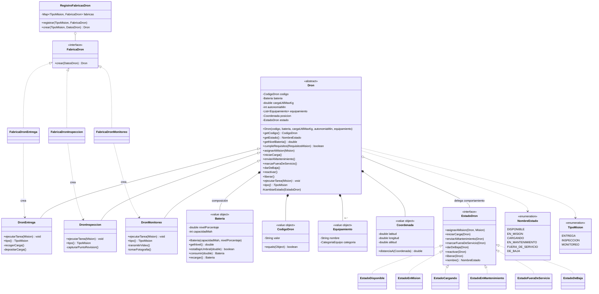
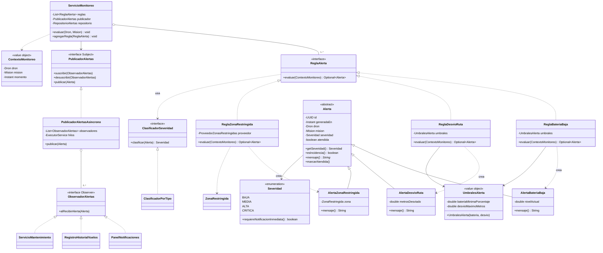
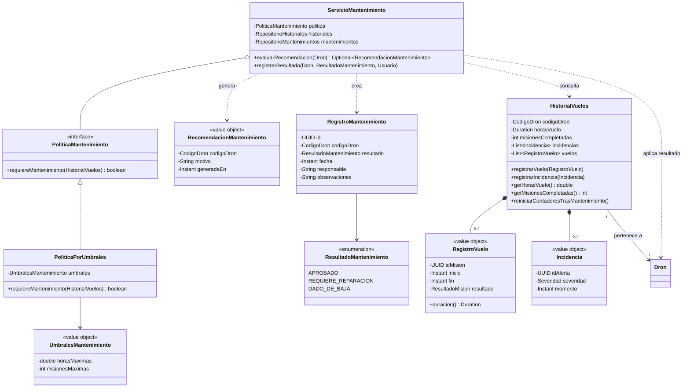
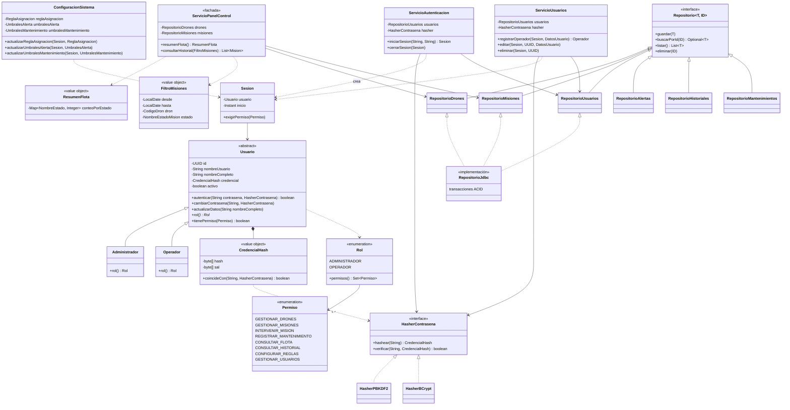

# Diagrama de clases — Dronflow

Diseño orientado a objetos derivado de `docs/requeriments.md` (RF-01..RF-23, RNF-01..RNF-10).
Los diagramas están en Mermaid (se renderizan en GitHub, VS Code con extensión Mermaid, etc.).
Notación: `+` público, `-` privado, `#` protegido, `{abstract}` método abstracto.

El modelo se divide en 5 vistas para que sea legible; las clases compartidas se repiten solo como referencia.

---

## 1. Drones: herencia, polimorfismo y patrón State (RF-01..RF-04, RNF-02)

**Reglas de negocio encapsuladas en los estados (RF-03, RF-04):**
`EstadoEnMision.darDeBaja()` lanza `OperacionNoPermitidaException` (no se da de baja con misión activa);
`EstadoFueraDeServicio` y `EstadoEnMantenimiento` aceptan `reactivar()`; `EstadoDeBaja` rechaza toda operación.
Agregar un tipo nuevo de dron = 2 clases (`DronX` + `FabricaDronX`) → cumple RNF-02.

---

## 2. Misiones, asignación y validación de ruta (RF-05..RF-09)

```mermaid
classDiagram
    direction TB

    class Mision {
        <<abstract>>
        -UUID id
        -Prioridad prioridad
        -Coordenada origen
        -Coordenada destino
        -RequisitosMision requisitos
        -Ruta ruta
        -Dron dronAsignado
        -EstadoMision estado
        -List~EventoMision~ bitacora
        +Mision(prioridad, origen, destino, requisitos)
        +asignarDron(Dron)
        +despegar()
        +iniciar()
        +pausar()
        +reanudar()
        +redirigir(Coordenada nuevoDestino)
        +abortar()
        +retornar()
        +finalizar()
        +getEstado() NombreEstadoMision
        +tipo()* TipoMision
        +crearTareaDron()* TareaMision
    }
    class MisionEntrega {
        -double pesoCargaKg
        +tipo() TipoMision
        +crearTareaDron() TareaMision
    }
    class MisionInspeccion {
        -List~Coordenada~ puntosRevision
        +tipo() TipoMision
        +crearTareaDron() TareaMision
    }
    class MisionMonitoreo {
        -ModoCaptura modo
        +tipo() TipoMision
        +crearTareaDron() TareaMision
    }

    class RequisitosMision {
        <<value object>>
        -double cargaUtilRequeridaKg
        -int autonomiaMinimaMin
        +RequisitosMision(cargaKg, autonomiaMin)
    }
    class Prioridad {
        <<enumeration>>
        BAJA
        MEDIA
        ALTA
        URGENTE
        +peso() int
    }
    class Ruta {
        <<value object>>
        -List~Coordenada~ puntos
        +distanciaTotal() double
        +desviacionMaxima(Coordenada actual) double
    }

    class EstadoMision {
        <<interface>>
        +asignarDron(Mision, Dron)
        +despegar(Mision)
        +iniciar(Mision)
        +pausar(Mision)
        +reanudar(Mision)
        +redirigir(Mision, Coordenada)
        +abortar(Mision)
        +retornar(Mision)
        +finalizar(Mision)
        +nombre() NombreEstadoMision
    }
    class EstadoPendiente
    class EstadoDespegue
    class EstadoEnCurso
    class EstadoPausada
    class EstadoRetorno
    class EstadoFinalizada
    class EstadoAbortada

    class FabricaMision {
        <<interface>>
        +crear(DatosMision) Mision
    }
    class FabricaMisionEntrega
    class FabricaMisionInspeccion
    class FabricaMisionMonitoreo

    class ControladorMisiones {
        <<controller GRASP>>
        -RepositorioMisiones misiones
        -RepositorioDrones drones
        -ServicioAsignacion asignacion
        -ValidadorRuta validador
        -RegistroFabricasMision fabricas
        +crearMision(DatosMision) Mision
        +autorizarDespegue(UUID) void
        +intervenir(UUID, Intervencion) void
        +reasignarPendientes() void
    }
    class Intervencion {
        <<interface>>
        +aplicar(Mision)
    }
    class IntervencionPausar
    class IntervencionReanudar
    class IntervencionRedirigir
    class IntervencionAbortar

    class ServicioAsignacion {
        -EstrategiaAsignacion estrategia
        +asignar(Mision, List~Dron~) Optional~Dron~
    }
    class EstrategiaAsignacion {
        <<interface>>
        +seleccionar(Mision, List~Dron~) Optional~Dron~
    }
    class AsignacionPonderada {
        -ReglaAsignacion regla
        -List~CriterioAsignacion~ criterios
        +seleccionar(Mision, List~Dron~) Optional~Dron~
    }
    class CriterioAsignacion {
        <<interface>>
        +puntuar(Dron, Mision) double
    }
    class CriterioBateria
    class CriterioCercania
    class CriterioPrioridad
    class ReglaAsignacion {
        <<value object>>
        -Map~Class, Double~ pesos
        +peso(CriterioAsignacion) double
    }

    class ValidadorRuta {
        -ProveedorZonasRestringidas proveedor
        +validar(Ruta) ResultadoValidacion
    }
    class ProveedorZonasRestringidas {
        <<interface>>
        +obtenerZonas() List~ZonaRestringida~
    }
    class ZonaRestringida {
        <<value object>>
        -String nombre
        -List~Coordenada~ perimetro
        +intersecta(Ruta) boolean
        +contiene(Coordenada) boolean
    }

    Mision <|-- MisionEntrega
    Mision <|-- MisionInspeccion
    Mision <|-- MisionMonitoreo
    Mision *-- RequisitosMision
    Mision *-- Ruta
    Mision --> Prioridad
    Mision o-- EstadoMision : delega comportamiento
    Mision "0..*" --> "0..1" Dron : dronAsignado

    EstadoMision <|.. EstadoPendiente
    EstadoMision <|.. EstadoDespegue
    EstadoMision <|.. EstadoEnCurso
    EstadoMision <|.. EstadoPausada
    EstadoMision <|.. EstadoRetorno
    EstadoMision <|.. EstadoFinalizada
    EstadoMision <|.. EstadoAbortada

    FabricaMision <|.. FabricaMisionEntrega
    FabricaMision <|.. FabricaMisionInspeccion
    FabricaMision <|.. FabricaMisionMonitoreo
    FabricaMisionEntrega ..> MisionEntrega : crea
    FabricaMisionInspeccion ..> MisionInspeccion : crea
    FabricaMisionMonitoreo ..> MisionMonitoreo : crea

    Intervencion <|.. IntervencionPausar
    Intervencion <|.. IntervencionReanudar
    Intervencion <|.. IntervencionRedirigir
    Intervencion <|.. IntervencionAbortar

    ControladorMisiones ..> FabricaMision
    ControladorMisiones --> ServicioAsignacion
    ControladorMisiones --> ValidadorRuta
    ControladorMisiones ..> Intervencion

    ServicioAsignacion o-- EstrategiaAsignacion
    EstrategiaAsignacion <|.. AsignacionPonderada
    AsignacionPonderada o-- "1..*" CriterioAsignacion
    AsignacionPonderada --> ReglaAsignacion
    CriterioAsignacion <|.. CriterioBateria
    CriterioAsignacion <|.. CriterioCercania
    CriterioAsignacion <|.. CriterioPrioridad

    ValidadorRuta --> ProveedorZonasRestringidas
    ProveedorZonasRestringidas ..> ZonaRestringida
```

**Notas:**
- `Mision.crearTareaDron()` es un *Factory Method*; `Dron.ejecutarTarea(Mision)` hace *double dispatch* para que cada tipo de dron ejecute su propia lógica.
- `AsignacionPonderada` ordena por `Σ peso(criterio) · criterio.puntuar(dron, mision)` solo entre drones que `cumpleRequisitos`; si `Optional` vacío → la misión permanece en `EstadoPendiente` (RF-06).
- `ZonaRestringida` viene de un `ProveedorZonasRestringidas` externo (RF-07: no es entidad editable).
- `Intervencion` aplica *Command*: cada acción del operador es un objeto que se puede registrar en la bitácora (RF-09).

---

## 3. Monitoreo, alertas y notificación en tiempo real (RF-10..RF-13, RNF-08, RNF-09)

**Notas:**
- Nueva regla de alerta = 1 clase que implementa `ReglaAlerta` (Open/Closed, *Protected Variations*).
- `ClasificadorPorTipo` centraliza el mapeo tipo→severidad (HU-12); cambiar la política no toca las alertas.
- `PublicadorAlertasAsincrono` entrega a los observadores en hilos aparte para cumplir RNF-08 (≤ 1 s) y RNF-09 (50 drones).
- `Alerta.esIncidencia()` = severidad ALTA o CRITICA → alimenta el historial de vuelos (RF-14).

---

## 4. Historial de vuelos y mantenimiento (RF-14..RF-16)

**Notas:**
- `registrarResultado`: `APROBADO` → `dron.reactivar()`; `REQUIERE_REPARACION` → `dron.marcarFueraDeServicio()`; `DADO_DE_BAJA` → `dron.darDeBaja()` (la transición la valida el `EstadoDron` actual).
- `HistorialVuelos` es *Information Expert* de horas, misiones e incidencias.

---

## 5. Usuarios, seguridad, configuración y persistencia (RF-17..RF-23, RNF-04, RNF-05, RNF-10)

---

## Encapsulamiento

| Mecanismo | Dónde se aplica |
|---|---|
| Atributos `private`, sin setters públicos | Toda entidad (`Dron`, `Mision`, `Alerta`, `Usuario`). Los cambios se hacen con métodos de negocio (`asignarAMision()`, `pausar()`), nunca con `setEstado()`. |
| Métodos de transición `protected`/package-private | `Dron.cambiarEstado()` solo lo invocan las clases `EstadoXxx` del mismo paquete. |
| Objetos de valor inmutables | `Bateria`, `Coordenada`, `CodigoDron`, `Ruta`, `UmbralesAlerta`, `CredencialHash`: `consumir()` devuelve una nueva `Bateria`. Invariantes validadas en el constructor (ej. nivel 0-100, origen ≠ destino). |
| Colecciones protegidas | `getEquipamiento()` devuelve `List.copyOf(...)` / vista no modificable. |
| Invariantes dentro de la clase | Código único (`RepositorioDrones`), autonomía > 0, carga ≥ 0, origen ≠ destino en el constructor de `Mision`. |
| Contraseña oculta | `Usuario` nunca expone la contraseña; solo `CredencialHash` (RNF-05). |

## Polimorfismo

| Punto de variación | Abstracción | Implementaciones |
|---|---|---|
| Tipo de dron (RF-02) | `Dron.ejecutarTarea()` | `DronEntrega`, `DronInspeccion`, `DronMonitoreo` |
| Tipo de misión | `Mision.crearTareaDron()` | `MisionEntrega`, `MisionInspeccion`, `MisionMonitoreo` |
| Comportamiento por estado | `EstadoDron`, `EstadoMision` | 6 estados de dron, 7 estados de misión (elimina `switch`/`if` por estado) |
| Criterio de asignación (RF-06) | `CriterioAsignacion` | batería, cercanía, prioridad |
| Estrategia de asignación | `EstrategiaAsignacion` | `AsignacionPonderada` (extensible) |
| Reglas de alerta (RF-10, RF-11) | `ReglaAlerta` | batería, desvío, zona restringida |
| Tipo de alerta | `Alerta.mensaje()` | 3 subclases |
| Acción del operador (RF-09) | `Intervencion` | pausar, reanudar, redirigir, abortar |
| Política de mantenimiento | `PoliticaMantenimiento` | `PoliticaPorUmbrales` |
| Hash de contraseñas | `HasherContrasena` | PBKDF2, BCrypt |
| Rol de usuario | `Usuario.rol()` | `Administrador`, `Operador` |

## Patrones de diseño utilizados

| Patrón | Clases | Problema que resuelve |
|---|---|---|
| **State** | `EstadoDron`, `EstadoMision` | Comportamiento dinámico por estado y transiciones válidas (RF-03, RF-04, RF-08). |
| **Strategy** | `EstrategiaAsignacion`, `CriterioAsignacion`, `ReglaAlerta`, `PoliticaMantenimiento`, `ClasificadorSeveridad`, `HasherContrasena` | Algoritmos intercambiables y configurables sin modificar al cliente. |
| **Factory Method / Registro de fábricas** | `FabricaDron`, `FabricaMision`, `RegistroFabricasDron` | Crear el dron/misión correcto sin `if/switch` por tipo (RNF-02). |
| **Observer** | `PublicadorAlertas`, `ObservadorAlertas` | Notificación en tiempo real y desacople entre monitoreo, panel, historial y mantenimiento (RF-12). |
| **Command** | `Intervencion` y subclases | Encapsular acciones del operador, permitir bitácora (RF-09). |
| **Template Method / Double dispatch** | `Dron.ejecutarTarea()` + `Mision.crearTareaDron()` | Flujo común, paso específico por tipo. |
| **Repository** | `Repositorio<T, ID>` | Aislar persistencia (RNF-10). |
| **Facade** | `ServicioPanelControl` | Punto único de consulta para la UI del panel (RF-17, RF-18). |
| **Value Object** | `Bateria`, `Coordenada`, `Ruta`, `RequisitosMision`... | Inmutabilidad y validación en la construcción. |

## Principios GRASP

| Principio | Aplicación |
|---|---|
| **Information Expert** | `Bateria` sabe si está bajo umbral; `Ruta` calcula su distancia y desviación; `HistorialVuelos` calcula horas y misiones; `ZonaRestringida` sabe si intersecta una ruta. |
| **Creator** | `FabricaDron`/`FabricaMision` crean entidades; `ReglaXxx` crea la `AlertaXxx` correspondiente (tiene los datos para inicializarla); `ServicioAutenticacion` crea `Sesion`. |
| **Controller** | `ControladorMisiones` coordina los casos de uso de misión sin que la UI toque el dominio; `ServicioAutenticacion` y `ServicioUsuarios` para usuarios. |
| **Low Coupling** | Dependencias hacia interfaces (`EstrategiaAsignacion`, `Repositorio`, `ProveedorZonasRestringidas`); CBO ≤ 8 (RNF-01). |
| **High Cohesion** | Cada clase una responsabilidad: `ValidadorRuta` solo valida; `ServicioAsignacion` solo asigna; `ServicioMonitoreo` solo evalúa reglas. |
| **Polymorphism** | Sustituye condicionales por tipo/estado (ver tabla anterior). |
| **Pure Fabrication** | `ServicioAsignacion`, `ValidadorRuta`, `ServicioMonitoreo`, `Repositorio*`, `HasherPBKDF2`: clases que no existen en el dominio real pero mantienen cohesión alta. |
| **Indirection** | `ProveedorZonasRestringidas` entre el sistema y la fuente externa; `PublicadorAlertas` entre monitoreo y receptores; repositorios entre dominio y BD. |
| **Protected Variations** | Interfaces estables en los puntos de cambio: tipos de dron/misión, reglas, hash, zonas, persistencia. |

## Principios SOLID (RNF-01)

| Principio | Evidencia |
|---|---|
| **S**ingle Responsibility | Servicios y políticas pequeñas separadas (asignar ≠ validar ruta ≠ monitorear ≠ notificar). |
| **O**pen/Closed | Nuevo dron o misión = 2 clases (RNF-02); nueva regla de alerta = 1 clase; ninguna modifica código existente. |
| **L**iskov | Cualquier `Dron` o `Mision` concreta sustituye a su base; los estados respetan el contrato de `EstadoDron`/`EstadoMision` (lanzan `OperacionNoPermitidaException` de forma uniforme). |
| **I**nterface Segregation | Interfaces pequeñas: `CriterioAsignacion`, `ReglaAlerta`, `ObservadorAlertas`, `HasherContrasena`. |
| **D**ependency Inversion | Servicios dependen de abstracciones (`Repositorio`, `EstrategiaAsignacion`, `PublicadorAlertas`), inyectadas por constructor. |

## Trazabilidad requerimiento → clases

| Requerimiento | Clases principales |
|---|---|
| RF-01, RF-02 | `Dron`, subclases, `Bateria`, `Equipamiento`, `FabricaDron`, `RegistroFabricasDron` |
| RF-03, RF-04 | `EstadoDron` y 6 estados, `NombreEstado` |
| RF-05 | `Mision`, subclases, `FabricaMision`, `RequisitosMision`, `ControladorMisiones` |
| RF-06 | `ServicioAsignacion`, `AsignacionPonderada`, `CriterioAsignacion`, `ReglaAsignacion` |
| RF-07 | `ValidadorRuta`, `ProveedorZonasRestringidas`, `ZonaRestringida` |
| RF-08, RF-09 | `EstadoMision` y 7 estados, `Intervencion` y subclases |
| RF-10, RF-11 | `ServicioMonitoreo`, `ReglaBateriaBaja`, `ReglaDesvioRuta`, `ReglaZonaRestringida` |
| RF-12 | `PublicadorAlertas`, `ObservadorAlertas`, `PanelNotificaciones` |
| RF-13 | `Severidad`, `ClasificadorSeveridad` |
| RF-14 | `HistorialVuelos`, `RegistroVuelo`, `Incidencia` |
| RF-15, RF-16 | `ServicioMantenimiento`, `PoliticaMantenimiento`, `RegistroMantenimiento`, `ResultadoMantenimiento` |
| RF-17, RF-18 | `ServicioPanelControl`, `ResumenFlota`, `FiltroMisiones` |
| RF-19 | `ConfiguracionSistema`, `ReglaAsignacion`, `UmbralesAlerta`, `UmbralesMantenimiento` |
| RF-20..RF-23 | `Usuario`, `Administrador`, `Operador`, `ServicioAutenticacion`, `ServicioUsuarios`, `Sesion` |
| RNF-02 | Fábricas + herencia (≤ 2 clases por tipo nuevo) |
| RNF-04, RNF-05 | `Sesion.exigirPermiso()`, `CredencialHash`, `HasherContrasena` |
| RNF-08, RNF-09 | `PublicadorAlertasAsincrono` |
| RNF-10 | `Repositorio<T, ID>` + `RepositorioJdbc` con transacciones |
