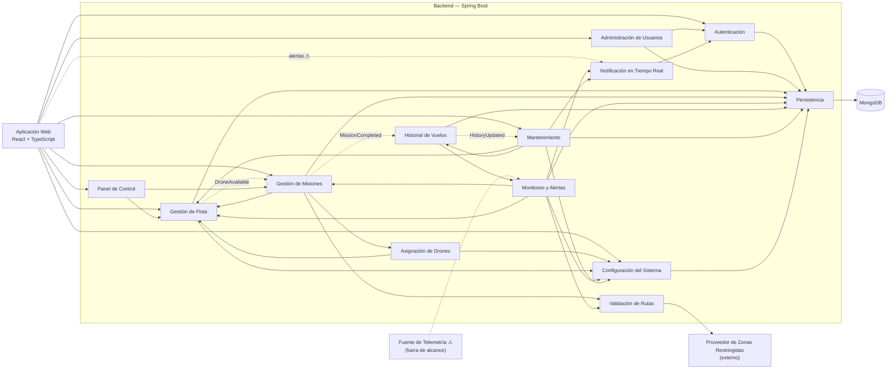

# Diagrama de componentes — Dronflow

Derivado **solo** de las historias de usuario (`docs/historias-usuario/`), `docs/requeriments.md` y el diagrama de clases (`dronflow-backend.jpg`, `docs/diagrama-clases.md`). Stack obligatorio (`AGENTS.md`): React + TypeScript, Spring Boot, MongoDB.
Cada componente del backend es un módulo (paquete) de la aplicación Spring Boot; no son microservicios. Lo que las historias de usuario no definen está marcado con ⚠ y listado en la sección 7.

Nota de nombres: los componentes llevan nombre en español; los puertos, interfaces y operaciones llevan el identificador en inglés, igual que las clases del diagrama de clases.

## 1. Reglas de dibujo

1. **Un puerto por funcionalidad y una interfaz por operación.** Cada puerto ofrece exactamente una interfaz y cada interfaz tiene exactamente una operación. Nombre del puerto = funcionalidad (`RegisterDrone`); nombre de la interfaz = `I` + el mismo nombre (`IRegisterDrone`).
2. **No existe un componente "REST API".** REST es la tecnología de transporte, no una parte del diseño. `@RestController` y el filtro de Spring Security son la *implementación* de los puertos ofrecidos; no aparecen en el diagrama. La aplicación web conecta sus puertos requeridos directamente con los puertos ofrecidos de los componentes del backend (la línea significa "HTTPS / JSON").
3. **Un componente nunca usa el repositorio de otro.** Requiere la interfaz del otro componente. Solo el componente `Persistencia` toca MongoDB.
4. **No hay ciclos entre componentes.** El único camino de regreso pasa por un evento (interfaz `«event»`).
5. **La autorización es transversal.** `IAuthorize` se aplica a todo puerto al que el usuario llega desde la web (filtro de Spring Security). Se dibuja una sola vez como nota en `Autenticación`, no como línea desde cada componente.
6. Ofrecida = círculo (paleta) en el puerto; requerida = semicírculo (socket) en el puerto.

## 2. Vista general (solo componentes, sin puertos)

## 3. Componentes, puertos e interfaces

"Requiere" lista interfaces de otros componentes (la sección 4 conecta cada una).

### 3.1 Autenticación — HU-19 · RNF-04, 05

| Puerto | Interfaz ofrecida | Operación | Diagrama de clases |
|---|---|---|---|
| Login | `ILogin` | `login(userName, password): Session` | `User.authenticate` |
| Authorize | `IAuthorize` | `authorize(session, role): boolean` | `Role` |
| HashPassword | `IHashPassword` | `hash(password): String` | `User.passwordHash` |

Requiere: `IRepository` (usuarios).

### 3.2 Administración de Usuarios — HU-20, 21, 22

| Puerto | Interfaz ofrecida | Operación | Diagrama de clases |
|---|---|---|---|
| RegisterOperator | `IRegisterOperator` | `registerOperator(userName, password)` | `User` |
| EditUser | `IEditUser` | `edit(id, userName, password, role)` | `User.editData` |
| DeleteUser | `IDeleteUser` | `delete(id)` (lógica) | `User.deactivate` |

Requiere: `IHashPassword`, `IRepository`.

### 3.3 Gestión de Flota — HU-01, 02, 03

| Puerto | Interfaz ofrecida | Operación | Diagrama de clases |
|---|---|---|---|
| RegisterDrone | `IRegisterDrone` | `register(droneData)` | `Drone` y subclases |
| ReserveDrone | `IReserveDrone` | `assignToMission(code)` | `Drone.assignToMission` |
| ReleaseDrone | `IReleaseDrone` | `releaseReservation(code)` | `Drone.releaseReservation` |
| CompleteDroneMission | `ICompleteDroneMission` | `completeMission(code)` | `Drone.completeMission` |
| FinishCharging | `IFinishCharging` | `finishCharging(code)` | `Drone.finishCharging` |
| ReportFault | `IReportFault` | `reportFault(code)` | `Drone.markOutOfService` |
| SendToMaintenance | `ISendToMaintenance` | `sendToMaintenance(code)` | `Drone.sendToMaintenance` |
| DecommissionDrone | `IDecommissionDrone` | `decommission(code)` | `Drone.decommission` |
| ReactivateDrone | `IReactivateDrone` | `reactivate(code)` | `Drone.reactivate` |
| FindAvailableDrones | `IFindAvailableDrones` | `findAvailable(): List<Drone>` | `DroneState.AVAILABLE` |
| FindDrone | `IFindDrone` | `findByCode(code): Drone` | `Drone.code` |
| ListDrones | `IListDrones` | `listAll(): List<Drone>` | `DroneState` |
| DroneAvailable | `«event» IDroneAvailable` | se publica cuando un dron queda disponible | HU-05, escenario 3 |

Requiere: `IGetAlertThresholds` (fin de misión: DISPONIBLE o CARGANDO según la batería), `IRepository`. La creación de cada tipo de dron pasa por un registro de fábricas dentro del componente (RNF-02); no es un puerto.

### 3.4 Gestión de Misiones — HU-04, 06, 07, 08

| Puerto | Interfaz ofrecida | Operación | Diagrama de clases |
|---|---|---|---|
| CreateMission | `ICreateMission` | `create(missionData)` | `Mission` |
| AuthorizeTakeoff | `IAuthorizeTakeoff` | `authorizeTakeoff(code)` (valida la ruta, 3 intentos) | `Mission.registerRouteAttempt` |
| TakeOff | `ITakeOff` | `takeOff(code)` | `Mission.takeOff` |
| ReachCruise | `IReachCruise` | `reachCruise(code)` | `Mission.reachCruise` |
| StartReturn | `IStartReturn` | `startReturn(code)` | `Mission.startReturn` |
| FinishMission | `IFinishMission` | `finish(code)` | `Mission.finish` |
| PauseMission | `IPauseMission` | `pause(code)` | `Mission.pause` |
| ResumeMission | `IResumeMission` | `resume(code)` | `Mission.resume` |
| RedirectMission | `IRedirectMission` | `redirect(code, newDestination)` | `Mission.redirect` |
| AbortMission | `IAbortMission` | `abort(code)` | `Mission.abort` |
| FindMission | `IFindMission` | `findByCode(code): Mission` | `Mission.code` |
| FindMissions | `IFindMissions` | `find(filter): List<Mission>` | HU-17 |
| MissionCompleted | `«event» IMissionCompleted` | se publica cuando termina una misión | HU-13 |

Requiere: `IAssignDrone`, `IChooseMission`, `IReserveDrone`, `IReleaseDrone`, `ICompleteDroneMission`, `IValidateRoute`, `«event» IDroneAvailable`, `IRepository`.

### 3.5 Asignación de Drones — HU-05

| Puerto | Interfaz ofrecida | Operación | Diagrama de clases |
|---|---|---|---|
| AssignDrone | `IAssignDrone` | `assignDrone(mission): Drone` | `Drone.canExecute`, `AssignmentRule` |
| ChooseMission | `IChooseMission` | `chooseMission(drone, pendingMissions): Mission` | `Priority` |

Requiere: `IFindAvailableDrones`, `IGetAssignmentRule`.

### 3.6 Validación de Rutas — HU-06

| Puerto | Interfaz ofrecida | Operación | Diagrama de clases |
|---|---|---|---|
| ValidateRoute | `IValidateRoute` | `validate(route): ValidationResult` | `Route.crosses` |
| CheckPosition | `ICheckPosition` | `isInRestrictedZone(position): boolean` | `RestrictedZone.contains` |

Requiere: `IGetRestrictedZones` (proveedor externo).

### 3.7 Monitoreo y Alertas — HU-09, 10, 12

| Puerto | Interfaz ofrecida | Operación | Diagrama de clases |
|---|---|---|---|
| EvaluateDrone | `IEvaluateDrone` | `evaluate(droneCode, missionCode)` | `Alert`, `AlertType`, `Severity` |
| GetAlertsOfMission | `IGetAlertsOfMission` | `alertsOfMission(missionCode): List<Alert>` | `Alert.mission` |

Requiere: `IReadTelemetry` ⚠, `IFindMission`, `IFindDrone`, `IGetAlertThresholds`, `ICheckPosition`, `IPublishAlert`, `IRepository`.

### 3.8 Notificación en Tiempo Real — HU-11 · RNF-08, 09

| Puerto | Interfaz ofrecida | Operación | Diagrama de clases |
|---|---|---|---|
| PublishAlert | `IPublishAlert` | `publish(alert)` | `Alert` |
| SubscribeToAlerts | `ISubscribeToAlerts` | `subscribe(session)` | — |

Requiere: `IAuthorize` (solo reciben alertas los administradores con sesión activa).

### 3.9 Historial de Vuelos — HU-13

| Puerto | Interfaz ofrecida | Operación | Diagrama de clases |
|---|---|---|---|
| GetFlightHistory | `IGetFlightHistory` | `getHistory(droneCode): FlightHistory` | `FlightHistory` |
| ResetHistory | `IResetHistory` | `resetCounters(droneCode)` | `FlightHistory.resetCounters` |
| HistoryUpdated | `«event» IHistoryUpdated` | se publica tras actualizar el historial | HU-14 |

Requiere: `«event» IMissionCompleted`, `IGetAlertsOfMission` (las alertas altas o críticas se vuelven incidencias), `IRepository`.

### 3.10 Mantenimiento — HU-14, 15

| Puerto | Interfaz ofrecida | Operación | Diagrama de clases |
|---|---|---|---|
| RecordMaintenanceResult | `IRecordMaintenanceResult` | `recordResult(droneCode, result)` | `MaintenanceRecord`, `MaintenanceResult.applyTo` |

Requiere: `«event» IHistoryUpdated`, `IGetMaintenanceThresholds`, `ISendToMaintenance`, `IReportFault`, `IReactivateDrone`, `IDecommissionDrone`, `IResetHistory`, `IPublishAlert`, `IRepository`. La recomendación (`MaintenanceRecommendation`) se genera cuando llega `IHistoryUpdated` y `MaintenanceThresholds.exceededBy(history)` es verdadero.

### 3.11 Panel de Control — HU-16, 17

| Puerto | Interfaz ofrecida | Operación | Diagrama de clases |
|---|---|---|---|
| GetFleetSummary | `IGetFleetSummary` | `fleetSummary(): FleetSummary` | `DroneState` |
| QueryMissions | `IQueryMissions` | `queryMissions(filter): List<Mission>` | `Mission`, `MissionState` |

Requiere: `IListDrones`, `IFindMissions`.

### 3.12 Configuración del Sistema — HU-18

| Puerto | Interfaz ofrecida | Operación | Diagrama de clases |
|---|---|---|---|
| GetAssignmentRule | `IGetAssignmentRule` | `getAssignmentRule()` | `SystemConfiguration`, `AssignmentRule` |
| GetAlertThresholds | `IGetAlertThresholds` | `getAlertThresholds()` | `AlertThresholds` |
| GetMaintenanceThresholds | `IGetMaintenanceThresholds` | `getMaintenanceThresholds()` | `MaintenanceThresholds` |
| UpdateAssignmentRule | `IUpdateAssignmentRule` | `updateAssignmentRule(rule)` | `SystemConfiguration` |
| UpdateAlertThresholds | `IUpdateAlertThresholds` | `updateAlertThresholds(thresholds)` | `SystemConfiguration` |
| UpdateMaintenanceThresholds | `IUpdateMaintenanceThresholds` | `updateMaintenanceThresholds(thresholds)` | `SystemConfiguration` |

Requiere: `IRepository`. Solo el administrador llega a los tres puertos de actualización.

### 3.13 Persistencia — RNF-10

| Puerto | Interfaz ofrecida | Operaciones |
|---|---|---|
| Storage | `IRepository<T, ID>` | `save`, `findById` (excepción de infraestructura a la regla de una operación) |

Requiere: MongoDB (escrituras con `majority` + journal).

### 3.14 Elementos externos y cliente

| Elemento | Ofrece | Requiere |
|---|---|---|
| Proveedor de Zonas Restringidas (externo, RF-07) | `IGetRestrictedZones`: `getZones()` | — |
| Fuente de Telemetría ⚠ (fuera de alcance, HU-07) | `IReadTelemetry`: `readTelemetry(droneCode)` | — |
| Aplicación Web (React + TS) | — | un puerto por pantalla, abajo |

Puertos de la Aplicación Web (cada uno es un puerto requerido con un socket por cada interfaz listada):

| Puerto (pantalla) | Interfaces requeridas |
|---|---|
| LoginScreen | `ILogin` |
| UsersScreen | `IRegisterOperator`, `IEditUser`, `IDeleteUser` |
| FleetScreen | `IRegisterDrone`, `IReportFault`, `IDecommissionDrone`, `IReactivateDrone` |
| MissionsScreen | `ICreateMission`, `IPauseMission`, `IResumeMission`, `IRedirectMission`, `IAbortMission` |
| MaintenanceScreen | `IRecordMaintenanceResult` |
| ConfigurationScreen | `IGetAssignmentRule`, `IGetAlertThresholds`, `IGetMaintenanceThresholds`, `IUpdateAssignmentRule`, `IUpdateAlertThresholds`, `IUpdateMaintenanceThresholds` |
| PanelScreen | `IGetFleetSummary`, `IQueryMissions` |
| AlertsScreen | `ISubscribeToAlerts` ⚠ |

## 4. Conexiones (requerida → ofrecida)

| Componente | Interfaz requerida | La ofrece |
|---|---|---|
| Administración de Usuarios | `IHashPassword` | Autenticación |
| Gestión de Flota | `IGetAlertThresholds` | Configuración del Sistema |
| Gestión de Misiones | `IAssignDrone`, `IChooseMission` | Asignación de Drones |
| Gestión de Misiones | `IReserveDrone`, `IReleaseDrone`, `ICompleteDroneMission` | Gestión de Flota |
| Gestión de Misiones | `IValidateRoute` | Validación de Rutas |
| Asignación de Drones | `IFindAvailableDrones` | Gestión de Flota |
| Asignación de Drones | `IGetAssignmentRule` | Configuración del Sistema |
| Validación de Rutas | `IGetRestrictedZones` | Proveedor de Zonas Restringidas |
| Monitoreo y Alertas | `IReadTelemetry` ⚠ | Fuente de Telemetría |
| Monitoreo y Alertas | `IFindMission` | Gestión de Misiones |
| Monitoreo y Alertas | `IFindDrone` | Gestión de Flota |
| Monitoreo y Alertas | `IGetAlertThresholds` | Configuración del Sistema |
| Monitoreo y Alertas | `ICheckPosition` | Validación de Rutas |
| Monitoreo y Alertas | `IPublishAlert` | Notificación en Tiempo Real |
| Notificación en Tiempo Real | `IAuthorize` | Autenticación |
| Historial de Vuelos | `IGetAlertsOfMission` | Monitoreo y Alertas |
| Mantenimiento | `IGetMaintenanceThresholds` | Configuración del Sistema |
| Mantenimiento | `ISendToMaintenance`, `IReportFault`, `IReactivateDrone`, `IDecommissionDrone` | Gestión de Flota |
| Mantenimiento | `IResetHistory` | Historial de Vuelos |
| Mantenimiento | `IPublishAlert` | Notificación en Tiempo Real |
| Panel de Control | `IListDrones` | Gestión de Flota |
| Panel de Control | `IFindMissions` | Gestión de Misiones |
| Autenticación, Administración de Usuarios, Flota, Misiones, Monitoreo, Historial, Mantenimiento, Configuración | `IRepository` | Persistencia |

Eventos (flecha punteada con `«event»`): `IMissionCompleted` de Gestión de Misiones a Historial de Vuelos; `IHistoryUpdated` de Historial de Vuelos a Mantenimiento; `IDroneAvailable` de Gestión de Flota a Gestión de Misiones.

## 5. Paso a paso en Visual Paradigm

1. **Diagram → New → Component Diagram.**
2. Dibuja los 13 componentes del backend, `Aplicación Web`, `Proveedor de Zonas Restringidas`, `Fuente de Telemetría` y un nodo `MongoDB`. Usa la herramienta **Component**.
3. **Puertos:** selecciona un componente → herramienta **Port** → clic en su borde. Ponle el nombre de la funcionalidad (`RegisterDrone`). Crea un puerto por cada fila de la sección 3.
4. **Interfaz ofrecida:** sobre el puerto, herramienta **Provided Interface** → ponle el nombre (`IRegisterDrone`). En su especificación agrega la única operación de la tabla.
5. **Interfaz requerida:** en el componente que consume, crea un puerto y usa la herramienta **Required Interface**; ponle el nombre de la interfaz que necesita (`IGetAlertThresholds`).
6. **Conectar:** arrastra el semicírculo requerido sobre el círculo ofrecido, o une los dos puertos con un **Assembly Connector** (bola y socket).
7. **Eventos:** usa una dependencia punteada con el estereotipo `«event»` entre los dos puertos.
8. Agrupa los 13 componentes del backend dentro de un límite llamado **Backend — Spring Boot**.
9. Si el diagrama queda muy cargado, dibújalo en dos imágenes: *Flota y misiones* (3.3 a 3.6) y *Monitoreo, historial y mantenimiento* (3.7 a 3.12), con los mismos nombres.

## 6. Decisiones de arquitectura

- **Monolito modular**: un solo artefacto Spring Boot. Nada en las historias de usuario pide servicios independientes.
- **Dependencias por interfaces**: ningún módulo lee la colección de otro (mantiene CBO ≤ 8, RNF-01).
- **Eventos internos solo donde las historias de usuario los requieren**: `MissionCompleted` (HU-13), `HistoryUpdated` (HU-14), `DroneAvailable` (HU-05, escenario 3).
- **Las clases de dominio no leen la configuración**: los servicios (componentes) la leen mediante `IGet…` y pasan los valores como parámetros.
- **Capacidades por rol**: administrador = usuarios (HU-20 a 22), configuración (HU-18), panel de control y consultas (HU-16 y 17), alertas y recomendaciones (HU-11 y 14); operador = misiones e intervención (HU-04 a 08), resultado de mantenimiento (HU-15); ambos = registrar, dar de baja y reactivar drones (HU-01 y 03).

## 7. Lo que no se incluye y pendientes

No incluido (no está en las historias de usuario): servicio de correo o SMS (HU-11 lo descarta), gestor de zonas restringidas (RF-07), simulador de hardware de drones (HU-07), bloqueo de cuenta (HU-19), registro de auditoría, bróker de mensajes, API gateway, caché, un componente REST API.

Pendientes:
1. Canal de notificación hacia la web (HU-11 no lo especifica; decisión técnica por aprobar por el autor).
2. Origen de la telemetría que alimenta a `Monitoreo` (HU-07 lo deja fuera de alcance).
3. Severidad de la alerta de mantenimiento: se propuso BAJA (HU-12), pendiente de validar.
4. Los puertos `CheckPosition`, `ListDrones`, `FindDrone` y `FindAvailableDrones` se derivan del diagrama de clases (`RestrictedZone.contains`, `DroneState`, `Drone.code`) y las historias de usuario no los nombran; confirmarlos con el autor.
