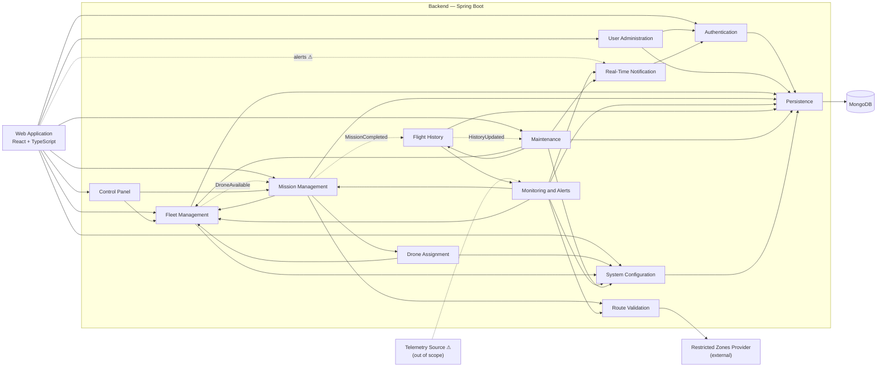

# Component Diagram — Dronflow

Derived **only** from the user stories (`docs/historias-usuario/`), `docs/requeriments.md` and the class diagram (`dronflow-backend.jpg`, `docs/diagrama-clases.md`). Mandatory stack (`AGENTS.md`): React + TypeScript, Spring Boot, MongoDB.
Each backend component is a module (package) of the Spring Boot application; they are not microservices. Anything the user stories do not define is marked with ⚠ and listed in section 7.

## 1. Drawing rules

1. **One port per functionality, one interface per operation.** Each port provides exactly one interface and each interface has exactly one operation. Port name = functionality (`RegisterDrone`); interface name = `I` + the same name (`IRegisterDrone`).
2. **There is no "REST API" component.** REST is the transport technology, not a part of the design. `@RestController` and the Spring Security filter are the *implementation* of the provided ports; they do not appear in the diagram. The web application connects its required ports straight to the provided ports of the backend components (the line means "HTTPS / JSON").
3. **A component never uses another component's repository.** It requires the other component's interface. Only the `Persistence` component touches MongoDB.
4. **No cycles between components.** The only way back goes through an event (`«event»` interface).
5. **Authorization is cross-cutting.** `IAuthorize` is applied to every port that a user reaches from the web (Spring Security filter). Draw it once as a note on `Authentication`, not as a line from every component.
6. Provided = circle (lollipop) on a port; required = half circle (socket) on a port.

## 2. Overview (components only, no ports)

## 3. Components, ports and interfaces

"Requires" lists interfaces of other components (section 4 wires each one).

### 3.1 Authentication — HU-19 · RNF-04, 05

| Port | Provided interface | Operation | Class diagram |
|---|---|---|---|
| Login | `ILogin` | `login(userName, password): Session` | `User.authenticate` |
| Authorize | `IAuthorize` | `authorize(session, role): boolean` | `Role` |
| HashPassword | `IHashPassword` | `hash(password): String` | `User.passwordHash` |

Requires: `IRepository` (users).

### 3.2 User Administration — HU-20, 21, 22

| Port | Provided interface | Operation | Class diagram |
|---|---|---|---|
| RegisterOperator | `IRegisterOperator` | `registerOperator(userName, password)` | `User` |
| EditUser | `IEditUser` | `edit(id, userName, password, role)` | `User.editData` |
| DeleteUser | `IDeleteUser` | `delete(id)` (logical) | `User.deactivate` |

Requires: `IHashPassword`, `IRepository`.

### 3.3 Fleet Management — HU-01, 02, 03

| Port | Provided interface | Operation | Class diagram |
|---|---|---|---|
| RegisterDrone | `IRegisterDrone` | `register(droneData)` | `Drone`, subclasses |
| ReserveDrone | `IReserveDrone` | `assignToMission(code)` | `Drone.assignToMission` |
| ReleaseDrone | `IReleaseDrone` | `releaseReservation(code)` | `Drone.releaseReservation` |
| CompleteDroneMission | `ICompleteDroneMission` | `completeMission(code)` | `Drone.completeMission` |
| FinishCharging | `IFinishCharging` | `finishCharging(code)` | `Drone.finishCharging` |
| ReportFault | `IReportFault` | `reportFault(code)` | `Drone.markOutOfService` |
| SendToMaintenance | `ISendToMaintenance` | `sendToMaintenance(code)` | `Drone.sendToMaintenance` |
| DecommissionDrone | `IDecommissionDrone` | `decommission(code)` | `Drone.decommission` |
| ReactivateDrone | `IReactivateDrone` | `reactivate(code)` | `Drone.reactivate` |
| FindAvailableDrones | `IFindAvailableDrones` | `findAvailable(): List<Drone>` | `DroneState.AVAILABLE` |
| FindDrone | `IFindDrone` | `findByCode(code): Drone` | `Drone.code` |
| ListDrones | `IListDrones` | `listAll(): List<Drone>` | `DroneState` |
| DroneAvailable | `«event» IDroneAvailable` | published when a drone becomes available | HU-05, scenario 3 |

Requires: `IGetAlertThresholds` (end of mission: AVAILABLE or CHARGING by battery), `IRepository`. The creation of each drone type goes through a factory registry inside the component (RNF-02); it is not a port.

### 3.4 Mission Management — HU-04, 06, 07, 08

| Port | Provided interface | Operation | Class diagram |
|---|---|---|---|
| CreateMission | `ICreateMission` | `create(missionData)` | `Mission` |
| AuthorizeTakeoff | `IAuthorizeTakeoff` | `authorizeTakeoff(code)` (validates route, 3 attempts) | `Mission.registerRouteAttempt` |
| TakeOff | `ITakeOff` | `takeOff(code)` | `Mission.takeOff` |
| ReachCruise | `IReachCruise` | `reachCruise(code)` | `Mission.reachCruise` |
| StartReturn | `IStartReturn` | `startReturn(code)` | `Mission.startReturn` |
| FinishMission | `IFinishMission` | `finish(code)` | `Mission.finish` |
| PauseMission | `IPauseMission` | `pause(code)` | `Mission.pause` |
| ResumeMission | `IResumeMission` | `resume(code)` | `Mission.resume` |
| RedirectMission | `IRedirectMission` | `redirect(code, newDestination)` | `Mission.redirect` |
| AbortMission | `IAbortMission` | `abort(code)` | `Mission.abort` |
| FindMission | `IFindMission` | `findByCode(code): Mission` | `Mission.code` |
| FindMissions | `IFindMissions` | `find(filter): List<Mission>` | HU-17 |
| MissionCompleted | `«event» IMissionCompleted` | published when a mission ends | HU-13 |

Requires: `IAssignDrone`, `IChooseMission`, `IReserveDrone`, `IReleaseDrone`, `ICompleteDroneMission`, `IValidateRoute`, `«event» IDroneAvailable`, `IRepository`.

### 3.5 Drone Assignment — HU-05

| Port | Provided interface | Operation | Class diagram |
|---|---|---|---|
| AssignDrone | `IAssignDrone` | `assignDrone(mission): Drone` | `Drone.canExecute`, `AssignmentRule` |
| ChooseMission | `IChooseMission` | `chooseMission(drone, pendingMissions): Mission` | `Priority` |

Requires: `IFindAvailableDrones`, `IGetAssignmentRule`.

### 3.6 Route Validation — HU-06

| Port | Provided interface | Operation | Class diagram |
|---|---|---|---|
| ValidateRoute | `IValidateRoute` | `validate(route): ValidationResult` | `Route.crosses` |
| CheckPosition | `ICheckPosition` | `isInRestrictedZone(position): boolean` | `RestrictedZone.contains` |

Requires: `IGetRestrictedZones` (external provider).

### 3.7 Monitoring and Alerts — HU-09, 10, 12

| Port | Provided interface | Operation | Class diagram |
|---|---|---|---|
| EvaluateDrone | `IEvaluateDrone` | `evaluate(droneCode, missionCode)` | `Alert`, `AlertType`, `Severity` |
| GetAlertsOfMission | `IGetAlertsOfMission` | `alertsOfMission(missionCode): List<Alert>` | `Alert.mission` |

Requires: `IReadTelemetry` ⚠, `IFindMission`, `IFindDrone`, `IGetAlertThresholds`, `ICheckPosition`, `IPublishAlert`, `IRepository`.

### 3.8 Real-Time Notification — HU-11 · RNF-08, 09

| Port | Provided interface | Operation | Class diagram |
|---|---|---|---|
| PublishAlert | `IPublishAlert` | `publish(alert)` | `Alert` |
| SubscribeToAlerts | `ISubscribeToAlerts` | `subscribe(session)` | — |

Requires: `IAuthorize` (only administrators with an active session receive alerts).

### 3.9 Flight History — HU-13

| Port | Provided interface | Operation | Class diagram |
|---|---|---|---|
| GetFlightHistory | `IGetFlightHistory` | `getHistory(droneCode): FlightHistory` | `FlightHistory` |
| ResetHistory | `IResetHistory` | `resetCounters(droneCode)` | `FlightHistory.resetCounters` |
| HistoryUpdated | `«event» IHistoryUpdated` | published after updating the history | HU-14 |

Requires: `«event» IMissionCompleted`, `IGetAlertsOfMission` (high/critical alerts become incidents), `IRepository`.

### 3.10 Maintenance — HU-14, 15

| Port | Provided interface | Operation | Class diagram |
|---|---|---|---|
| RecordMaintenanceResult | `IRecordMaintenanceResult` | `recordResult(droneCode, result)` | `MaintenanceRecord`, `MaintenanceResult.applyTo` |

Requires: `«event» IHistoryUpdated`, `IGetMaintenanceThresholds`, `ISendToMaintenance`, `IReportFault`, `IReactivateDrone`, `IDecommissionDrone`, `IResetHistory`, `IPublishAlert`, `IRepository`. The recommendation itself (`MaintenanceRecommendation`) is generated when `IHistoryUpdated` arrives and `MaintenanceThresholds.exceededBy(history)` is true.

### 3.11 Control Panel — HU-16, 17

| Port | Provided interface | Operation | Class diagram |
|---|---|---|---|
| GetFleetSummary | `IGetFleetSummary` | `fleetSummary(): FleetSummary` | `DroneState` |
| QueryMissions | `IQueryMissions` | `queryMissions(filter): List<Mission>` | `Mission`, `MissionState` |

Requires: `IListDrones`, `IFindMissions`.

### 3.12 System Configuration — HU-18

| Port | Provided interface | Operation | Class diagram |
|---|---|---|---|
| GetAssignmentRule | `IGetAssignmentRule` | `getAssignmentRule()` | `SystemConfiguration`, `AssignmentRule` |
| GetAlertThresholds | `IGetAlertThresholds` | `getAlertThresholds()` | `AlertThresholds` |
| GetMaintenanceThresholds | `IGetMaintenanceThresholds` | `getMaintenanceThresholds()` | `MaintenanceThresholds` |
| UpdateAssignmentRule | `IUpdateAssignmentRule` | `updateAssignmentRule(rule)` | `SystemConfiguration` |
| UpdateAlertThresholds | `IUpdateAlertThresholds` | `updateAlertThresholds(thresholds)` | `SystemConfiguration` |
| UpdateMaintenanceThresholds | `IUpdateMaintenanceThresholds` | `updateMaintenanceThresholds(thresholds)` | `SystemConfiguration` |

Requires: `IRepository`. Only the administrator reaches the three update ports.

### 3.13 Persistence — RNF-10

| Port | Provided interface | Operations |
|---|---|---|
| Storage | `IRepository<T, ID>` | `save`, `findById` (infrastructure exception to the one-operation rule) |

Requires: MongoDB (writes with `majority` + journal).

### 3.14 External and client elements

| Element | Provides | Requires |
|---|---|---|
| Restricted Zones Provider (external, RF-07) | `IGetRestrictedZones`: `getZones()` | — |
| Telemetry Source ⚠ (out of scope, HU-07) | `IReadTelemetry`: `readTelemetry(droneCode)` | — |
| Web Application (React + TS) | — | one port per screen, below |

Web Application ports (each one is a required port with one socket per interface listed):

| Port (screen) | Required interfaces |
|---|---|
| LoginScreen | `ILogin` |
| UsersScreen | `IRegisterOperator`, `IEditUser`, `IDeleteUser` |
| FleetScreen | `IRegisterDrone`, `IReportFault`, `IDecommissionDrone`, `IReactivateDrone` |
| MissionsScreen | `ICreateMission`, `IPauseMission`, `IResumeMission`, `IRedirectMission`, `IAbortMission` |
| MaintenanceScreen | `IRecordMaintenanceResult` |
| ConfigurationScreen | `IGetAssignmentRule`, `IGetAlertThresholds`, `IGetMaintenanceThresholds`, `IUpdateAssignmentRule`, `IUpdateAlertThresholds`, `IUpdateMaintenanceThresholds` |
| PanelScreen | `IGetFleetSummary`, `IQueryMissions` |
| AlertsScreen | `ISubscribeToAlerts` ⚠ |

## 4. Wiring (required → provided)

| Component | Required interface | Provided by |
|---|---|---|
| User Administration | `IHashPassword` | Authentication |
| Fleet Management | `IGetAlertThresholds` | System Configuration |
| Mission Management | `IAssignDrone`, `IChooseMission` | Drone Assignment |
| Mission Management | `IReserveDrone`, `IReleaseDrone`, `ICompleteDroneMission` | Fleet Management |
| Mission Management | `IValidateRoute` | Route Validation |
| Drone Assignment | `IFindAvailableDrones` | Fleet Management |
| Drone Assignment | `IGetAssignmentRule` | System Configuration |
| Route Validation | `IGetRestrictedZones` | Restricted Zones Provider |
| Monitoring and Alerts | `IReadTelemetry` ⚠ | Telemetry Source |
| Monitoring and Alerts | `IFindMission` | Mission Management |
| Monitoring and Alerts | `IFindDrone` | Fleet Management |
| Monitoring and Alerts | `IGetAlertThresholds` | System Configuration |
| Monitoring and Alerts | `ICheckPosition` | Route Validation |
| Monitoring and Alerts | `IPublishAlert` | Real-Time Notification |
| Real-Time Notification | `IAuthorize` | Authentication |
| Flight History | `IGetAlertsOfMission` | Monitoring and Alerts |
| Maintenance | `IGetMaintenanceThresholds` | System Configuration |
| Maintenance | `ISendToMaintenance`, `IReportFault`, `IReactivateDrone`, `IDecommissionDrone` | Fleet Management |
| Maintenance | `IResetHistory` | Flight History |
| Maintenance | `IPublishAlert` | Real-Time Notification |
| Control Panel | `IListDrones` | Fleet Management |
| Control Panel | `IFindMissions` | Mission Management |
| Authentication, User Administration, Fleet, Mission, Monitoring, History, Maintenance, Configuration | `IRepository` | Persistence |

Events (dashed arrow with `«event»`): `IMissionCompleted` Mission Management → Flight History; `IHistoryUpdated` Flight History → Maintenance; `IDroneAvailable` Fleet Management → Mission Management.

## 5. Step by step in Visual Paradigm

1. **Diagram → New → Component Diagram.**
2. Draw the 13 backend components, `Web Application`, `Restricted Zones Provider`, `Telemetry Source` and a `MongoDB` node. Use the **Component** tool.
3. **Ports:** select a component → **Port** tool → click on its border. Name it with the functionality (`RegisterDrone`). Create one port per row of section 3.
4. **Provided interface:** on the port, **Provided Interface** tool → name it (`IRegisterDrone`). In its specification, add the single operation from the table.
5. **Required interface:** on the consuming component, create a port and use the **Required Interface** tool; name it with the interface it needs (`IGetAlertThresholds`).
6. **Connect:** drag the required socket onto the provided circle, or join the two ports with an **Assembly Connector** (ball-and-socket).
7. **Events:** use a dashed dependency with the stereotype `«event»` between the two ports.
8. Group the 13 backend components inside a boundary named **Backend — Spring Boot**.
9. If the diagram is too crowded, draw it in two pictures: *Fleet and missions* (3.3–3.6) and *Monitoring, history and maintenance* (3.7–3.12), both with the same names.

## 6. Architecture decisions

- **Modular monolith**: one Spring Boot artifact. Nothing in the user stories asks for independent services.
- **Dependencies through interfaces**: no module reads another module's collection (keeps CBO ≤ 8, RNF-01).
- **Internal events only where the user stories require them**: `MissionCompleted` (HU-13), `HistoryUpdated` (HU-14), `DroneAvailable` (HU-05, scenario 3).
- **Domain classes do not read the configuration**: the services (components) read it through `IGet…` and pass the values as parameters.
- **Capabilities per role**: administrator = users (HU-20–22), configuration (HU-18), control panel and queries (HU-16–17), alerts and recommendations (HU-11, 14); operator = missions and intervention (HU-04–08), maintenance result (HU-15); both = register, decommission and reactivate drones (HU-01, 03).

## 7. Not included and open items

Not included (not in the user stories): email/SMS service (HU-11 rules it out), restricted-zone manager (RF-07), drone hardware simulator (HU-07), account lockout (HU-19), audit log, message broker, API gateway, cache, a REST API component.

Open items:
1. Notification channel to the web (HU-11 does not specify it; technical decision to be approved by the author).
2. Origin of the telemetry that feeds `Monitoring` (HU-07 leaves it out of scope).
3. Severity of the maintenance alert: LOW proposed (HU-12), pending validation.
4. The ports `CheckPosition` and `ListDrones` / `FindDrone` are derived from the class diagram (`RestrictedZone.contains`, `DroneState`, `Drone.code`) and are not named in the user stories; confirm them with the author.
