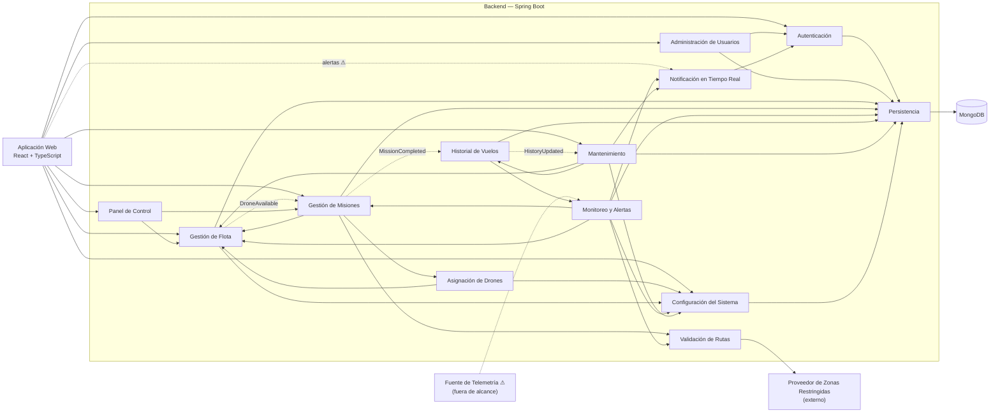

# Diagrama de componentes — Dronflow

Derivado **solo** de las historias de usuario (`docs/historias-usuario/`), `docs/requeriments.md` y el diagrama de clases (`dronflow-backend.jpg`, `docs/diagrama-clases.md`). Stack obligatorio (`AGENTS.md`): React + TypeScript, Spring Boot, MongoDB.
Cada componente del backend es un módulo (paquete) de la aplicación Spring Boot; no son microservicios. Lo que las historias de usuario no definen está marcado con ⚠ y listado en la sección 7.

Nota de nombres: los componentes llevan nombre en español; los puertos, interfaces y operaciones llevan el identificador en inglés, igual que las clases del diagrama de clases.

## 1. Reglas de dibujo

1. **Un puerto por funcionalidad y una interfaz por operación.** Cada puerto ofrece exactamente una interfaz y cada interfaz tiene exactamente una operación. Nombre del puerto = funcionalidad (`RegisterDrone`); nombre de la interfaz = `I` + el mismo nombre (`IRegisterDrone`).
2. **No existe un componente "REST API".** REST es la tecnología de transporte, no una parte del diseño. `@RestController` y el filtro de Spring Security son la *implementación* de los puertos ofrecidos; no aparecen en el diagrama. La aplicación web conecta sus puertos requeridos directamente con los puertos ofrecidos de los componentes del backend (la línea significa "HTTPS / JSON").
3. **Un componente nunca usa el repositorio de otro.** Requiere la interfaz del otro componente. Solo el componente `Persistencia` toca MongoDB.
4. **No hay ciclos entre componentes.** El único camino de regreso pasa por un evento (interfaz `«event»`).
5. **La autorización es transversal.** `IAuthorize` se aplica a todo puerto al que el usuario llega desde la web (filtro de Spring Security). Se dibuja una sola vez como nota en `Autenticación`, no como línea desde cada componente.
6. Ofrecida = círculo (paleta) en el puerto; requerida = semicírculo (socket) en el puerto.

## 2. Vista general (solo componentes, sin puertos)

## 3. Componentes, puertos e interfaces

"Requiere" lista interfaces de otros componentes (la sección 4 conecta cada una).

### 3.1 Autenticación — HU-19 · RNF-04, 05

| Puerto | Interfaz ofrecida | Operación | Diagrama de clases |
|---|---|---|---|
| Login | `ILogin` | `login(userName, password): Session` | `User.authenticate` |
| Authorize | `IAuthorize` | `authorize(session, role): boolean` | `Role` |
| HashPassword | `IHashPassword` | `hash(password): String` | `User.passwordHash` |

Requiere: `IRepository` (usuarios).

### 3.2 Administración de Usuarios — HU-20, 21, 22

| Puerto | Interfaz ofrecida | Operación | Diagrama de clases |
|---|---|---|---|
| RegisterOperator | `IRegisterOperator` | `registerOperator(userName, password)` | `User` |
| EditUser | `IEditUser` | `edit(id, userName, password, role)` | `User.editData` |
| DeleteUser | `IDeleteUser` | `delete(id)` (lógica) | `User.deactivate` |

Requiere: `IHashPassword`, `IRepository`.

### 3.3 Gestión de Flota — HU-01, 02, 03

| Puerto | Interfaz ofrecida | Operación | Diagrama de clases |
|---|---|---|---|
| RegisterDrone | `IRegisterDrone` | `register(droneData)` | `Drone` y subclases |
| ReserveDrone | `IReserveDrone` | `assignToMission(code)` | `Drone.assignToMission` |
| ReleaseDrone | `IReleaseDrone` | `releaseReservation(code)` | `Drone.releaseReservation` |
| CompleteDroneMission | `ICompleteDroneMission` | `completeMission(code)` | `Drone.completeMission` |
| FinishCharging | `IFinishCharging` | `finishCharging(code)` | `Drone.finishCharging` |
| ReportFault | `IReportFault` | `reportFault(code)` | `Drone.markOutOfService` |
| SendToMaintenance | `ISendToMaintenance` | `sendToMaintenance(code)` | `Drone.sendToMaintenance` |
| DecommissionDrone | `IDecommissionDrone` | `decommission(code)` | `Drone.decommission` |
| ReactivateDrone | `IReactivateDrone` | `reactivate(code)` | `Drone.reactivate` |
| FindAvailableDrones | `IFindAvailableDrones` | `findAvailable(): List<Drone>` | `DroneState.AVAILABLE` |
| FindDrone | `IFindDrone` | `findByCode(code): Drone` | `Drone.code` |
| ListDrones | `IListDrones` | `listAll(): List<Drone>` | `DroneState` |
| DroneAvailable | `«event» IDroneAvailable` | se publica cuando un dron queda disponible | HU-05, escenario 3 |

Requiere: `IGetAlertThresholds` (fin de misión: DISPONIBLE o CARGANDO según la batería), `IRepository`. La creación de cada tipo de dron pasa por un registro de fábricas dentro del componente (RNF-02); no es un puerto.

### 3.4 Gestión de Misiones — HU-04, 06, 07, 08

| Puerto | Interfaz ofrecida | Operación | Diagrama de clases |
|---|---|---|---|
| CreateMission | `ICreateMission` | `create(missionData)` | `Mission` |
| AuthorizeTakeoff | `IAuthorizeTakeoff` | `authorizeTakeoff(code)` (valida la ruta, 3 intentos) | `Mission.registerRouteAttempt` |
| TakeOff | `ITakeOff` | `takeOff(code)` | `Mission.takeOff` |
| ReachCruise | `IReachCruise` | `reachCruise(code)` | `Mission.reachCruise` |
| StartReturn | `IStartReturn` | `startReturn(code)` | `Mission.startReturn` |
| FinishMission | `IFinishMission` | `finish(code)` | `Mission.finish` |
| PauseMission | `IPauseMission` | `pause(code)` | `Mission.pause` |
| ResumeMission | `IResumeMission` | `resume(code)` | `Mission.resume` |
| RedirectMission | `IRedirectMission` | `redirect(code, newDestination)` | `Mission.redirect` |
| AbortMission | `IAbortMission` | `abort(code)` | `Mission.abort` |
| FindMission | `IFindMission` | `findByCode(code): Mission` | `Mission.code` |
| FindMissions | `IFindMissions` | `find(filter): List<Mission>` | HU-17 |
| MissionCompleted | `«event» IMissionCompleted` | se publica cuando termina una misión | HU-13 |

Requiere: `IAssignDrone`, `IChooseMission`, `IReserveDrone`, `IReleaseDrone`, `ICompleteDroneMission`, `IValidateRoute`, `«event» IDroneAvailable`, `IRepository`.

### 3.5 Asignación de Drones — HU-05

| Puerto | Interfaz ofrecida | Operación | Diagrama de clases |
|---|---|---|---|
| AssignDrone | `IAssignDrone` | `assignDrone(mission): Drone` | `Drone.canExecute`, `AssignmentRule` |
| ChooseMission | `IChooseMission` | `chooseMission(drone, pendingMissions): Mission` | `Priority` |

Requiere: `IFindAvailableDrones`, `IGetAssignmentRule`.

### 3.6 Validación de Rutas — HU-06

| Puerto | Interfaz ofrecida | Operación | Diagrama de clases |
|---|---|---|---|
| ValidateRoute | `IValidateRoute` | `validate(route): ValidationResult` | `Route.crosses` |
| CheckPosition | `ICheckPosition` | `isInRestrictedZone(position): boolean` | `RestrictedZone.contains` |

Requiere: `IGetRestrictedZones` (proveedor externo).

### 3.7 Monitoreo y Alertas — HU-09, 10, 12

| Puerto | Interfaz ofrecida | Operación | Diagrama de clases |
|---|---|---|---|
| EvaluateDrone | `IEvaluateDrone` | `evaluate(droneCode, missionCode)` | `Alert`, `AlertType`, `Severity` |
| GetAlertsOfMission | `IGetAlertsOfMission` | `alertsOfMission(missionCode): List<Alert>` | `Alert.mission` |

Requiere: `IReadTelemetry` ⚠, `IFindMission`, `IFindDrone`, `IGetAlertThresholds`, `ICheckPosition`, `IPublishAlert`, `IRepository`.

### 3.8 Notificación en Tiempo Real — HU-11 · RNF-08, 09

| Puerto | Interfaz ofrecida | Operación | Diagrama de clases |
|---|---|---|---|
| PublishAlert | `IPublishAlert` | `publish(alert)` | `Alert` |
| SubscribeToAlerts | `ISubscribeToAlerts` | `subscribe(session)` | — |

Requiere: `IAuthorize` (solo reciben alertas los administradores con sesión activa).

### 3.9 Historial de Vuelos — HU-13

| Puerto | Interfaz ofrecida | Operación | Diagrama de clases |
|---|---|---|---|
| GetFlightHistory | `IGetFlightHistory` | `getHistory(droneCode): FlightHistory` | `FlightHistory` |
| ResetHistory | `IResetHistory` | `resetCounters(droneCode)` | `FlightHistory.resetCounters` |
| HistoryUpdated | `«event» IHistoryUpdated` | se publica tras actualizar el historial | HU-14 |

Requiere: `«event» IMissionCompleted`, `IGetAlertsOfMission` (las alertas altas o críticas se vuelven incidencias), `IRepository`.

### 3.10 Mantenimiento — HU-14, 15

| Puerto | Interfaz ofrecida | Operación | Diagrama de clases |
|---|---|---|---|
| RecordMaintenanceResult | `IRecordMaintenanceResult` | `recordResult(droneCode, result)` | `MaintenanceRecord`, `MaintenanceResult.applyTo` |

Requiere: `«event» IHistoryUpdated`, `IGetMaintenanceThresholds`, `ISendToMaintenance`, `IReportFault`, `IReactivateDrone`, `IDecommissionDrone`, `IResetHistory`, `IPublishAlert`, `IRepository`. La recomendación (`MaintenanceRecommendation`) se genera cuando llega `IHistoryUpdated` y `MaintenanceThresholds.exceededBy(history)` es verdadero.

### 3.11 Panel de Control — HU-16, 17

| Puerto | Interfaz ofrecida | Operación | Diagrama de clases |
|---|---|---|---|
| GetFleetSummary | `IGetFleetSummary` | `fleetSummary(): FleetSummary` | `DroneState` |
| QueryMissions | `IQueryMissions` | `queryMissions(filter): List<Mission>` | `Mission`, `MissionState` |

Requiere: `IListDrones`, `IFindMissions`.

### 3.12 Configuración del Sistema — HU-18

| Puerto | Interfaz ofrecida | Operación | Diagrama de clases |
|---|---|---|---|
| GetAssignmentRule | `IGetAssignmentRule` | `getAssignmentRule()` | `SystemConfiguration`, `AssignmentRule` |
| GetAlertThresholds | `IGetAlertThresholds` | `getAlertThresholds()` | `AlertThresholds` |
| GetMaintenanceThresholds | `IGetMaintenanceThresholds` | `getMaintenanceThresholds()` | `MaintenanceThresholds` |
| UpdateAssignmentRule | `IUpdateAssignmentRule` | `updateAssignmentRule(rule)` | `SystemConfiguration` |
| UpdateAlertThresholds | `IUpdateAlertThresholds` | `updateAlertThresholds(thresholds)` | `SystemConfiguration` |
| UpdateMaintenanceThresholds | `IUpdateMaintenanceThresholds` | `updateMaintenanceThresholds(thresholds)` | `SystemConfiguration` |

Requiere: `IRepository`. Solo el administrador llega a los tres puertos de actualización.

### 3.13 Persistencia — RNF-10

| Puerto | Interfaz ofrecida | Operaciones |
|---|---|---|
| Storage | `IRepository<T, ID>` | `save`, `findById` (excepción de infraestructura a la regla de una operación) |

Requiere: MongoDB (escrituras con `majority` + journal).

### 3.14 Elementos externos y cliente

| Elemento | Ofrece | Requiere |
|---|---|---|
| Proveedor de Zonas Restringidas (externo, RF-07) | `IGetRestrictedZones`: `getZones()` | — |
| Fuente de Telemetría ⚠ (fuera de alcance, HU-07) | `IReadTelemetry`: `readTelemetry(droneCode)` | — |
| Aplicación Web (React + TS) | — | un puerto por pantalla, abajo |

Puertos de la Aplicación Web (cada uno es un puerto requerido con un socket por cada interfaz listada):

| Puerto (pantalla) | Interfaces requeridas |
|---|---|
| LoginScreen | `ILogin` |
| UsersScreen | `IRegisterOperator`, `IEditUser`, `IDeleteUser` |
| FleetScreen | `IRegisterDrone`, `IReportFault`, `IDecommissionDrone`, `IReactivateDrone` |
| MissionsScreen | `ICreateMission`, `IPauseMission`, `IResumeMission`, `IRedirectMission`, `IAbortMission` |
| MaintenanceScreen | `IRecordMaintenanceResult` |
| ConfigurationScreen | `IGetAssignmentRule`, `IGetAlertThresholds`, `IGetMaintenanceThresholds`, `IUpdateAssignmentRule`, `IUpdateAlertThresholds`, `IUpdateMaintenanceThresholds` |
| PanelScreen | `IGetFleetSummary`, `IQueryMissions` |
| AlertsScreen | `ISubscribeToAlerts` ⚠ |

## 4. Relaciones entre componentes

### 4.1 Notación UML usada

| Elemento | Símbolo | Significado |
|---|---|---|
| Componente | rectángulo con `«component»` | módulo del backend |
| Puerto | cuadrado pequeño en el borde del componente | punto de interacción de **una** funcionalidad |
| Interfaz ofrecida | círculo (paleta) unido al puerto | el componente implementa la operación |
| Interfaz requerida | semicírculo (socket) unido al puerto | el componente necesita la operación |
| Conector de ensamble | paleta encajada en el socket | une un puerto requerido con el ofrecido del mismo nombre |
| Evento | flecha punteada `«event»` | comunicación asíncrona entre dos puertos |

Regla de nombres: el puerto requerido lleva **el mismo nombre** que el puerto ofrecido al que se conecta. Así cada conector se lee como `Consumidor.Puerto → Proveedor.Puerto`, y cada fila de las tablas siguientes es una línea del diagrama.

### 4.2 Conectores de ensamble del backend

| N.º | Consumidor (puerto requerido) | Interfaz | Proveedor (puerto ofrecido) | HU |
|---|---|---|---|---|
| 1 | Administración de Usuarios.`HashPassword` | `IHashPassword` | Autenticación.`HashPassword` | HU-20, 22 |
| 2 | Gestión de Flota.`GetAlertThresholds` | `IGetAlertThresholds` | Configuración del Sistema.`GetAlertThresholds` | HU-18 |
| 3 | Gestión de Misiones.`AssignDrone` | `IAssignDrone` | Asignación de Drones.`AssignDrone` | HU-05 |
| 4 | Gestión de Misiones.`ChooseMission` | `IChooseMission` | Asignación de Drones.`ChooseMission` | HU-05 |
| 5 | Gestión de Misiones.`ReserveDrone` | `IReserveDrone` | Gestión de Flota.`ReserveDrone` | HU-05 |
| 6 | Gestión de Misiones.`ReleaseDrone` | `IReleaseDrone` | Gestión de Flota.`ReleaseDrone` | HU-06 |
| 7 | Gestión de Misiones.`CompleteDroneMission` | `ICompleteDroneMission` | Gestión de Flota.`CompleteDroneMission` | HU-02, 07 |
| 8 | Gestión de Misiones.`ValidateRoute` | `IValidateRoute` | Validación de Rutas.`ValidateRoute` | HU-06 |
| 9 | Asignación de Drones.`FindAvailableDrones` | `IFindAvailableDrones` | Gestión de Flota.`FindAvailableDrones` | HU-05 |
| 10 | Asignación de Drones.`GetAssignmentRule` | `IGetAssignmentRule` | Configuración del Sistema.`GetAssignmentRule` | HU-05, 18 |
| 11 | Monitoreo y Alertas.`FindMission` | `IFindMission` | Gestión de Misiones.`FindMission` | HU-09, 10 |
| 12 | Monitoreo y Alertas.`FindDrone` | `IFindDrone` | Gestión de Flota.`FindDrone` | HU-09, 10 |
| 13 | Monitoreo y Alertas.`GetAlertThresholds` | `IGetAlertThresholds` | Configuración del Sistema.`GetAlertThresholds` | HU-09, 10 |
| 14 | Monitoreo y Alertas.`CheckPosition` | `ICheckPosition` | Validación de Rutas.`CheckPosition` | HU-10 |
| 15 | Monitoreo y Alertas.`PublishAlert` | `IPublishAlert` | Notificación en Tiempo Real.`PublishAlert` | HU-11 |
| 16 | Notificación en Tiempo Real.`Authorize` | `IAuthorize` | Autenticación.`Authorize` | HU-11 |
| 17 | Historial de Vuelos.`GetAlertsOfMission` | `IGetAlertsOfMission` | Monitoreo y Alertas.`GetAlertsOfMission` | HU-13 |
| 18 | Mantenimiento.`GetMaintenanceThresholds` | `IGetMaintenanceThresholds` | Configuración del Sistema.`GetMaintenanceThresholds` | HU-14 |
| 19 | Mantenimiento.`SendToMaintenance` | `ISendToMaintenance` | Gestión de Flota.`SendToMaintenance` | HU-14 |
| 20 | Mantenimiento.`ReportFault` | `IReportFault` | Gestión de Flota.`ReportFault` | HU-15 |
| 21 | Mantenimiento.`ReactivateDrone` | `IReactivateDrone` | Gestión de Flota.`ReactivateDrone` | HU-15 |
| 22 | Mantenimiento.`DecommissionDrone` | `IDecommissionDrone` | Gestión de Flota.`DecommissionDrone` | HU-15 |
| 23 | Mantenimiento.`ResetHistory` | `IResetHistory` | Historial de Vuelos.`ResetHistory` | HU-15 |
| 24 | Mantenimiento.`PublishAlert` | `IPublishAlert` | Notificación en Tiempo Real.`PublishAlert` | HU-14 |
| 25 | Panel de Control.`ListDrones` | `IListDrones` | Gestión de Flota.`ListDrones` | HU-16 |
| 26 | Panel de Control.`FindMissions` | `IFindMissions` | Gestión de Misiones.`FindMissions` | HU-17 |

### 4.3 Eventos (`«event»`)

| N.º | Publica (puerto ofrecido) | Interfaz | Recibe (puerto requerido) | HU |
|---|---|---|---|---|
| E1 | Gestión de Misiones.`MissionCompleted` | `IMissionCompleted` | Historial de Vuelos.`MissionCompleted` | HU-13 |
| E2 | Historial de Vuelos.`HistoryUpdated` | `IHistoryUpdated` | Mantenimiento.`HistoryUpdated` | HU-14 |
| E3 | Gestión de Flota.`DroneAvailable` | `IDroneAvailable` | Gestión de Misiones.`DroneAvailable` | HU-05 |

### 4.4 Persistencia

Todos usan el mismo puerto ofrecido de Persistencia, `Storage` (`IRepository`). Cada componente tiene su propio puerto requerido `Storage` y lo conecta con ese puerto, de modo que ningún componente lee las colecciones de otro.

| N.º | Consumidor | Interfaz | Proveedor |
|---|---|---|---|
| P1 a P8 | Autenticación, Administración de Usuarios, Gestión de Flota, Gestión de Misiones, Monitoreo y Alertas, Historial de Vuelos, Mantenimiento, Configuración del Sistema (cada uno con su puerto `Storage`) | `IRepository` | Persistencia.`Storage` |
| P9 | Persistencia | MongoDB | nodo `MongoDB` |

### 4.5 Elementos externos

| N.º | Consumidor (puerto requerido) | Interfaz | Proveedor (puerto ofrecido) | HU |
|---|---|---|---|---|
| X1 | Validación de Rutas.`GetRestrictedZones` | `IGetRestrictedZones` | Proveedor de Zonas Restringidas.`GetRestrictedZones` | HU-06 |
| X2 | Monitoreo y Alertas.`ReadTelemetry` ⚠ | `IReadTelemetry` | Fuente de Telemetría.`ReadTelemetry` | HU-07, 09, 10 |

### 4.6 Aplicación Web (cliente)

Cada pantalla es un puerto requerido de la Aplicación Web y se conecta, por línea, al puerto ofrecido del mismo nombre. El transporte es HTTPS / JSON y no se dibuja como componente.

| Pantalla (puerto requerido) | Se conecta a | Componente proveedor | HU |
|---|---|---|---|
| LoginScreen → `Login` | `ILogin` | Autenticación | HU-19 |
| UsersScreen → `RegisterOperator` | `IRegisterOperator` | Administración de Usuarios | HU-20 |
| UsersScreen → `EditUser` | `IEditUser` | Administración de Usuarios | HU-22 |
| UsersScreen → `DeleteUser` | `IDeleteUser` | Administración de Usuarios | HU-21 |
| FleetScreen → `RegisterDrone` | `IRegisterDrone` | Gestión de Flota | HU-01 |
| FleetScreen → `ReportFault` | `IReportFault` | Gestión de Flota | HU-02 |
| FleetScreen → `DecommissionDrone` | `IDecommissionDrone` | Gestión de Flota | HU-03 |
| FleetScreen → `ReactivateDrone` | `IReactivateDrone` | Gestión de Flota | HU-03 |
| MissionsScreen → `CreateMission` | `ICreateMission` | Gestión de Misiones | HU-04 |
| MissionsScreen → `PauseMission` | `IPauseMission` | Gestión de Misiones | HU-08 |
| MissionsScreen → `ResumeMission` | `IResumeMission` | Gestión de Misiones | HU-08 |
| MissionsScreen → `RedirectMission` | `IRedirectMission` | Gestión de Misiones | HU-08 |
| MissionsScreen → `AbortMission` | `IAbortMission` | Gestión de Misiones | HU-08 |
| MaintenanceScreen → `RecordMaintenanceResult` | `IRecordMaintenanceResult` | Mantenimiento | HU-15 |
| ConfigurationScreen → `GetAssignmentRule` y `UpdateAssignmentRule` | `IGetAssignmentRule`, `IUpdateAssignmentRule` | Configuración del Sistema | HU-18 |
| ConfigurationScreen → `GetAlertThresholds` y `UpdateAlertThresholds` | `IGetAlertThresholds`, `IUpdateAlertThresholds` | Configuración del Sistema | HU-18 |
| ConfigurationScreen → `GetMaintenanceThresholds` y `UpdateMaintenanceThresholds` | `IGetMaintenanceThresholds`, `IUpdateMaintenanceThresholds` | Configuración del Sistema | HU-18 |
| PanelScreen → `GetFleetSummary` | `IGetFleetSummary` | Panel de Control | HU-16 |
| PanelScreen → `QueryMissions` | `IQueryMissions` | Panel de Control | HU-17 |
| AlertsScreen → `SubscribeToAlerts` ⚠ | `ISubscribeToAlerts` | Notificación en Tiempo Real | HU-11 |

### 4.7 Lo que no se conecta

- **No hay conector** de las clases de dominio con `Configuración del Sistema`: la leen los servicios y pasan los valores por parámetro.
- **No hay conector** entre `Gestión de Flota` y `Gestión de Misiones` por llamada directa en sentido contrario: el único camino de regreso es el evento E3.
- **No hay conector** `Gestión de Misiones` → `Monitoreo y Alertas`; es al revés (11).

## 5. Paso a paso en Visual Paradigm

1. **Diagram → New → Component Diagram.**
2. Dibuja los 13 componentes del backend, `Aplicación Web`, `Proveedor de Zonas Restringidas`, `Fuente de Telemetría` y un nodo `MongoDB`. Usa la herramienta **Component**.
3. **Puertos:** selecciona un componente → herramienta **Port** → clic en su borde. Ponle el nombre de la funcionalidad (`RegisterDrone`). Crea un puerto por cada fila de la sección 3.
4. **Interfaz ofrecida:** sobre el puerto, herramienta **Provided Interface** → ponle el nombre (`IRegisterDrone`). En su especificación agrega la única operación de la tabla.
5. **Interfaz requerida:** en el componente que consume, crea un puerto y usa la herramienta **Required Interface**; ponle el nombre de la interfaz que necesita (`IGetAlertThresholds`).
6. **Conectar:** arrastra el semicírculo requerido sobre el círculo ofrecido, o une los dos puertos con un **Assembly Connector** (bola y socket).
7. **Eventos:** usa una dependencia punteada con el estereotipo `«event»` entre los dos puertos.
8. Agrupa los 13 componentes del backend dentro de un límite llamado **Backend — Spring Boot**.
9. Si el diagrama queda muy cargado, dibújalo en dos imágenes: *Flota y misiones* (3.3 a 3.6) y *Monitoreo, historial y mantenimiento* (3.7 a 3.12), con los mismos nombres.

## 6. Decisiones de arquitectura

- **Monolito modular**: un solo artefacto Spring Boot. Nada en las historias de usuario pide servicios independientes.
- **Dependencias por interfaces**: ningún módulo lee la colección de otro (mantiene CBO ≤ 8, RNF-01).
- **Eventos internos solo donde las historias de usuario los requieren**: `MissionCompleted` (HU-13), `HistoryUpdated` (HU-14), `DroneAvailable` (HU-05, escenario 3).
- **Las clases de dominio no leen la configuración**: los servicios (componentes) la leen mediante `IGet…` y pasan los valores como parámetros.
- **Capacidades por rol**: administrador = usuarios (HU-20 a 22), configuración (HU-18), panel de control y consultas (HU-16 y 17), alertas y recomendaciones (HU-11 y 14); operador = misiones e intervención (HU-04 a 08), resultado de mantenimiento (HU-15); ambos = registrar, dar de baja y reactivar drones (HU-01 y 03).

## 7. Lo que no se incluye y pendientes

No incluido (no está en las historias de usuario): servicio de correo o SMS (HU-11 lo descarta), gestor de zonas restringidas (RF-07), simulador de hardware de drones (HU-07), bloqueo de cuenta (HU-19), registro de auditoría, bróker de mensajes, API gateway, caché, un componente REST API.

Pendientes:
1. Canal de notificación hacia la web (HU-11 no lo especifica; decisión técnica por aprobar por el autor).
2. Origen de la telemetría que alimenta a `Monitoreo` (HU-07 lo deja fuera de alcance).
3. Severidad de la alerta de mantenimiento: se propuso BAJA (HU-12), pendiente de validar.
4. Los puertos `CheckPosition`, `ListDrones`, `FindDrone` y `FindAvailableDrones` se derivan del diagrama de clases (`RestrictedZone.contains`, `DroneState`, `Drone.code`) y las historias de usuario no los nombran; confirmarlos con el autor.

## 8. Hoja de dibujo: conexiones con los nombres que están en el `.vpp`

Esta sección es la lista de trabajo para terminar el diagrama. Usa **los nombres tal como ya están en el archivo de Visual Paradigm** (sin tildes, `Gestion de Vuelos`, `ICompleteMission`, `IReactivate`, `ISendMaintenance`), no los nombres normalizados de la sección 3.

Filtro aplicado: **solo lo explícito en las historias de usuario**. Quedan fuera `Persistencia`/`IRepository` y el nodo MongoDB (RNF-10), la `Aplicación Web` y sus pantallas (ninguna HU define pantallas) y la `Fuente de Telemetría` (HU-07 la deja fuera de alcance).

Marcas: ▲ = el comportamiento está en la HU pero el nombre de la interfaz se derivó del diagrama de clases (pendiente 4 de la sección 7). ✱ = viene de un RNF, no de una HU.

### 8.1 Faltan por crear

Estado leído del `.vpp` el **8 de noviembre de 2026**: 11 componentes, 48 interfaces, 47 Realization, **0 Usage, 0 Assembly Connector, 0 Dependency**. Es decir: el lado ofrecido está casi completo y el lado consumidor sigue sin empezar.

Ya resuelto desde la revisión anterior: `IHashPassword` pasó de Association a Realization · Panel de Control quedó como caja propia con `IGetFleetSummary` y `IQueryMissions` · Gestion Monitoreo y Alertas ya tiene `IEvaluateDrone` e `IGetAlertsOfMission` · Gestion de Misiones ya tiene `IReachCruise` e `IRedirectMission`.

**Componentes (2):** `Asignacion de Drones` y `Proveedor de Zonas Restringidas` (externo). Ninguno existe todavía.

**Interfaces (5):** `IAssignDrone`, `IChooseMission` (Asignacion de Drones) · `IMissionCompleted` (Gestion de Misiones) · `IDroneAvailable` (Gestion de Flota) · `IGetRestrictedZones` (Proveedor de Zonas Restringidas).

**Dos defectos en el `.vpp`:**

1. `ILogin ` tiene un **espacio al final** del nombre. Renómbrala a `ILogin`: un conector que busque `ILogin` no va a casar con ella.
2. `IRegisterOperator` está dibujada pero **sin Realization**: la bolita flota suelta y Gestion de Usuarios solo implementa 2 de sus 3 interfaces. Conéctala a su puerto en Gestion de Usuarios.

### 8.2 Conectores de ensamble (28)

Técnica: hover sobre el **consumidor** → Resource Catalog → soltar **sobre la bolita** del proveedor → **Usage**.

| N.º | Consumidor | Interfaz (bolita destino) | Proveedor | HU | Bolita |
|---|---|---|---|---|---|
| 1 | Gestion de Usuarios | `IHashPassword` | Autenticacion | ✱ RNF-05 | existe |
| 2 | Gestion de Misiones | `IAssignDrone` | Asignacion de Drones | HU-04, 05 | crear |
| 3 | Gestion de Misiones | `IChooseMission` | Asignacion de Drones | HU-05 | crear |
| 4 | Gestion de Misiones | `IReserveDrone` | Gestion de Flota | HU-05 | existe |
| 5 | Gestion de Misiones | `IReleaseDrone` | Gestion de Flota | HU-06 | existe |
| 6 | Gestion de Misiones | `ICompleteMission` | Gestion de Flota | HU-02, 07 | existe |
| 7 | Gestion de Misiones | `IValidateRoute` | Validacion de Rutas | HU-06, 08 | existe |
| 8 | Asignacion de Drones | `IFindAvailableDrones` | Gestion de Flota | HU-05 | existe |
| 9 | Asignacion de Drones | `IGetAssignmentRule` | Configuracion del Sistema | HU-05, 18 | existe |
| 10 | Gestion de Flota | `IGetAlertThresholds` | Configuracion del Sistema | HU-02, 18 | existe |
| 11 | Gestion Monitoreo y Alertas | `IGetAlertThresholds` | Configuracion del Sistema | HU-09, 10, 18 | existe |
| 12 | Gestion Monitoreo y Alertas | `IFindDrone` | Gestion de Flota | HU-09, 10 ▲ | existe |
| 13 | Gestion Monitoreo y Alertas | `IFindMission` | Gestion de Misiones | HU-09, 10 ▲ | existe |
| 14 | Gestion Monitoreo y Alertas | `ICheckPosition` | Validacion de Rutas | HU-10 ▲ | existe |
| 15 | Gestion Monitoreo y Alertas | `IPublishAlert` | Notificacion en Tiempo Real | HU-11 | existe |
| 16 | Notificacion en Tiempo Real | `IAuthorize` | Autenticacion | HU-11 | existe |
| 17 | Panel de Control | `ISubscribeToAlerts` | Notificacion en Tiempo Real | HU-11, 16 | existe |
| 18 | Panel de Control | `IListDrones` | Gestion de Flota | HU-16 ▲ | existe |
| 19 | Panel de Control | `IFindMissions` | Gestion de Misiones | HU-17 | existe |
| 20 | Gestion de Vuelos | `IGetAlertsOfMission` | Gestion Monitoreo y Alertas | HU-13 | existe |
| 21 | Gestion de Mantenimientos | `IGetMaintenanceThresholds` | Configuracion del Sistema | HU-14, 18 | existe |
| 22 | Gestion de Mantenimientos | `ISendMaintenance` | Gestion de Flota | HU-14 | existe |
| 23 | Gestion de Mantenimientos | `IPublishAlert` | Notificacion en Tiempo Real | HU-11, 14 | existe |
| 24 | Gestion de Mantenimientos | `IReactivate` | Gestion de Flota | HU-15 | existe |
| 25 | Gestion de Mantenimientos | `IReportFault` | Gestion de Flota | HU-15 | existe |
| 26 | Gestion de Mantenimientos | `IDecommissionDrone` | Gestion de Flota | HU-15 | existe |
| 27 | Gestion de Mantenimientos | `IResetHistory` | Gestion de Vuelos | HU-15 | existe |
| 28 | Validacion de Rutas | `IGetRestrictedZones` | Proveedor de Zonas Restringidas (externo) | HU-06 | crear |

Frases que respaldan las menos obvias:

- **17** — HU-11, supuesto: "La notificación es una alerta en pantalla dentro del panel de control (HU-16)".
- **10** — HU-18, escenario 3: "usa 25% para decidir si un dron que termina una misión pasa a *disponible* o *cargando*".
- **6** — HU-02, escenarios 4 y 5: "Cuando la misión finaliza o se aborta… el estado del dron cambia a *disponible* / *cargando*".
- **5** — HU-06, escenario 4: "Dron liberado tras agotar los intentos → el dron pasa a estado *disponible*".
- **20** — HU-13, escenario 2: "la alerta queda registrada como incidencia en el historial del dron".
- **28** — HU-06, supuesto: "Las zonas restringidas son datos de configuración fija/externa; esta historia solo cubre su consulta".

### 8.3 Eventos (3)

Dependency punteada entre los dos puertos → clic derecho → *Stereotypes* → `event`.

| N.º | Publica | Interfaz | Recibe | HU | Bolita |
|---|---|---|---|---|---|
| E1 | Gestion de Misiones | `IMissionCompleted` | Gestion de Vuelos | HU-13 | crear |
| E2 | Gestion de Vuelos | `IHistoryUpdated` | Gestion de Mantenimientos | HU-14 | existe, falta el estereotipo `«event»` |
| E3 | Gestion de Flota | `IDroneAvailable` | Gestion de Misiones | HU-05 | crear |

### 8.4 Interfaces ofrecidas que no llevan conector

No es un error que se queden sueltas: nadie dentro del alcance las consume.

- **Entrada directa del usuario** (el actor las invoca; sin componente cliente en el diagrama): `ILogin`, `IRegisterOperator`, `IEditUser`, `IDeleteUser`, `IRegisterDrone`, `ICreateMission`, `IPauseMission`, `IResumeMission`, `IRedirectMission`, `IAbortMission`, `IRecordMaintenanceResult`, `IGetFleetSummary`, `IQueryMissions`, `IGetAssignmentRule`, `IGetAlertThresholds`, `IGetMaintenanceThresholds`, `IUpdateAssignmentRule`, `IUpdateAlertThresholds`, `IUpdateMaintenanceThresholds`. `IReportFault`, `IReactivate` y `IDecommissionDrone` son además entrada de usuario (HU-02, HU-03) aparte de los conectores 24 a 26.
- **Disparadas desde fuera del alcance** (HU-07 deja la telemetría fuera): `IAuthorizeTakeoff`, `ITakeOff`, `IReachCruise`, `IStartReturn`, `IFinishMission`, `IFinishCharging`, `IEvaluateDrone`.
- **Sin consumidor en las HU**: `IGetFlightHistory`. Mantenimiento recibe los contadores en el evento `IHistoryUpdated` (E2), así que no la necesita; si prefieres que los lea, agrega el conector Gestion de Mantenimientos → `IGetFlightHistory`.

### 8.5 Totales

Al 8 de noviembre de 2026: **2 componentes y 5 interfaces por crear · 2 nombres por arreglar · 28 conectores de ensamble · 3 eventos**. Los 28 conectores y los 3 eventos siguen sin empezar: el `.vpp` no tiene ni un Usage ni una Dependency.
