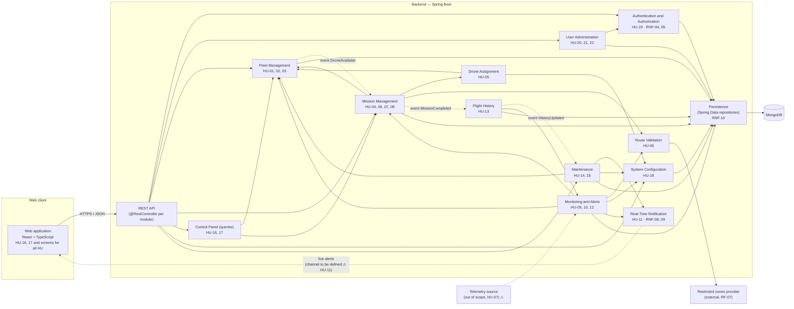

# Component Diagram — Dronflow

Derived **only** from the user stories (`docs/historias-usuario/`) and `docs/requeriments.md`. Mandatory stack (`AGENTS.md`): React + TypeScript, Spring Boot, MongoDB.
Each backend component is a module (package) of the Spring Boot application; they are not microservices. Anything the user stories do not define is marked with ⚠ and listed in section 5.

## 1. Overview

Legend: solid arrow = the source calls the target's interface; dotted arrow = event or asynchronous channel; `⚠` = not defined in the user stories.

## 2. Components, responsibilities and interfaces

| Component | HU / RNF | Responsibility | Interface it **provides** | Interface it **requires** |
|---|---|---|---|---|
| **Web application** (React + TS) | HU-16, 17 + UI for all HU, RNF-06, 07 | Screens per role, clear error messages | — | REST API, notification channel |
| **REST API** | all | HTTP adapters: validate input and delegate to the use cases; enforce role-based authorization before calling the module (RNF-04) | HTTP/JSON | `Authentication and Authorization` + target module |
| **Authentication and Authorization** | HU-19, RNF-04, 05 | Log in, verify the password hash, resolve role and permissions | `login`, `authorize(role, permission)` | `Persistence` (users) |
| **User Administration** | HU-20, 21, 22 | Register operator, edit, delete (logical) | `registerOperator`, `edit`, `delete` | `Authentication` (hash), `Persistence` |
| **Fleet Management** | HU-01, 02, 03 | Register drones by type, operational state, decommission/reactivation. Factory registry per type (RNF-02) | `register`, `changeState`, `reportFault`, `decommission`, `reactivate`, `findAvailable`; publishes `DroneAvailable` | `Persistence` |
| **Mission Management** | HU-04, 06, 07, 08 | Create mission, state machine, pause/resume/redirect/abort. If the route cannot be calculated it keeps the drone reserved and retries up to 3 times; then it releases the drone and the mission goes back to pending | `create`, `authorizeTakeoff`, `pause`, `resume`, `redirect`, `abort`; publishes `MissionCompleted` | `Fleet Management`, `Assignment`, `Route Validation`, `Persistence` |
| **Drone Assignment** | HU-05 | Choose the compatible drone with the highest score (weighted battery, proximity, priority) | `assign(mission)` | `Fleet Management` (candidates), `Configuration` (weights) |
| **Route Validation** | HU-06 | Check that the route does not cross restricted zones; report the reason | `validate(route)` | `Restricted zones provider` |
| **Monitoring and Alerts** | HU-09, 10, 12 | Evaluate battery, deviation and restricted zone; create and classify the alert | `evaluate(drone, mission)`, `alertsOfMission(mission)` | `Fleet Management`, `Mission Management`, `Route Validation`, `Configuration` (thresholds), `Notification`, `Persistence`; telemetry ⚠ |
| **Real-Time Notification** | HU-11, RNF-08, 09 | Deliver each alert (including the maintenance recommendation) as an on-screen alert to administrators with an active session in ≤ 1 s, asynchronously | `publish(alert)`, `subscribe(session)` | channel to the web ⚠ |
| **Flight History** | HU-13 | Accumulate hours, completed missions and incidents (high/critical alerts of the mission) when a mission ends | `getHistory(drone)`; publishes `HistoryUpdated` | event `MissionCompleted`, `Monitoring` (alerts), `Persistence` |
| **Maintenance** | HU-14, 15 | When the maintenance threshold is exceeded: generate the recommendation, send the drone to maintenance and warn the administrator with an on-screen alert. Record the result; if it is APPROVED, reset the drone's hours and missions | `recordResult` | event `HistoryUpdated`, `Fleet Management`, `Configuration`, `Notification`, `Persistence` |
| **Control Panel (queries)** | HU-16, 17 | Fleet summary by state and filterable mission history (administrator only) | `fleetSummary`, `queryMissions(filter)` | `Fleet Management`, `Mission Management` |
| **System Configuration** | HU-18 | Assignment weights, alert thresholds (battery, deviation) and maintenance thresholds, kept separate. Only the administrator modifies them | `get…`, `update…` | `Persistence` |
| **Persistence** | RNF-10 | Repositories per aggregate on MongoDB; writes with `majority` + journal | `Repository<T,ID>` | MongoDB |

## 3. Architecture decisions

- **Modular monolith**: the 12 modules live in a single Spring Boot application, deployable as one artifact. Nothing in the user stories asks for independent services.
- **Dependencies through interfaces**: a module never uses another module's repository; it uses the interface of the module that owns the aggregate (`Monitoring` asks for alerts through `alertsOfMission`, it does not read another module's collection). Keeps CBO ≤ 8 (RNF-01).
- **Internal events only where the user stories require them**: `MissionCompleted` → History (HU-13), `HistoryUpdated` → Maintenance (HU-14), `DroneAvailable` → reassign pending missions (HU-05, scenario 3). The History → Maintenance order is guaranteed by the chaining.
- **No cycles between modules**: `Mission Management → Monitoring` does not exist; it is `Monitoring → Mission Management`. The only way back (`Fleet → Missions`) is through an event.
- **Authorization at the edge**: the REST API checks the role (HU-19, RNF-04) before entering the module, so domain modules do not handle sessions.
- **Capabilities per role according to the user stories**: administrator = Users (HU-20–22), Configuration (HU-18), control panel and mission queries (HU-16–17), alerts and maintenance recommendations (HU-11, 14); operator = missions, intervention (HU-04–08), maintenance result (HU-15); both = register/decommission/reactivate drones (HU-01, 03).
- **End of mission**: `Fleet Management` decides `AVAILABLE` or `CHARGING` depending on the drone's battery versus the battery threshold from `Configuration`.

## 4. Not included (not in the user stories)

Email/SMS service (HU-11 rules it out), restricted-zone manager (RF-07: fixed external data), drone hardware simulator or integration (HU-07), account lockout after failed attempts (HU-19), audit log, message broker, API gateway, cache.

## 5. Open items affecting the components

1. Notification channel to the web (HU-11 does not specify it; technical decision to be approved by the author).
2. Origin of the telemetry that feeds `Monitoring` (HU-07 leaves it out of scope).
3. Severity of the maintenance alert: LOW was proposed (HU-12), pending validation.
