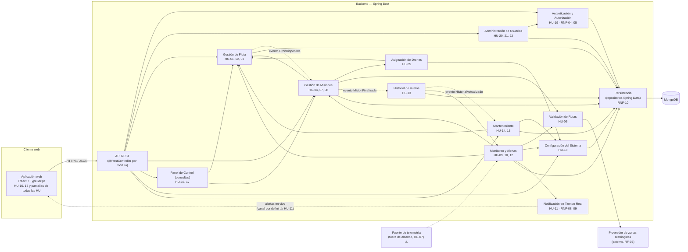

# Diagrama de componentes — Dronflow

Derivado **solo** de las historias de usuario (`docs/historias-usuario/`) y de `docs/requeriments.md`. Stack obligatorio (`AGENTS.md`): React + TypeScript, Spring Boot, MongoDB.
Cada componente del backend es un módulo (paquete) de la aplicación Spring Boot; no son microservicios. Lo no definido por las HU está marcado con ⚠ y detallado en `diagrama-clases.md` §8.

## 1. Vista general

Leyenda: flecha continua = el origen invoca la interfaz del destino; flecha punteada = comunicación por evento o canal asíncrono; `⚠` = no definido en las HU.

## 2. Componentes, responsabilidades e interfaces

| Componente | HU / RNF | Responsabilidad | Interfaz que **provee** | Interfaz que **requiere** |
|---|---|---|---|---|
| **Aplicación web** (React + TS) | HU-16, 17 + UI de todas las HU, RNF-06, 07 | Pantallas por rol, mensajes de error claros | — | API REST, canal de notificaciones |
| **API REST** | todas | Adaptadores HTTP: validan entrada y delegan a los casos de uso; aplican la autorización por rol antes de invocar el módulo (RNF-04) | HTTP/JSON | `Autenticación y Autorización` + módulo destino |
| **Autenticación y Autorización** | HU-19, RNF-04, 05 | Iniciar sesión, verificar hash de contraseña, resolver rol y permisos | `iniciarSesion`, `autorizar(rol, permiso)` | `Persistencia` (usuarios) |
| **Administración de Usuarios** | HU-20, 21, 22 | Registrar operador, editar, eliminar (lógico) | `registrarOperador`, `editar`, `eliminar` | `Autenticación` (hash), `Persistencia` |
| **Gestión de Flota** | HU-01, 02, 03 | Registrar drones por tipo, estado operativo, baja/reactivación. Registro de fábricas por tipo (RNF-02) | `registrar`, `cambiarEstado`, `reportarAveria`, `darDeBaja`, `reactivar`, `consultarDisponibles`; publica `DronDisponible` | `Persistencia` |
| **Gestión de Misiones** | HU-04, 07, 08 | Crear misión, máquina de estados, pausar/reanudar/redirigir/abortar | `crear`, `autorizarDespegue`, `pausar`, `reanudar`, `redirigir`, `abortar`; publica `MisionFinalizada` | `Gestión de Flota`, `Asignación`, `Validación de Rutas`, `Persistencia` |
| **Asignación de Drones** | HU-05 | Elegir el dron compatible con mayor puntaje (batería, cercanía, prioridad ponderados) | `asignar(misión)` | `Gestión de Flota` (candidatos), `Configuración` (ponderación) |
| **Validación de Rutas** | HU-06 | Verificar que la ruta no cruce zonas restringidas; informar el motivo | `validar(ruta)` | `Proveedor de zonas restringidas` |
| **Monitoreo y Alertas** | HU-09, 10, 12 | Evaluar batería, desvío y zona restringida; crear y clasificar la alerta | `evaluar(dron, misión)`, `alertasDeMision(misión)` | `Gestión de Flota`, `Gestión de Misiones`, `Validación de Rutas`, `Configuración` (umbrales), `Notificación`, `Persistencia`; telemetría ⚠ |
| **Notificación en Tiempo Real** | HU-11, RNF-08, 09 | Entregar cada alerta a los operadores con sesión activa en ≤ 1 s, de forma asíncrona | `publicar(alerta)`, `suscribir(sesión)` | canal hacia la web ⚠ |
| **Historial de Vuelos** | HU-13 | Acumular horas, misiones completadas e incidencias (alertas alta/crítica de la misión) al finalizar | `consultarHistorial(dron)`; publica `HistorialActualizado` | evento `MisionFinalizada`, `Monitoreo` (alertas), `Persistencia` |
| **Mantenimiento** | HU-14, 15 | Recomendar mantenimiento al superar umbral; registrar resultado y mover el estado del dron | `registrarResultado`, `consultarRecomendaciones` ⚠ | evento `HistorialActualizado`, `Gestión de Flota`, `Configuración`, `Persistencia` |
| **Panel de Control (consultas)** | HU-16, 17 | Resumen de flota por estado e historial de misiones filtrable | `resumenFlota`, `consultarMisiones(filtro)` | `Gestión de Flota`, `Gestión de Misiones` |
| **Configuración del Sistema** | HU-18 | Ponderación de asignación y umbrales (alerta; mantenimiento ⚠) | `obtener…`, `actualizar…` | `Persistencia` |
| **Persistencia** | RNF-10 | Repositorios por agregado sobre MongoDB; escritura con `majority` + journal | `Repositorio<T,ID>` | MongoDB |

## 3. Decisiones de arquitectura

- **Monolito modular**: los 12 módulos viven en una sola aplicación Spring Boot, desplegable como un artefacto. Nada en las HU pide servicios independientes.
- **Dependencias por interfaz**: un módulo nunca usa el repositorio de otro; usa la interfaz del módulo dueño del agregado (`Monitoreo` pide alertas por `alertasDeMision`, no lee la colección de otro). Mantiene CBO ≤ 8 (RNF-01).
- **Eventos internos solo donde las HU lo piden**: `MisionFinalizada` → Historial (HU-13), `HistorialActualizado` → Mantenimiento (HU-14), `DronDisponible` → reasignar misiones pendientes (HU-05, escenario 3). El orden Historial → Mantenimiento queda garantizado por el encadenamiento.
- **Sin ciclos entre módulos**: `Gestión de Misiones → Monitoreo` no existe; es `Monitoreo → Gestión de Misiones`. La única vuelta (`Flota → Misiones`) es por evento.
- **Autorización en el borde**: la API REST comprueba el rol (HU-19, RNF-04) antes de entrar al módulo, por lo que los módulos de dominio no manejan sesiones.
- **Capacidades por rol según las HU**: administrador = Usuarios (HU-20–22), Configuración (HU-18), recomendaciones de mantenimiento (HU-14); operador = misiones, intervención, mantenimiento (HU-15), panel (HU-16–17), alertas (HU-11); ambos = registrar/baja/reactivar drones (HU-01, 03).

## 4. No incluido (no está en las HU)

Servicio de correo/SMS (HU-11 lo descarta), gestor de zonas restringidas (RF-07: datos externos fijos), simulador o integración con hardware de drones (HU-07), bloqueo de cuenta por intentos fallidos (HU-19), auditoría/bitácora, bróker de mensajes, API gateway, caché.

## 5. Pendientes que afectan a los componentes

1. Canal de notificación hacia la web (HU-11 no lo especifica; es decisión técnica a aprobar por el autor).
2. Origen de la telemetría que alimenta `Monitoreo` (HU-07 la deja fuera de alcance).
3. Forma de entrega de las recomendaciones de mantenimiento al administrador (HU-14).
4. Qué evento lleva un dron a "en mantenimiento" (ninguna HU lo define; hoy `Mantenimiento` solo cierra el ciclo).
5. Dónde se configuran los umbrales de mantenimiento (RF-15 vs. alcance de HU-18).
