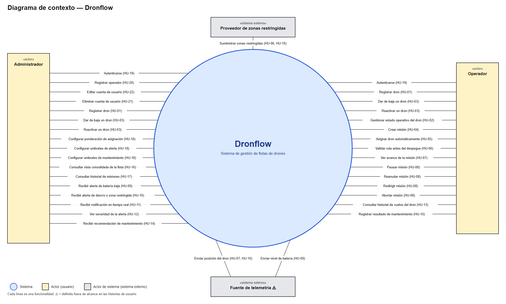

# Diagrama de contexto — Dronflow

Derivado solo de las historias de usuario (`docs/historias-usuario/`) y `docs/requeriments.md`. Muestra el sistema como una sola caja negra y a quienes interactúan con él.

Archivos: [`diagrama-contexto.svg`](diagrama-contexto.svg) (vectorial, editable) y [`diagrama-contexto.png`](diagrama-contexto.png).

## Notación

| Elemento | Forma | Qué representa |
|---|---|---|
| Sistema | círculo | Dronflow |
| Actor | cuadrado `«actor»` | persona que usa el sistema |
| Actor de sistema | cuadrado `«sistema externo»` | sistema ajeno que da o recibe datos |
| Relación | línea con etiqueta | **una** funcionalidad concreta, con su HU |

## Líneas por actor

### Administrador (17 funcionalidades)

| Línea | HU |
|---|---|
| Autenticarse | HU-19 |
| Registrar operador | HU-20 |
| Editar cuenta de usuario | HU-22 |
| Eliminar cuenta de usuario | HU-21 |
| Registrar dron | HU-01 |
| Dar de baja un dron | HU-03 |
| Reactivar un dron | HU-03 |
| Configurar ponderación de asignación | HU-18 |
| Configurar umbrales de alerta | HU-18 |
| Configurar umbrales de mantenimiento | HU-18 |
| Consultar vista consolidada de la flota | HU-16 |
| Consultar historial de misiones | HU-17 |
| Recibir alerta de batería baja | HU-09 |
| Recibir alerta de desvío o zona restringida | HU-10 |
| Recibir notificación en tiempo real | HU-11 |
| Ver severidad de la alerta | HU-12 |
| Recibir recomendación de mantenimiento | HU-14 |

### Operador (15 funcionalidades)

| Línea | HU |
|---|---|
| Autenticarse | HU-19 |
| Registrar dron | HU-01 |
| Dar de baja un dron | HU-03 |
| Reactivar un dron | HU-03 |
| Gestionar estado operativo del dron | HU-02 |
| Crear misión | HU-04 |
| Asignar dron automáticamente | HU-05 |
| Validar ruta antes del despegue | HU-06 |
| Ver avance de la misión | HU-07 |
| Pausar misión | HU-08 |
| Reanudar misión | HU-08 |
| Redirigir misión | HU-08 |
| Abortar misión | HU-08 |
| Consultar historial de vuelos del dron | HU-13 |
| Registrar resultado de mantenimiento | HU-15 |

### Actores de sistema (3 funcionalidades)

| Actor de sistema | Línea | HU |
|---|---|---|
| Proveedor de zonas restringidas | Suministrar zonas restringidas | HU-06, HU-10 |
| Fuente de telemetría ⚠ | Enviar posición del dron | HU-07, HU-10 |
| Fuente de telemetría ⚠ | Enviar nivel de batería | HU-09 |

## Notas

- Registrar, dar de baja y reactivar drones aparecen en los dos actores porque HU-01 y HU-03 las permiten a administrador u operador, sin distinción.
- Las alertas, el panel y el historial de misiones son solo del administrador (decisión del autor, `00-resumen.md`).
- ⚠ La fuente de telemetría está fuera de alcance en HU-07: el diagrama muestra que el sistema recibe posición y batería, pero no define de dónde vienen.
- La asignación automática (HU-05) y la validación de ruta (HU-06) las ejecuta el sistema; se dibujan en el operador porque es quien obtiene su resultado.
