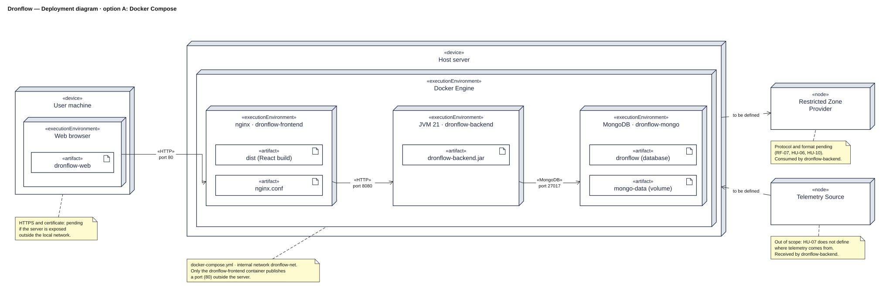
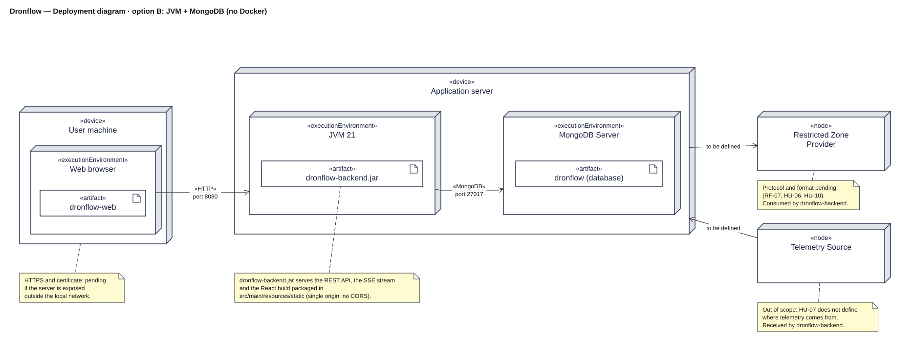
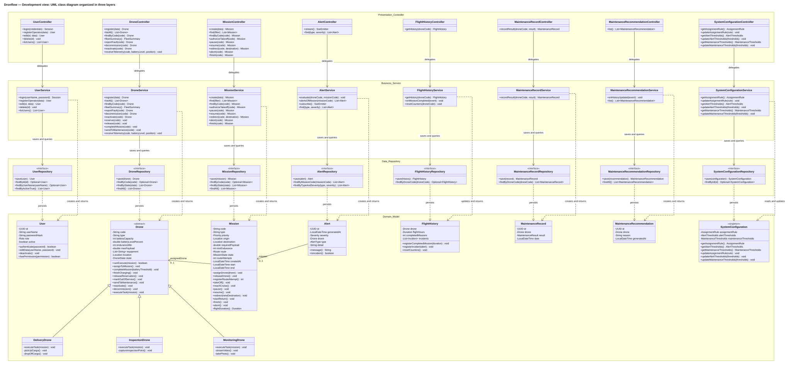

# Dronflow — Diagrama de despliegue y vista de desarrollo (REST)

Derivado de `docs/requeriments.md`, las historias de usuario, `docs/diagrama-clases.md`, `docs/diagrama-componentes.md`, `pom.xml` y la regla del README: **por cada clase del modelo hay un Repository, un Service y un Controller**.

Decisiones del autor aplicadas: despliegue con **Docker Compose** y alertas en tiempo real por **Server-Sent Events**. Lo no definido va con ⚠.

## Notación (UML, como en Visual Paradigm)

| Elemento | Cómo se dibuja |
|---|---|
| Clase | 3 compartimentos: nombre (con `«estereotipo»`), atributos, operaciones |
| Atributo | `visibilidad nombre : Tipo` (`-` privado, `+` público) |
| Operación | `visibilidad nombre(param : Tipo) : TipoRetorno` |
| Interfaz | clase con `«interface»` |
| Asociación navegable | línea continua con flecha abierta; nombre de rol (`-userService`) y multiplicidad (`1`, `0..*`) en el extremo destino. El rol reemplaza al atributo: no se repite en el compartimento |
| Dependencia | línea punteada con flecha abierta, `«use»` |
| Realización | línea punteada con triángulo hueco |
| Generalización | línea continua con triángulo hueco |
| Plantilla / ligadura | `MongoRepository` con parámetros `T, ID` en el recuadro punteado; cada repositorio se liga con `«bind» <T → Entidad, ID → Tipo>` |
| Marco de capa | rectángulo con el nombre de la capa centrado arriba (`Presentation_Controller`, `Business_Service`, `Data_Repository`, `Domain_Model`) |
| Nodo | cubo 3D: `«device»` (equipo físico), `«executionEnvironment»` (plataforma donde corre software: navegador, Docker, JVM, MongoDB) o `«node»` (sistema externo) |
| Artefacto | rectángulo `«artifact»` con el icono de hoja, **dentro** del nodo donde se despliega (el anidamiento ya significa «deploy») |
| Ruta de comunicación | línea continua **entre nodos** (nunca entre artefactos), con `«protocolo»` y el puerto; la punta abierta marca el extremo navegable, el que atiende la conexión |
| Nota | rectángulo con esquina doblada, unido con línea punteada |

Los SVG están en [`docs/vistas/`](vistas/) y se regeneran con `python docs/diagrama_desarrollo.py`.

---

## Parte 1 — Diagrama de despliegue

Las dos versiones usan **solo elementos que existen en la paleta de Visual Paradigm** (Deployment Diagram), para que el dibujo salga idéntico:

| Lo que ves en el SVG | Elemento de la paleta de VP | Cómo se obtiene |
|---|---|---|
| Cubo 3D con `«device»` | **Device** | arrastrar *Device*; el estereotipo lo pone VP solo |
| Cubo 3D con `«executionEnvironment»` | **Execution Environment** | arrastrar *Execution Environment* |
| Cubo 3D con `«node»` (sistemas externos) | **Node** | arrastrar *Node* y escribir el estereotipo `node` si no aparece |
| Rectángulo con `«artifact»` y el icono de hoja | **Artifact** | arrastrar *Artifact* **dentro** del nodo: el anidamiento ya significa «deploy», no hace falta la flecha |
| Línea continua con `«PROTOCOLO»` y el puerto | **Communication Path** | solo se puede trazar **de nodo a nodo** (ver abajo) |
| Punta de flecha abierta en un extremo | extremo navegable | clic derecho sobre el extremo de la ruta → *Navigable* |
| Rectángulo amarillo con la esquina doblada | **Note** + **Anchor** | la línea punteada es el conector *Anchor* |

**Lo que cambió respecto a la versión anterior (y que era justo lo que no se podía dibujar en VP):**

1. Las rutas de comunicación ya **no salen de un artefacto**. En UML una *CommunicationPath* une **nodos**, y VP no deja engancharla a un artefacto. Ahora salen de `Web browser`, `nginx · dronflow-frontend`, `JVM 21 · dronflow-backend`, etc.
2. Los sistemas externos se conectan al **`«device»` Host server**, no a un contenedor de adentro: es la máquina la que tiene la conexión de red. Qué contenedor lo consume lo dice la nota.
3. Los símbolos `⚠` y los textos largos dentro de las etiquetas se movieron a **notas UML**. Las etiquetas de las rutas solo llevan protocolo y puerto.
4. Nada de relleno de color ni de nombres en dos líneas dentro de los nodos: nombre en una línea, como lo escribe VP.
5. El volumen `mongo-data` es un **artefacto desplegado en el contenedor de MongoDB**, no una caja unida con una línea suelta.

### Opción A — con Docker Compose

| # | Elemento | Tipo en VP | Nombre exacto | Va dentro de |
|---|---|---|---|---|
| 1 | Equipo del usuario | Device | `User machine` | — |
| 2 | Navegador web | Execution Environment | `Web browser` | 1 |
| 3 | dronflow-web | Artifact | `dronflow-web` | 2 |
| 4 | Servidor host | Device | `Host server` | — |
| 5 | Docker Engine | Execution Environment | `Docker Engine` | 4 |
| 6 | Contenedor web | Execution Environment | `nginx · dronflow-frontend` | 5 |
| 7 | dist | Artifact | `dist (React build)` | 6 |
| 8 | nginx.conf | Artifact | `nginx.conf` | 6 |
| 9 | Contenedor API | Execution Environment | `JVM 21 · dronflow-backend` | 5 |
| 10 | JAR | Artifact | `dronflow-backend.jar` | 9 |
| 11 | Contenedor datos | Execution Environment | `MongoDB · dronflow-mongo` | 5 |
| 12 | Base de datos | Artifact | `dronflow (database)` | 11 |
| 13 | Volumen | Artifact | `mongo-data (volume)` | 11 |
| 14 | Zonas restringidas | Node | `Restricted Zone Provider` | — |
| 15 | Telemetría | Node | `Telemetry Source` | — |

| Ruta de comunicación | Desde (nodo) | Hasta (nodo) | Etiqueta | Qué viaja |
|---|---|---|---|---|
| 1 | Web browser | nginx · dronflow-frontend | `«HTTP» port 80` | la SPA y las llamadas `/api/**` |
| 2 | nginx · dronflow-frontend | JVM 21 · dronflow-backend | `«HTTP» port 8080` | REST/JSON y el flujo SSE de alertas (HU-11) |
| 3 | JVM 21 · dronflow-backend | MongoDB · dronflow-mongo | `«MongoDB» port 27017` | documentos de las 8 colecciones |
| 4 | Host server | Restricted Zone Provider | `to be defined` | zonas restringidas (HU-06, HU-10) |
| 5 | Telemetry Source | Host server | `to be defined` | posición y batería (HU-07, 09, 10) |

### Opción B — sin Docker (JVM + MongoDB, formato del curso)

Mismos elementos, menos cajas: desaparecen Docker Engine, los tres contenedores, `dist`, `nginx.conf` y el volumen.

| # | Elemento | Tipo en VP | Nombre exacto | Va dentro de |
|---|---|---|---|---|
| 1 | Equipo del usuario | Device | `User machine` | — |
| 2 | Navegador web | Execution Environment | `Web browser` | 1 |
| 3 | dronflow-web | Artifact | `dronflow-web` | 2 |
| 4 | Servidor de aplicación | Device | `Application server` | — |
| 5 | JVM | Execution Environment | `JVM 21` | 4 |
| 6 | JAR | Artifact | `dronflow-backend.jar` | 5 |
| 7 | Motor de datos | Execution Environment | `MongoDB Server` | 4 |
| 8 | Base de datos | Artifact | `dronflow (database)` | 7 |
| 9 | Zonas restringidas | Node | `Restricted Zone Provider` | — |
| 10 | Telemetría | Node | `Telemetry Source` | — |

| Ruta de comunicación | Desde (nodo) | Hasta (nodo) | Etiqueta |
|---|---|---|---|
| 1 | Web browser | JVM 21 | `«HTTP» port 8080` |
| 2 | JVM 21 | MongoDB Server | `«MongoDB» port 27017` |
| 3 | Application server | Restricted Zone Provider | `to be defined` |
| 4 | Telemetry Source | Application server | `to be defined` |

### Diferencia entre las dos opciones

| | Opción A — Docker Compose | Opción B — sin Docker |
|---|---|---|
| Frontend | nginx sirve el build de React | el JAR sirve el build de React (`src/main/resources/static`) |
| API | JVM 21 dentro de un contenedor | JVM 21 instalada en el servidor |
| Datos | MongoDB en un contenedor + volumen `mongo-data` | MongoDB Server instalado en el servidor |
| Puerto que ve el navegador | 80 (nginx hace de proxy al 8080) | 8080 |
| CORS | no hace falta (un solo origen) | no hace falta (el mismo JAR sirve web y API) |

Las clases, las capas y los endpoints (Parte 2) son **los mismos en las dos**: solo cambia dónde se ejecuta cada artefacto.

---

## Parte 2 — Vista de desarrollo: clases REST

### 2.1 Diagrama UML de clases organizado en tres capas (el diagrama para entregar)

Mismo formato que la diapositiva *"Diagrama UML de clases: implementación organizada en tres capas"* del curso, con las clases reales de Dronflow (versión JPG: [`vistas/capas.jpg`](vistas/capas.jpg)).

**Cómo leerlo:**

| Elemento | Notación UML | Significado |
|---|---|---|
| Marcos `Presentation_Controller`, `Business_Service`, `Data_Repository` | rectángulo con título | las tres capas. `Domain_Model` va aparte: **no es una cuarta capa** |
| `Controller → Service` («delegates») | asociación navegable: línea continua, flecha abierta | el controller guarda una referencia al service (inyección de dependencias) y le delega cada operación |
| `Service → Repository` («saves and queries») | asociación navegable | el service usa el repositorio para guardar y consultar |
| `Repository ⇢ entidad` («persists») | dependencia: línea punteada, flecha abierta | el repositorio usa la entidad como tipo de sus operaciones |
| `Service ⇢ entidad` («creates and returns») | dependencia | el service crea, modifica o devuelve la entidad |
| `DeliveryDrone / InspectionDrone / MonitoringDrone → Drone` | generalización: línea continua, triángulo hueco | herencia; no lleva multiplicidades |
| `Mission → Drone` (`assignedDrone 0..1`), `Alert → Mission` (`mission 0..1`) | asociación con rol y multiplicidad | relaciones del modelo de dominio (`diagrama-clases.md`) |
| `«interface»`, `«abstract»`, `«singleton»` | estereotipo sobre el nombre | repositorios = interfaces de Spring Data; `Drone` es abstracta; `SystemConfiguration` es singleton |

Notas:

- Los atributos se escriben `-Tipo nombre` y las operaciones `+nombre(parámetros) : Retorno`, como en el material del curso. Los parámetros van sin tipo para que se vea la responsabilidad de cada clase.
- Como en el ejemplo del curso, los controllers devuelven las entidades. En el código, la entrada y la salida pasan por DTO (`record`) y por los tipos HTTP (`ResponseEntity`).
- Las referencias a `Drone` en `Alert`, `FlightHistory`, `MaintenanceRecord` y `MaintenanceRecommendation` se muestran como atributo (`-Drone drone`) y no como línea, para no cruzar todo el modelo.
- MongoDB no aparece: es el almacenamiento externo que usa la implementación de los repositorios (Spring Data), no una clase.

### 2.2 De qué HU sale cada clase

| Entidad (`Domain_Model`) | Controller | Service | Repository | HU |
|---|---|---|---|---|
| `User` | `UserController` | `UserService` | `UserRepository` | HU-19, 20, 21, 22 |
| `Drone` (+ 3 subtipos) | `DroneController` | `DroneService` | `DroneRepository` | HU-01, 02, 03, 16 |
| `Mission` | `MissionController` | `MissionService` | `MissionRepository` | HU-04, 05, 06, 07, 08, 17 |
| `Alert` | `AlertController` | `AlertService` | `AlertRepository` | HU-09, 10, 11, 12 |
| `FlightHistory` | `FlightHistoryController` | `FlightHistoryService` | `FlightHistoryRepository` | HU-13 |
| `MaintenanceRecord` | `MaintenanceRecordController` | `MaintenanceRecordService` | `MaintenanceRecordRepository` | HU-15 |
| `MaintenanceRecommendation` | `MaintenanceRecommendationController` ⚠ | `MaintenanceRecommendationService` | `MaintenanceRecommendationRepository` | HU-14 |
| `SystemConfiguration` | `SystemConfigurationController` | `SystemConfigurationService` | `SystemConfigurationRepository` | HU-18 |

⚠ `MaintenanceRecommendationController` es el único punto a confirmar (ver 2.6, pendiente 4).

### 2.3 Colaboraciones dentro de la capa Service

Dentro de `Business_Service` unos servicios usan a otros. Para que el diagrama de tres capas se pueda leer, estas relaciones van en la tabla y no como líneas:

| Service | Usa | Para | HU |
|---|---|---|---|
| `MissionService` | `DroneService` | reservar, liberar y cerrar el dron de la misión | HU-05, 06, 07 |
| `MissionService` | `AssignmentService` | elegir el dron por batería, cercanía y prioridad | HU-05 |
| `MissionService` | `RouteValidator` | validar la ruta antes del despegue (3 intentos) | HU-06 |
| `AssignmentService` | `DroneService`, `SystemConfigurationService` | drones disponibles y ponderación | HU-05, 18 |
| `RouteValidator` | `RestrictedZoneProvider` «interface» | zonas restringidas (proveedor externo) | HU-06, 10 |
| `AlertService` | `MissionService`, `DroneService`, `RouteValidator`, `SystemConfigurationService` | evaluar batería, desvío y zona restringida | HU-09, 10 |
| `AlertService` | `SseAlertChannel` | enviar la alerta en tiempo real (SSE) | HU-11 |
| `DroneService` | `AlertService` | evaluar alertas al recibir telemetría | HU-09, 10 |
| `FlightHistoryService` | `AlertService` | convertir alertas altas/críticas en incidencias | HU-13 |
| `MaintenanceRecordService` | `DroneService`, `FlightHistoryService` | aplicar el resultado y reiniciar contadores | HU-15 |
| `MaintenanceRecommendationService` | `DroneService`, `SystemConfigurationService`, `SseAlertChannel` | enviar a mantenimiento y avisar al administrador | HU-14 |

Eventos internos: `MissionCompleted` (Mission → FlightHistory), `HistoryUpdated` (FlightHistory → MaintenanceRecommendation), `DroneAvailable` (Drone → Mission).

### 2.4 Transversales

- `SecurityConfig`: toda ruta exige sesión salvo el login (RNF-04); restringe por rol según la tabla `Role`/`Permission`.
- `GlobalExceptionHandler`: convierte cada error en un mensaje específico (RNF-07). Transición de estado inválida → **409**, validación → **400**, no encontrado → **404**.

### 2.5 Endpoints REST

Cada endpoint corresponde 1 a 1 a una interfaz ya aprobada del diagrama de componentes, salvo los marcados como *decisión del autor*, que salen de las decisiones registradas en las HU. El verbo y la ruta son la propuesta REST; no se agregan funcionalidades.

| Método | Ruta | Controller.método | Interfaz | Rol | HU |
|---|---|---|---|---|---|
| POST | `/api/auth/login` | `UserController.login` | `ILogin` | público | HU-19 |
| GET | `/api/users` (solo usuarios activos; 200 aunque la lista esté vacía) | `UserController.listUsers` | *decisión del autor* | ADMIN | HU-21, 22 |
| POST | `/api/users` | `UserController.registerOperator` | `IRegisterOperator` | ADMIN | HU-20 |
| PUT | `/api/users/{id}` | `UserController.edit` | `IEditUser` | ADMIN | HU-22 |
| DELETE | `/api/users/{id}` | `UserController.delete` (lógico) | `IDeleteUser` | ADMIN | HU-21 |
| POST | `/api/drones` | `DroneController.register` | `IRegisterDrone` | ADMIN, OPERATOR | HU-01 |
| GET | `/api/drones` | `DroneController.listAll` | `IListDrones` | ADMIN, OPERATOR | HU-16 |
| GET | `/api/drones/{code}` | `DroneController.findByCode` | `IFindDrone` | ADMIN, OPERATOR | HU-02 |
| GET | `/api/drones/summary` | `DroneController.fleetSummary` | `IGetFleetSummary` | ADMIN | HU-16 |
| POST | `/api/drones/{code}/fault` | `DroneController.reportFault` | `IReportFault` | OPERATOR | HU-02 |
| POST | `/api/drones/{code}/decommission` | `DroneController.decommission` | `IDecommissionDrone` | ADMIN, OPERATOR | HU-03 |
| POST | `/api/drones/{code}/reactivate` | `DroneController.reactivate` | `IReactivateDrone` | ADMIN, OPERATOR | HU-03 |
| POST | `/api/drones/{code}/telemetry` | `DroneController.receiveTelemetry` (batería y posición; dispara `AlertService.evaluate`) | *decisión del autor* | Fuente de telemetría | HU-07, 09, 10 |
| GET | `/api/drones/{code}/flight-history` | `FlightHistoryController.getHistory` | `IGetFlightHistory` | OPERATOR | HU-13 |
| POST | `/api/drones/{code}/maintenance-records` | `MaintenanceRecordController.recordResult` | `IRecordMaintenanceResult` | OPERATOR | HU-15 |
| GET | `/api/maintenance-recommendations` | `MaintenanceRecommendationController.list` | ⚠ | ADMIN | HU-14 |
| POST | `/api/missions` | `MissionController.create` (asigna dron, HU-05) | `ICreateMission` | OPERATOR | HU-04, 05 |
| GET | `/api/missions?state=&from=&to=&droneCode=` | `MissionController.find` | `IQueryMissions` | ADMIN | HU-17 |
| GET | `/api/missions/{code}` | `MissionController.findByCode` | `IFindMission` | OPERATOR | HU-07 |
| POST | `/api/missions/{code}/authorize-takeoff` | `MissionController.authorizeTakeoff` | `IAuthorizeTakeoff` | OPERATOR | HU-06 |
| POST | `/api/missions/{code}/pause` | `MissionController.pause` | `IPauseMission` | OPERATOR | HU-08 |
| POST | `/api/missions/{code}/resume` | `MissionController.resume` | `IResumeMission` | OPERATOR | HU-08 |
| POST | `/api/missions/{code}/redirect` | `MissionController.redirect` | `IRedirectMission` | OPERATOR | HU-08 |
| POST | `/api/missions/{code}/abort` | `MissionController.abort` | `IAbortMission` | OPERATOR | HU-08 |
| POST | `/api/missions/{code}/finish` | `MissionController.finish` (misión → finalizada; publica `MissionCompleted`) | *decisión del autor* | ⚠ por confirmar | HU-07, 13, 14 |
| GET | `/api/alerts/stream` (`text/event-stream`) | `AlertController.stream` | `ISubscribeToAlerts` | ADMIN | HU-11, 12 |
| GET | `/api/alerts?type=&severity=` | `AlertController.find` | *decisión del autor* | ADMIN | HU-12 |
| GET / PUT | `/api/configuration/assignment-rule` | `SystemConfigurationController` | `IGet/IUpdateAssignmentRule` | ADMIN | HU-18 |
| GET / PUT | `/api/configuration/alert-thresholds` | `SystemConfigurationController` | `IGet/IUpdateAlertThresholds` | ADMIN | HU-18 |
| GET / PUT | `/api/configuration/maintenance-thresholds` | `SystemConfigurationController` | `IGet/IUpdateMaintenanceThresholds` | ADMIN | HU-18 |

Las transiciones de estado se modelan como `POST /{recurso}/{code}/{acción}` porque son acciones con reglas (patrón State), no ediciones de campos; un `PATCH state` dejaría saltarse esas reglas.

**Sin endpoint (las dispara el sistema, no un usuario):** `takeOff`, `reachCruise`, `startReturn`, `AlertService.evaluate` (lo llama `DroneService.receiveTelemetry`), `FlightHistoryService.onMissionCompleted` y `MaintenanceRecommendationService.onHistoryUpdated` (eventos internos).

### 2.6 Pendientes ⚠

1. HTTPS y certificado si se expone fuera del host.
2. Protocolo del Proveedor de Zonas Restringidas (RF-07).
3. Protocolo de la Fuente de Telemetría: el backend la recibe por `POST /api/drones/{code}/telemetry`; falta definir qué sistema la envía (HU-07).
4. `GET /api/maintenance-recommendations`: el diagrama de componentes no tiene puerto de consulta para recomendaciones (solo llegan como alerta, HU-14). Confirmar si se quiere o se quita el Controller (excepción a la regla del README).
5. Quién llama a `POST /api/missions/{code}/finish` (la fuente de telemetría al aterrizar o el operador).
6. Rol que consulta historial de vuelos (HU-13) y detalle de misión (HU-07): se puso OPERATOR según `diagrama-contexto.md`.
