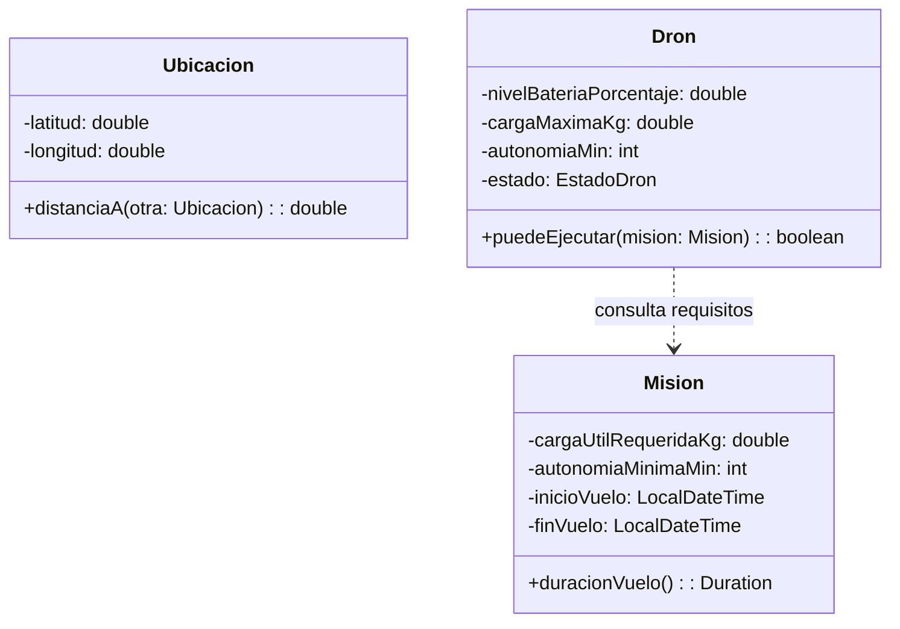
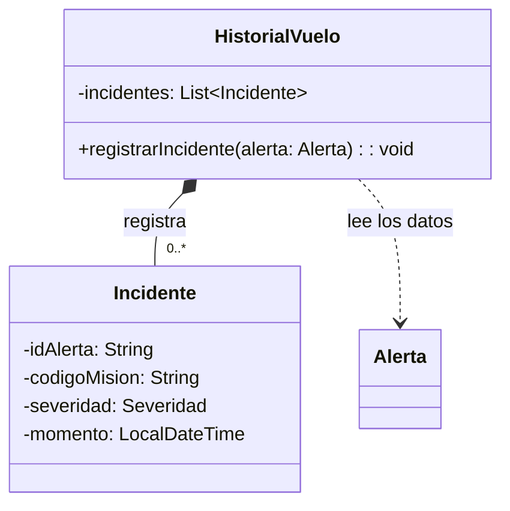
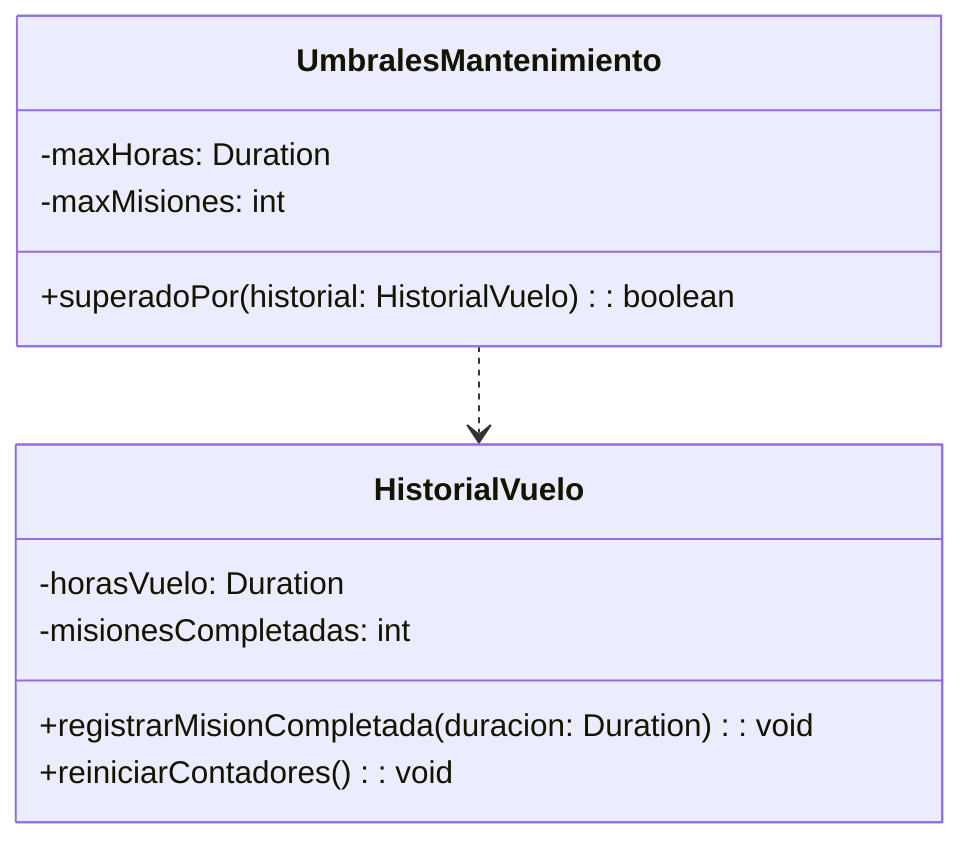
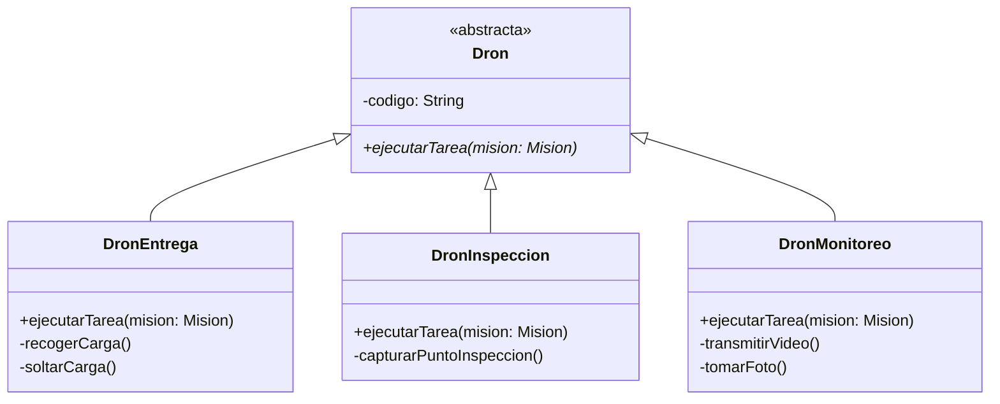
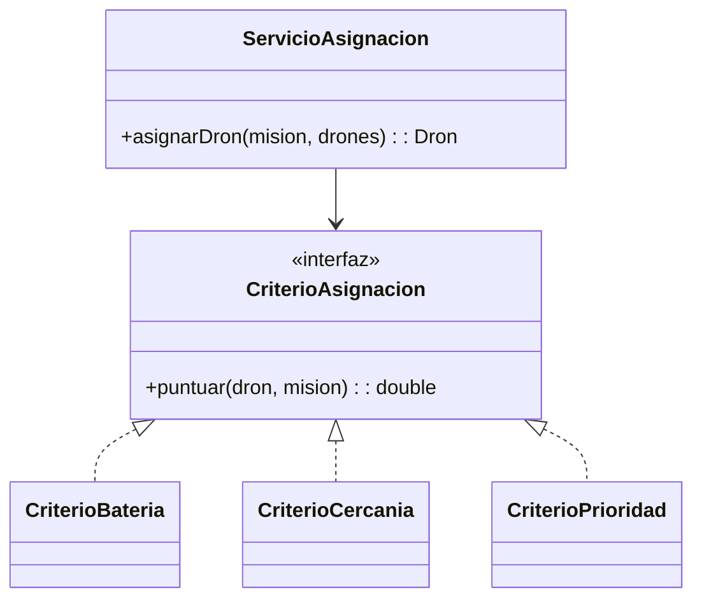
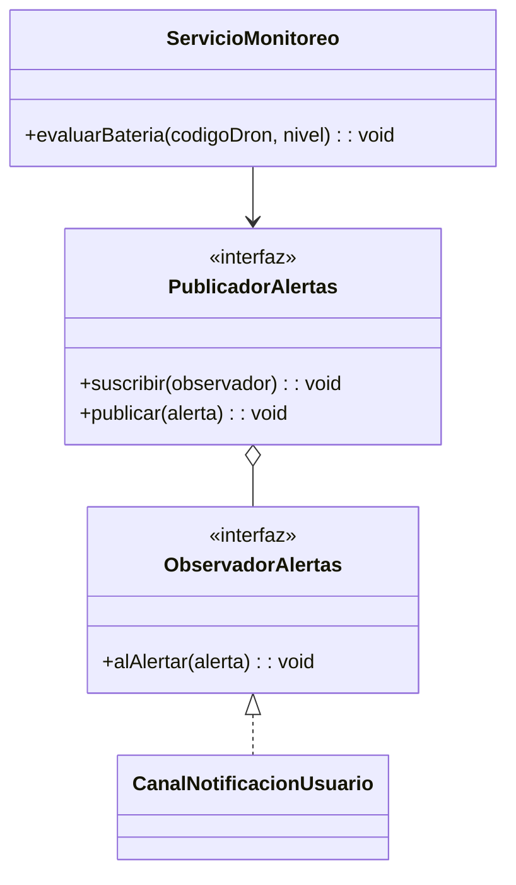
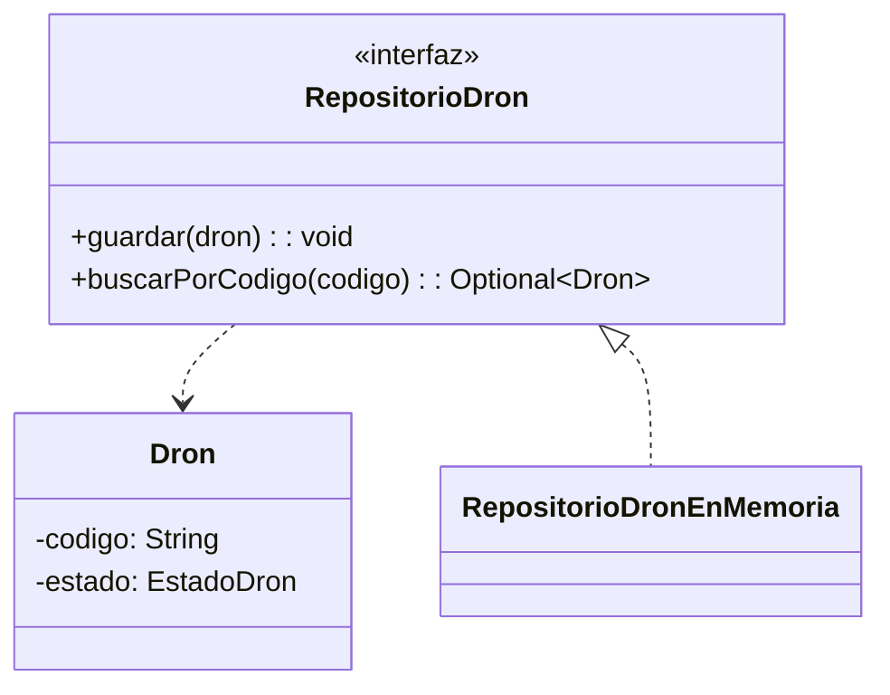
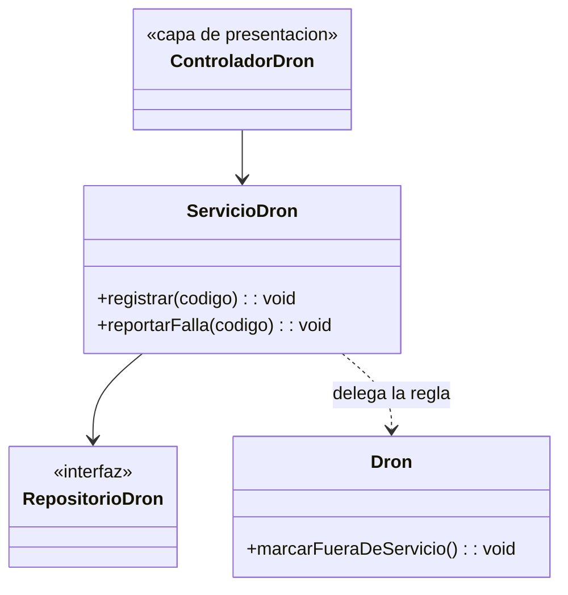

# Principios GRASP aplicados en Dronflow

Material de exposición. Cada principio tiene: la idea, dónde aparece en el diseño de Dronflow, un diagrama Mermaid y un ejemplo en Java puro (sin Spring). Los diagramas y el código usan nombres en español.

Cada bloque de código es autónomo: se copia a un archivo `.java` con el nombre de la clase que tiene el `main` (la `Demo...` que aparece primero) y se ejecuta con `java NombreDemo.java` (Java 17 o superior). La clase con `main` va primero porque el lanzador de un solo archivo ejecuta la primera clase declarada.

Solo se incluyen los principios que el diseño aplica de forma explícita. Cada uno indica su evidencia: una clase u operación del diagrama de clases (vista lógica) o una interfaz de la vista de desarrollo (`docs/diagrama-clases.md`, sección 5.2).

## Equivalencia de nombres

El diagrama de clases (`docs/diagrama-clases.md`) usa nombres en inglés; aquí van en español para la exposición.

| Diagrama de clases | En este documento |
|---|---|
| `Drone`, `DeliveryDrone`, `InspectionDrone`, `MonitoringDrone` | `Dron`, `DronEntrega`, `DronInspeccion`, `DronMonitoreo` |
| `DroneState` (`AVAILABLE`, `ON_MISSION`, `OUT_OF_SERVICE`...) | `EstadoDron` (`DISPONIBLE`, `EN_MISION`, `FUERA_DE_SERVICIO`...) |
| `Mission`, `Location`, `Route` | `Mision`, `Ubicacion`, `Ruta` |
| `FlightHistory`, `Incident`, `MaintenanceThresholds` | `HistorialVuelo`, `Incidente`, `UmbralesMantenimiento` |
| `Alert` | `Alerta` |
| `AssignmentService`, `AssignmentCriterion` | `ServicioAsignacion`, `CriterioAsignacion` |
| `MonitoringService`, `AlertPublisher`, `AlertObserver` | `ServicioMonitoreo`, `PublicadorAlertas`, `ObservadorAlertas` |
| `DroneRepository`, `DroneService` | `RepositorioDron`, `ServicioDron` |

| # | Principio | Dónde se cumple |
|---|---|---|
| 1 | Experto en Información | `Ubicacion.distanciaA`, `Mision.duracionVuelo`, `Dron.puedeEjecutar` |
| 2 | Creador | `HistorialVuelo` crea sus `Incidente` |
| 3 | Alta Cohesión | `HistorialVuelo` y `UmbralesMantenimiento` |
| 4 | Polimorfismo | `Dron.ejecutarTarea` en sus 3 subclases |
| 5 | Variaciones Protegidas | `CriterioAsignacion` (Strategy) |
| 6 | Indirección | `PublicadorAlertas` entre monitoreo y notificación |
| 7 | Fabricación Pura | `RepositorioDron` |
| 8 | Controlador | `ServicioDron` |

---

## 1. Experto en Información (Information Expert)

**Idea:** asigna una responsabilidad a la clase que tiene la información necesaria para cumplirla.

**En Dronflow:** la distancia entre dos puntos la calcula `Ubicacion` (tiene latitud y longitud). La duración del vuelo la calcula `Mision` (tiene `inicioVuelo` y `finVuelo`). Saber si un dron puede ejecutar una misión lo decide `Dron` (tiene batería, carga máxima y autonomía).

**Evidencia:** en el diagrama de clases, `Location.distanceTo()`, `Mission.flightDuration()`, `Drone.canExecute()`, `Route.deviationFrom()` y `Route.crosses()`.



```java
import java.time.Duration;
import java.time.LocalDateTime;

class DemoExperto {
    public static void main(String[] args) {
        Ubicacion a = new Ubicacion(4.6097, -74.0817);
        Ubicacion b = new Ubicacion(4.7110, -74.0721);
        System.out.printf("Distancia: %.0f m%n", a.distanciaA(b));

        LocalDateTime inicio = LocalDateTime.of(2026, 10, 25, 10, 0);
        Mision mision = new Mision(2.0, 30, inicio, inicio.plusMinutes(42));
        System.out.println("Duración: " + mision.duracionVuelo().toMinutes() + " min");

        Dron dron = new Dron(80, 5.0, 45, EstadoDron.DISPONIBLE);
        System.out.println("¿Puede ejecutarla? " + dron.puedeEjecutar(mision));
    }
}

enum EstadoDron { DISPONIBLE, EN_MISION, CARGANDO, EN_MANTENIMIENTO, FUERA_DE_SERVICIO, DADO_DE_BAJA }

class Ubicacion {
    private final double latitud;
    private final double longitud;

    Ubicacion(double latitud, double longitud) {
        this.latitud = latitud;
        this.longitud = longitud;
    }

    // Experto: Ubicacion tiene las coordenadas, por eso calcula la distancia (haversine, en metros)
    double distanciaA(Ubicacion otra) {
        double radioTierra = 6_371_000;
        double dLat = Math.toRadians(otra.latitud - latitud);
        double dLon = Math.toRadians(otra.longitud - longitud);
        double a = Math.sin(dLat / 2) * Math.sin(dLat / 2)
                + Math.cos(Math.toRadians(latitud)) * Math.cos(Math.toRadians(otra.latitud))
                * Math.sin(dLon / 2) * Math.sin(dLon / 2);
        return 2 * radioTierra * Math.asin(Math.sqrt(a));
    }
}

class Mision {
    private final double cargaUtilRequeridaKg;
    private final int autonomiaMinimaMin;
    private final LocalDateTime inicioVuelo;
    private final LocalDateTime finVuelo;

    Mision(double cargaUtilRequeridaKg, int autonomiaMinimaMin, LocalDateTime inicioVuelo, LocalDateTime finVuelo) {
        this.cargaUtilRequeridaKg = cargaUtilRequeridaKg;
        this.autonomiaMinimaMin = autonomiaMinimaMin;
        this.inicioVuelo = inicioVuelo;
        this.finVuelo = finVuelo;
    }

    double getCargaUtilRequeridaKg() { return cargaUtilRequeridaKg; }
    int getAutonomiaMinimaMin() { return autonomiaMinimaMin; }

    // Experto: Mision guarda las dos fechas, por eso calcula la duración
    Duration duracionVuelo() {
        return Duration.between(inicioVuelo, finVuelo);
    }
}

class Dron {
    private final double nivelBateriaPorcentaje;
    private final double cargaMaximaKg;
    private final int autonomiaMin;
    private final EstadoDron estado;

    Dron(double nivelBateriaPorcentaje, double cargaMaximaKg, int autonomiaMin, EstadoDron estado) {
        this.nivelBateriaPorcentaje = nivelBateriaPorcentaje;
        this.cargaMaximaKg = cargaMaximaKg;
        this.autonomiaMin = autonomiaMin;
        this.estado = estado;
    }

    // Experto: solo el dron conoce su batería, carga y autonomía
    boolean puedeEjecutar(Mision mision) {
        return estado == EstadoDron.DISPONIBLE
                && nivelBateriaPorcentaje > 0
                && cargaMaximaKg >= mision.getCargaUtilRequeridaKg()
                && autonomiaMin >= mision.getAutonomiaMinimaMin();
    }
}
```

**Qué decir en la exposición:** nadie fuera de `Dron` calcula si el dron sirve para la misión. Si `ServicioMision` leyera los atributos del dron y decidiera, el conocimiento estaría repartido y cada cambio en el dron obligaría a tocar el servicio.

---

## 2. Creador (Creator)

**Idea:** la clase B crea instancias de A si B contiene a A, la agrega, la registra o tiene los datos para inicializarla.

**En Dronflow:** `HistorialVuelo` crea los `Incidente`. Los contiene (composición `HistorialVuelo ◆ Incidente`, con el nombre `records` en el diagrama) y su operación `registrarIncidente(alerta)` recibe la alerta, que trae los datos con los que se inicializa el incidente.

**Evidencia:** en el diagrama de clases, la composición `FlightHistory ◆ Incident` y la operación `FlightHistory.registerIncident(alert: Alert)`.



```java
import java.time.LocalDateTime;
import java.util.ArrayList;
import java.util.List;

class DemoCreador {
    public static void main(String[] args) {
        HistorialVuelo historial = new HistorialVuelo();

        historial.registrarIncidente(new Alerta("A-1", "MIS-100", Severidad.CRITICA, LocalDateTime.now()));
        historial.registrarIncidente(new Alerta("A-2", "MIS-100", Severidad.BAJA, LocalDateTime.now()));

        // Solo la alerta crítica se volvió incidente
        System.out.println("Incidentes: " + historial.getIncidentes().size());
    }
}

enum Severidad {
    BAJA, MEDIA, ALTA, CRITICA;

    boolean esIncidente() { return this == ALTA || this == CRITICA; }
}

record Alerta(String id, String codigoMision, Severidad severidad, LocalDateTime generadaEn) { }

class Incidente {
    private final String idAlerta;
    private final String codigoMision;
    private final Severidad severidad;
    private final LocalDateTime momento;

    Incidente(String idAlerta, String codigoMision, Severidad severidad, LocalDateTime momento) {
        this.idAlerta = idAlerta;
        this.codigoMision = codigoMision;
        this.severidad = severidad;
        this.momento = momento;
    }
}

class HistorialVuelo {
    private final List<Incidente> incidentes = new ArrayList<>();

    // Creador: HistorialVuelo contiene los Incidente y tiene (por la alerta) los datos para crearlos
    void registrarIncidente(Alerta alerta) {
        if (alerta.severidad().esIncidente()) {
            incidentes.add(new Incidente(alerta.id(), alerta.codigoMision(),
                    alerta.severidad(), alerta.generadaEn()));
        }
    }

    List<Incidente> getIncidentes() { return List.copyOf(incidentes); }
}
```

**Qué decir en la exposición:** el cliente nunca hace `new Incidente(...)`. Quien contiene los incidentes y recibe la alerta con los datos es quien los crea.

---

## 3. Alta Cohesión (High Cohesion)

**Idea:** cada clase tiene responsabilidades fuertemente relacionadas y enfocadas. Una clase con responsabilidades dispersas es difícil de entender, reutilizar y mantener.

**En Dronflow:** `HistorialVuelo` solo lleva horas, misiones e incidentes de un dron. `UmbralesMantenimiento` solo sabe cuándo se excede un umbral de mantenimiento. Ninguna calcula rutas, ni asigna drones, ni envía alertas.

**Evidencia:** en el diagrama de clases, `FlightHistory` (solo historial) y, en `docs/diagrama-clases.md`, `MaintenanceThresholds` separado de `AlertThresholds`.



```java
import java.time.Duration;

class DemoCohesion {
    public static void main(String[] args) {
        HistorialVuelo historial = new HistorialVuelo();
        UmbralesMantenimiento umbrales = new UmbralesMantenimiento(Duration.ofHours(50), 3);

        for (int i = 0; i < 3; i++) {
            historial.registrarMisionCompletada(Duration.ofMinutes(40));
        }
        System.out.println("¿Requiere mantenimiento? " + umbrales.superadoPor(historial));

        historial.reiniciarContadores();
        System.out.println("Tras resultado APROBADO: " + umbrales.superadoPor(historial));
    }
}

// Cohesiva: todo lo que hace tiene que ver con acumular el historial de vuelo
class HistorialVuelo {
    private Duration horasVuelo = Duration.ZERO;
    private int misionesCompletadas = 0;

    void registrarMisionCompletada(Duration duracion) {
        horasVuelo = horasVuelo.plus(duracion);
        misionesCompletadas++;
    }

    void reiniciarContadores() {
        horasVuelo = Duration.ZERO;
        misionesCompletadas = 0;
    }

    Duration getHorasVuelo() { return horasVuelo; }
    int getMisionesCompletadas() { return misionesCompletadas; }
}

// Cohesiva: todo lo que hace tiene que ver con los límites de mantenimiento
class UmbralesMantenimiento {
    private final Duration maxHoras;
    private final int maxMisiones;

    UmbralesMantenimiento(Duration maxHoras, int maxMisiones) {
        this.maxHoras = maxHoras;
        this.maxMisiones = maxMisiones;
    }

    boolean superadoPor(HistorialVuelo historial) {
        return historial.getHorasVuelo().compareTo(maxHoras) >= 0
                || historial.getMisionesCompletadas() >= maxMisiones;
    }
}

// Contraejemplo (NO hacer): una clase "todo en uno" mezcla historial, mantenimiento,
// alertas y notificaciones. Cualquier cambio en una de esas áreas obliga a tocarla.
// class GestorDron {
//     void registrarVuelo(...) { ... }
//     boolean necesitaMantenimiento(...) { ... }
//     void enviarAlertaBateriaBaja(...) { ... }
//     void notificarAdministrador(...) { ... }
// }
```

**Qué decir en la exposición:** `HistorialVuelo` cambia solo si cambia cómo se lleva el historial; `UmbralesMantenimiento` cambia solo si cambia la regla de mantenimiento. Son razones de cambio distintas, por eso están en clases distintas.

---

## 4. Polimorfismo (Polymorphism)

**Idea:** cuando el comportamiento varía según el tipo, asigna la responsabilidad a los tipos mediante operaciones polimórficas, en lugar de usar condicionales (`if`/`switch`) sobre el tipo.

**En Dronflow:** `Dron` declara `ejecutarTarea(mision)` como abstracta y cada subclase la implementa a su manera. Quien ejecuta la misión no pregunta qué tipo de dron es.

**Evidencia:** en el diagrama de clases, la generalización `Drone` → `DeliveryDrone`, `InspectionDrone` y `MonitoringDrone`, con `executeTask()` en cada una.



```java
import java.util.List;

class DemoPolimorfismo {
    public static void main(String[] args) {
        List<Dron> drones = List.of(
                new DronEntrega("D-01"),
                new DronInspeccion("I-01"),
                new DronMonitoreo("M-01"));
        Mision mision = new Mision("MIS-100");

        // Sin if (dron instanceof ...): cada tipo sabe qué hacer
        for (Dron dron : drones) {
            dron.ejecutarTarea(mision);
        }
    }
}

class Mision {
    private final String codigo;

    Mision(String codigo) { this.codigo = codigo; }

    String getCodigo() { return codigo; }
}

abstract class Dron {
    private final String codigo;

    Dron(String codigo) { this.codigo = codigo; }

    String getCodigo() { return codigo; }

    abstract void ejecutarTarea(Mision mision);
}

class DronEntrega extends Dron {
    DronEntrega(String codigo) { super(codigo); }

    @Override
    void ejecutarTarea(Mision mision) {
        recogerCarga();
        soltarCarga();
        System.out.println(getCodigo() + " entregó la carga de " + mision.getCodigo());
    }

    private void recogerCarga() { System.out.println("Recogiendo carga..."); }
    private void soltarCarga() { System.out.println("Soltando carga..."); }
}

class DronInspeccion extends Dron {
    DronInspeccion(String codigo) { super(codigo); }

    @Override
    void ejecutarTarea(Mision mision) {
        capturarPuntoInspeccion();
        System.out.println(getCodigo() + " inspeccionó en " + mision.getCodigo());
    }

    private void capturarPuntoInspeccion() { System.out.println("Capturando punto de inspección..."); }
}

class DronMonitoreo extends Dron {
    DronMonitoreo(String codigo) { super(codigo); }

    @Override
    void ejecutarTarea(Mision mision) {
        transmitirVideo();
        tomarFoto();
        System.out.println(getCodigo() + " monitoreó " + mision.getCodigo());
    }

    private void transmitirVideo() { System.out.println("Transmitiendo video..."); }
    private void tomarFoto() { System.out.println("Tomando foto..."); }
}
```

**Qué decir en la exposición:** agregar un cuarto tipo de dron es crear una subclase; el ciclo que recorre los drones no cambia.

**Nota para ser honesto en la exposición:** en `Alerta` se colapsaron las 4 subclases en un enum `TipoAlerta`, así que ahí `mensaje()` es un `switch` y no polimorfismo. Es una concesión aceptable porque solo cambia el texto del mensaje.

---

## 5. Variaciones Protegidas (Protected Variations)

**Idea:** identifica los puntos de variación o inestabilidad y protégelos detrás de una interfaz estable, para que los cambios no se propaguen al resto del sistema.

**En Dronflow:** los criterios de asignación de drones (batería, cercanía, prioridad) y sus pesos pueden cambiar. `ServicioAsignacion` depende solo de la interfaz `CriterioAsignacion` (patrón Strategy), no de ningún criterio concreto.

**Evidencia:** en `docs/diagrama-clases.md` (sección 5.2), `AssignmentCriterion` con `BatteryCriterion`, `ProximityCriterion` y `PriorityCriterion`; también `RestrictedZoneProvider` y `PasswordHasher`.



```java
import java.util.Comparator;
import java.util.List;

class DemoVariaciones {
    public static void main(String[] args) {
        List<Dron> drones = List.of(
                new Dron("D-01", 90, 12.0),
                new Dron("D-02", 60, 1.5),
                new Dron("D-03", 75, 4.0));
        Mision mision = new Mision(3);

        ServicioAsignacion soloBateria = new ServicioAsignacion(
                List.of(new CriterioBateria()), List.of(1.0));
        ServicioAsignacion mixto = new ServicioAsignacion(
                List.of(new CriterioBateria(), new CriterioCercania(), new CriterioPrioridad()),
                List.of(0.4, 0.4, 0.2));

        System.out.println("Solo batería: " + soloBateria.asignarDron(mision, drones).getCodigo());
        System.out.println("Regla mixta:  " + mixto.asignarDron(mision, drones).getCodigo());
    }
}

class Dron {
    private final String codigo;
    private final double nivelBateriaPorcentaje;
    private final double distanciaAlOrigenKm;

    Dron(String codigo, double nivelBateriaPorcentaje, double distanciaAlOrigenKm) {
        this.codigo = codigo;
        this.nivelBateriaPorcentaje = nivelBateriaPorcentaje;
        this.distanciaAlOrigenKm = distanciaAlOrigenKm;
    }

    String getCodigo() { return codigo; }
    double getNivelBateriaPorcentaje() { return nivelBateriaPorcentaje; }
    double getDistanciaAlOrigenKm() { return distanciaAlOrigenKm; }
}

class Mision {
    private final int pesoPrioridad; // BAJA=1 ... CRITICA=4

    Mision(int pesoPrioridad) { this.pesoPrioridad = pesoPrioridad; }

    int getPesoPrioridad() { return pesoPrioridad; }
}

// Interfaz estable: protege a ServicioAsignacion de los cambios en los criterios
interface CriterioAsignacion {
    double puntuar(Dron dron, Mision mision);
}

class CriterioBateria implements CriterioAsignacion {
    public double puntuar(Dron dron, Mision mision) {
        return dron.getNivelBateriaPorcentaje() / 100.0;
    }
}

class CriterioCercania implements CriterioAsignacion {
    public double puntuar(Dron dron, Mision mision) {
        return 1.0 / (1.0 + dron.getDistanciaAlOrigenKm());
    }
}

class CriterioPrioridad implements CriterioAsignacion {
    public double puntuar(Dron dron, Mision mision) {
        return mision.getPesoPrioridad() / 4.0;
    }
}

class ServicioAsignacion {
    private final List<CriterioAsignacion> criterios;
    private final List<Double> pesos;

    ServicioAsignacion(List<CriterioAsignacion> criterios, List<Double> pesos) {
        this.criterios = criterios;
        this.pesos = pesos;
    }

    // No conoce ningún criterio concreto: recorre la interfaz
    Dron asignarDron(Mision mision, List<Dron> drones) {
        return drones.stream()
                .max(Comparator.comparingDouble(d -> puntajeTotal(d, mision)))
                .orElseThrow(() -> new IllegalStateException("No hay drones disponibles"));
    }

    private double puntajeTotal(Dron dron, Mision mision) {
        double total = 0;
        for (int i = 0; i < criterios.size(); i++) {
            total += pesos.get(i) * criterios.get(i).puntuar(dron, mision);
        }
        return total;
    }
}
```

**Qué decir en la exposición:** cuando el administrador cambia la regla de asignación (HU-18), o aparece un criterio nuevo, `ServicioAsignacion` no se modifica. El mismo principio protege el dato externo de zonas restringidas con la interfaz `ProveedorZonasRestringidas`.

---

## 6. Indirección (Indirection)

**Idea:** asigna la responsabilidad a un objeto intermedio que desacopla dos componentes, para que no dependan directamente uno del otro.

**En Dronflow:** `ServicioMonitoreo` detecta alertas, pero no sabe quién las muestra. Entre ambos está `PublicadorAlertas` (patrón Observer): el monitoreo publica y los canales de notificación se suscriben.

**Evidencia:** en `docs/diagrama-clases.md` (sección 5.2), `AlertPublisher`, `AlertObserver` y `UserNotificationChannel`.



```java
import java.util.ArrayList;
import java.util.List;

class DemoIndireccion {
    public static void main(String[] args) {
        PublicadorAlertas publicador = new PublicadorSimple();
        publicador.suscribir(new CanalNotificacionUsuario());
        publicador.suscribir(new CanalRegistro()); // canal nuevo sin tocar ServicioMonitoreo

        ServicioMonitoreo monitoreo = new ServicioMonitoreo(publicador, 20);
        monitoreo.evaluarBateria("D-01", 15);
    }
}

record Alerta(String tipo, String codigoDron, String mensaje) { }

// Observador
interface ObservadorAlertas {
    void alAlertar(Alerta alerta);
}

// Intermediario: desacopla a quien genera alertas de quien las consume
interface PublicadorAlertas {
    void suscribir(ObservadorAlertas observador);
    void publicar(Alerta alerta);
}

class PublicadorSimple implements PublicadorAlertas {
    private final List<ObservadorAlertas> observadores = new ArrayList<>();

    public void suscribir(ObservadorAlertas observador) { observadores.add(observador); }

    public void publicar(Alerta alerta) {
        for (ObservadorAlertas observador : observadores) {
            observador.alAlertar(alerta);
        }
    }
}

class CanalNotificacionUsuario implements ObservadorAlertas {
    public void alAlertar(Alerta alerta) {
        System.out.println("[Pantalla del administrador] " + alerta.mensaje());
    }
}

class CanalRegistro implements ObservadorAlertas {
    public void alAlertar(Alerta alerta) {
        System.out.println("[Registro] " + alerta.tipo() + " en " + alerta.codigoDron());
    }
}

class ServicioMonitoreo {
    private final PublicadorAlertas publicador;
    private final double bateriaMinimaPorcentaje;

    ServicioMonitoreo(PublicadorAlertas publicador, double bateriaMinimaPorcentaje) {
        this.publicador = publicador;
        this.bateriaMinimaPorcentaje = bateriaMinimaPorcentaje;
    }

    // Solo conoce a PublicadorAlertas: no sabe cuántos canales hay ni cuáles son
    void evaluarBateria(String codigoDron, double nivelBateriaPorcentaje) {
        if (nivelBateriaPorcentaje < bateriaMinimaPorcentaje) {
            publicador.publicar(new Alerta("BATERIA_BAJA", codigoDron,
                    "Batería baja en " + codigoDron + ": " + nivelBateriaPorcentaje + "%"));
        }
    }
}
```

**Qué decir en la exposición:** agregar un canal (correo, SMS, WebSocket) es suscribir un observador nuevo. `ServicioMonitoreo` ni se entera.

---

## 7. Fabricación Pura (Pure Fabrication)

**Idea:** cuando asignar una responsabilidad a una clase del dominio rompería la cohesión o el acoplamiento, inventa una clase artificial (que no representa un concepto del dominio) que la asuma.

**En Dronflow:** `Dron` no debería saber cómo se guarda en MongoDB. `RepositorioDron` no existe en el negocio de drones: es una invención para encapsular la persistencia y dejar `Dron` limpio.

**Evidencia:** en `docs/diagrama-clases.md` (sección 5.2), `DroneRepository` y los demás repositorios; también `AssignmentService`, `RouteValidator` y `SeverityClassifier`.



```java
import java.util.HashMap;
import java.util.Map;
import java.util.Optional;

class DemoFabricacion {
    public static void main(String[] args) {
        RepositorioDron repositorio = new RepositorioDronEnMemoria();
        repositorio.guardar(new Dron("D-01"));

        Dron dron = repositorio.buscarPorCodigo("D-01").orElseThrow();
        dron.marcarFueraDeServicio();
        repositorio.guardar(dron);

        System.out.println(repositorio.buscarPorCodigo("D-01").orElseThrow().getEstado());
    }
}

enum EstadoDron { DISPONIBLE, FUERA_DE_SERVICIO }

// Clase de dominio: no sabe nada de dónde ni cómo se guarda
class Dron {
    private final String codigo;
    private EstadoDron estado = EstadoDron.DISPONIBLE;

    Dron(String codigo) { this.codigo = codigo; }

    String getCodigo() { return codigo; }
    EstadoDron getEstado() { return estado; }

    void marcarFueraDeServicio() { estado = EstadoDron.FUERA_DE_SERVICIO; }
}

// Fabricación pura: concepto técnico, no del dominio de drones
interface RepositorioDron {
    void guardar(Dron dron);
    Optional<Dron> buscarPorCodigo(String codigo);
}

class RepositorioDronEnMemoria implements RepositorioDron {
    private final Map<String, Dron> almacen = new HashMap<>();

    public void guardar(Dron dron) { almacen.put(dron.getCodigo(), dron); }

    public Optional<Dron> buscarPorCodigo(String codigo) { return Optional.ofNullable(almacen.get(codigo)); }
}
```

**Qué decir en la exposición:** en producción esta interfaz la implementa MongoDB, y `Dron` no cambia. Otras fabricaciones puras del diseño: `ServicioAsignacion`, `ValidadorRuta` y `ClasificadorSeveridad`.

---

## 8. Controlador (Controller)

**Idea:** asigna la responsabilidad de recibir y coordinar una operación del sistema a un objeto que no es de la interfaz de usuario: la fachada del caso de uso.

**En Dronflow:** `ServicioDron` recibe las operaciones del sistema relacionadas con drones (registrar, reportar falla, dar de baja) y coordina el repositorio y el dominio. No contiene reglas de negocio: las reglas viven en `Dron`.

**Evidencia:** en `docs/diagrama-clases.md` (sección 5.2), `DroneService` (`register`, `reportFault`, `decommission`, `reactivate`), y `@RestController` por módulo en `docs/diagrama-componentes.md`.



```java
import java.util.HashMap;
import java.util.Map;
import java.util.Optional;

class DemoControlador {
    public static void main(String[] args) {
        RepositorioDron repositorio = new RepositorioDronEnMemoria();
        ServicioDron servicio = new ServicioDron(repositorio);

        servicio.registrar("D-01");
        servicio.reportarFalla("D-01");
        System.out.println(repositorio.buscarPorCodigo("D-01").orElseThrow().getEstado());
    }
}

enum EstadoDron { DISPONIBLE, EN_MISION, FUERA_DE_SERVICIO }

class Dron {
    private final String codigo;
    private EstadoDron estado = EstadoDron.DISPONIBLE;

    Dron(String codigo) { this.codigo = codigo; }

    String getCodigo() { return codigo; }
    EstadoDron getEstado() { return estado; }

    // La regla de negocio vive en el dominio, no en el controlador
    void marcarFueraDeServicio() {
        if (estado != EstadoDron.DISPONIBLE) {
            throw new IllegalStateException("Solo un dron disponible puede reportarse con falla");
        }
        estado = EstadoDron.FUERA_DE_SERVICIO;
    }
}

interface RepositorioDron {
    void guardar(Dron dron);
    Optional<Dron> buscarPorCodigo(String codigo);
}

class RepositorioDronEnMemoria implements RepositorioDron {
    private final Map<String, Dron> almacen = new HashMap<>();

    public void guardar(Dron dron) { almacen.put(dron.getCodigo(), dron); }

    public Optional<Dron> buscarPorCodigo(String codigo) { return Optional.ofNullable(almacen.get(codigo)); }
}

// Controlador (de caso de uso): recibe la operación del sistema y coordina, sin reglas propias
class ServicioDron {
    private final RepositorioDron repositorio;

    ServicioDron(RepositorioDron repositorio) { this.repositorio = repositorio; }

    void registrar(String codigo) {
        repositorio.guardar(new Dron(codigo));
    }

    void reportarFalla(String codigo) {
        Dron dron = repositorio.buscarPorCodigo(codigo)
                .orElseThrow(() -> new IllegalArgumentException("Dron no existe: " + codigo));
        dron.marcarFueraDeServicio();
        repositorio.guardar(dron);
    }
}
```

**Qué decir en la exposición:** el controlador REST (capa de presentación) llama a `ServicioDron`; este no sabe de HTTP ni de JSON. Con Spring Boot, `ServicioDron` es un `@Service` y el controlador REST es el único que conoce la web.
